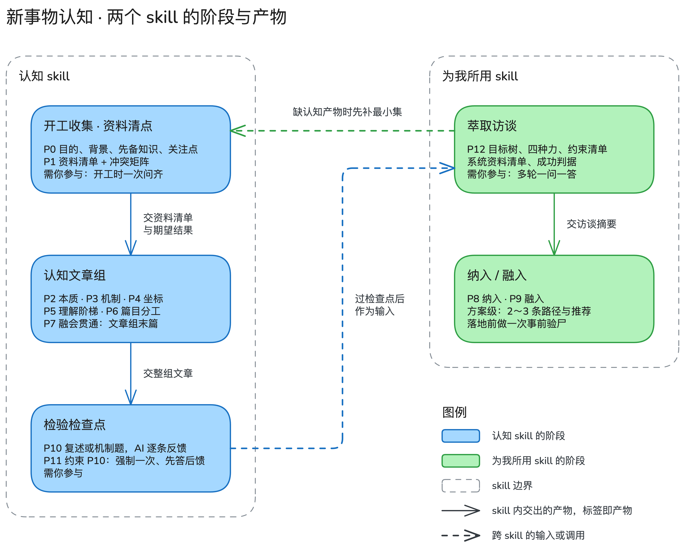

# 新事物认知流程（P0–P12）可用理论调研：出处、证据强度与对两个 skill 的规则

**编制说明**

- 调研日期：2026-11-06。
- 依据：任务书 [theory-research-brief.md](vscode://file/Users/zhangq/.claude/jobs/095d5831/tmp/theory-research-brief.md)（2026-11-06 更新版，含第 4 轮拍板）。两个 skill 的分工以它为准：**认知 skill** 出多篇认知文章，「融会贯通」归它，作为认知文章组的最后一篇；**为我所用 skill** 以多轮萃取访谈开工，再出「纳入」「融入」两类文章。
- 读者假定：懂开发，没读过学习科学文献，对本项目零上下文。
- 范围：任务书第 3 节的 P0–P12 十三个阶段，加跨阶段总骨架与排除清单。
- 图 1 由主会话用 Excalidraw 画（子代理不出图），源文件与 PNG 在 `figures/`；子代理交回时的 mermaid 草稿已替换。

**检索过的来源类型**

- 期刊论文的作者稿或机构仓储 PDF（大学与实验室主页、机构库）。
- 出版社、数据库与索引的摘要页（ERIC、IDEAS/RePEc、OUP、arXiv、机构仓储记录页）。
- 官方网站：c4model.com、diataxis.fr、teamtopologies.com、jobstobedone.org、christenseninstitute.org、NASA ESTO、ThoughtWorks、martinfowler.com、cognitect.com、melconway.com、gary-klein.com、barbaraminto.com、fortelabs.com。
- 政府出版物（CIA 情报研究中心）；会议论文集（CHI、RE、CogSci、SREE）；复制研究数据库（FORRT）。
- 百科、博客、课程讲义只当线索，没有作为出处。

**读取方式**

- 网页经 WebFetch 读取：它返回逐字引文（每段不超过 125 字符）加转写。
本文引号里的英文只取逐字引文部分；转写内容写成中文并注明。
- PDF 用本机 PDFKit 提取文本层；扫描件（Chi 1981、Gentner 1983、Star & Griesemer 1989）用 Vision OCR。
OCR 引文按上下文校正了拼写，双栏拼合处另行注明。

**核实状态标记**

| 标记 | 含义 |
|---|---|
| 【已读原文】 | 本次亲自读到一手出处的相关段落（作者稿、出版社全文、作者或机构官网）；括注读的是哪个版本 |
| 【仅读摘要】 | 只读到出版社、数据库或作者官网上的摘要 |
| 【转述】 | 只见到二手转述：他人论文的引用、检索结果摘录、书目描述 |
| 【未查到】 | 本次没有找到可读的来源；不凭记忆补 |

正文里另有两个断言强度标记：「推断」是 AI 依据文献做的推论，「判断」是 AI 的经验看法；两者都不等于文献结论。

**计数口径**

- 正文共 **45 个六项小节**；一个小节可能合并同一主题的几篇文献，状态逐篇标。
- 核实状态统计按第六节出处索引逐条计（一条文献一个状态）。
- 第五节「评估后未展开」的条目只写一句评估，不计入 45。

---

**一句话**：十三个阶段都找到了可用的理论，但证据强度两极分化——**学习技巧类**（提取练习、自我解释、生成效应、反驳文本、分散练习）**有元分析支撑**，**架构与组织类**（C4、DDD、Team Topologies、Wardley、Cynefin）**基本是经验框架**；AI 代读的副作用已有随机实验证据，足以支持在认知 skill 里设一个**带反馈的强制提取检查点**。

图 1 说的是：两个 skill 各管哪些阶段、阶段之间传什么产物；P7 融会贯通是认知文章组的最后一篇；P11 不是独立步骤，而是约束 P10 的规则；用户过了 P10 的检查点，认知文章才作为输入交给为我所用 skill；为我所用找不到认知产物时，先回认知 skill 补最小集。

**图例**：蓝框是认知 skill 的阶段；绿框是为我所用 skill 的阶段。
实线箭头是 skill 内的产物流向，标签是交出的产物；虚线箭头是跨 skill 的输入或调用；灰色虚线框是 skill 边界。
源文件是 `figures/fig1-two-skills-stages.excalidraw`，可在 Excalidraw 里继续改。

**怎么读**

| 想知道什么 | 读哪里 |
|---|---|
| 每阶段推荐什么、加哪条规则、落在哪个 skill | [一、一页结论](#一一页结论) |
| 某个理论的出处、原文、证据、边界 | [二、分阶段详述](#二分阶段详述) |
| 用什么当整个流程的骨架 | [三、跨阶段总骨架](#三跨阶段总骨架) |
| 哪些流行说法不该用 | [四、排除清单](#四排除清单) |
| 哪些没查到、为什么、怎么补 | [五、未展开、未查到与未核实完](#五未展开未查到与未核实完) |
| 文献的完整信息与核实状态 | [六、出处索引](#六出处索引) |

---

## 一、一页结论

每条格式：**理论**（出处，证据强度）【落在哪个 skill】：规则。
规则里的「要求」都是对 skill 执行者（AI）的要求。

### P0–P6：认知文章的生产线

**P0 开工收集**

- **先备知识**（Simonsmeier 等 2022，元分析）【认知】：在 P0 阶段，要求记下用户在相邻领域的已知，分成「可借力」「可能误导」两类，后一类在文章里必须显式对比。
- **JTBD 进步视角**（Christensen 研究所，经验框架）【认知】：在 P0 阶段，要求用一句话写下用户想借这个新事物取得什么进步，篇目取舍以这句为准；深挖目的留给 P12。

**P1 资料清点与冲突识别**

- **竞争性假设分析 ACH**（Heuer 1999，经验框架；Dhami 等 2019 随机实验未证实其去偏效果）【认知】：在 P1 阶段，要求资料有冲突时列「候选解释 × 证据」矩阵，以**反对证据最少**而不是支持证据最多的解释为准；不要求走完八步。
- **横向阅读**（Wineburg & McGrew 2017，单项研究，45 人）【认知】：在 P1 阶段，要求判断陌生来源可信度时先离开它、查第三方怎么评价这个来源，再决定是否采信与细读。

**P2 抓本质**

- **专家按深层原理归类**（Chi 等 1981，单项研究）【认知】：在 P2 阶段，要求「本质」写成能统一解释多个表面不同案例的原理，并配两个表面不同、原理相同的例子。
- **阈值概念**（Land 等 2005，概念框架）【认知】：在 P2 阶段，要求标出 1–3 个「不过这关就看不懂其余部分」的概念，单独成节放在前面，并提醒读者会经历似懂非懂的过渡期。
- **本质与偶然**（Brooks 1986，论述文）【认知】：在 P2 阶段，要求把难点分成本质难点（换工具也消不掉）与偶然难点（来自当前实现或历史），后者注明来源。

**P3 按类型拆机制**

- **按类型选拆解框架**（C4、DDD、Lakatos、Toulmin、REA，经验或规范框架）【认知】：在 P3 阶段，要求先判新事物类型再选框架——软件系统用 C4 逐层放大，业务域用通用语言与限界上下文，交易型业务用「主体—事件—资源」，理论用「硬核—保护带」与「主张—依据—保证」。
- **康威定律与镜像假说**（Colfer & Baldwin 2016，142 项研究的综述）【认知】：在 P3 阶段，要求拆组织或平台类新事物时把沟通结构与系统结构并排列出，标出不镜像之处并解释原因。

**P4 坐标定位**

- **对比案例**（Schwartz & Bransford 1998，3 项课堂研究；Alfieri 等 2011 会议版元分析 d = .60）【认知】：在 P4 阶段，要求先给 2–3 个对照方案的具体案例让用户找差异，再讲新事物的概念。
- **演进与成熟度标尺**（Wardley、NASA TRL、技术雷达，经验框架）【认知】：在 P4 阶段，要求给出新事物的演进或成熟度读数并注明用的哪把尺，不同尺的读数不混用、不当预测。
- **Cynefin**（Kurtz & Snowden 2003，概念框架）【认知】：在 P4 阶段，要求判断新事物要解决的问题落在哪个域，落在复杂域时只给可撤回的小规模试探，不给「最佳实践」。

**P5 渐进理解阶梯**

- **SOLO**（转述）与**修订版布鲁姆**（Krathwohl 2002）【认知】：在 P5 阶段，要求每篇文章标出目标层级（能列出要点 → 能讲清要点间关系 → 能迁移到新情境），并用「知识类型 × 认知过程」表检查多篇的覆盖。
- **认知负荷与专长逆转**（de Jong 2010 综述；Kalyuga 等 2003 转述）【认知】：在 P5 阶段，要求按 P0 记下的先备知识选写法：新手给完整示例与分步说明，熟手删掉他已知部分的解释。

**P6 多篇专业文章**

- **认知灵活性理论**（Spiro 等 1988）与 **DeFT 多重表征**（Ainsworth）【认知】：在 P6 阶段，要求核心概念在至少两篇里从不同案例或表征重访，并写一张篇目分工表说明各篇如何互补、互相约束。
- **Diátaxis**（官网，经验框架）【认知】：在 P6 阶段，要求每篇只承担教程、操作指南、参考、解释四类中的一类。
- **知识的诅咒**（Camerer 等 1989，实验研究）【认知】：在 P6 阶段，要求成稿后按 P0 的用户画像做一遍零上下文检查，每个术语首次出现处有白话解释。

---

### P7：融会贯通（认知 skill，认知文章组的最后一篇）

归属已于 2026-11-06 第 4 轮拍板；落地含义见 [P7 详述](#p7-融会贯通)。

- **结构映射、类比编码与高路迁移**（Gentner 1983；Gentner 等 2003；Perkins & Salomon 1992）【认知】：在 P7 阶段，要求每个类比写明映射了哪些关系、哪些表面属性不映射、在哪里失效，类比源取 P0 记下的用户熟悉领域；给两个同原理案例时先让用户说出共同结构。
- **反驳文本与概念转变**（Schroeder & Kucera 2022 元分析 g = 0.41；Posner 等 1982）【认知】：在 P7 阶段，要求对 P0 记下的「可能误导的已知」写反驳段：先陈述旧观念，明说它在这里不成立，再给新解释。
- **自我解释**（Bisra 等 2018 元分析 g = .55）【认知】：在 P7 阶段，要求在关键机制处插入「先用自己的话解释为什么，再往下读」的提示。

---

### P8–P9：为我所用的两类文章

**P8 纳入**

- **吸收能力**（Cohen & Levinthal 1990，转述）【为我所用】：在 P8 阶段，要求先盘点用户团队已有的相关知识，缺口大的部分先小范围试用再纳入。
- **ADR 与绞杀者模式**（Nygard 2011；Fowler，经验框架）【为我所用】：在 P8 阶段，要求纳入文章附一份 ADR 草稿（背景、决定、状态、后果），并给出新旧并存、逐步替换的过渡路径。

**P9 融入**

- **DDD 上下文映射**（Evans 2015）【为我所用】：在 P9 阶段，要求先判用户业务与新事物之间的上下游关系与可谈判程度，再从遵奉者、防腐层、客户/供应商等模式里选一种写接入方案，并写明代价。
- **Team Topologies 交互模式**（官网，经验框架）【为我所用】：在 P9 阶段，要求写明融入期间双方团队的交互模式（协作 / X 即服务 / 引导）与预期持续多久。
- **边界对象**（Star & Griesemer 1989）【为我所用】：在 P9 阶段，要求点出双方共用的边界对象（租户配置、接口契约、标准表单等），写清各方对它的本地用法。

---

### P10–P11：检验与防代读副作用

**P10 演练与自测**

- **解释深度错觉**（Rozenblit & Keil 2002 摘要；Silk-Eglit & Kurtz 2011）【认知】：在 P10 阶段，要求「先打分—写出机制解释—再打分」三步自测，问题问「它怎么运作」，不问「它能拿来做什么」。
- **ICAP**（Chi & Wylie 2014）【认知】：在 P10 阶段，要求自测活动至少到「建构」级（自己生成解释、画图、提问）；AI 追问的对话属于更高的「互动」级。
- **事前验尸**（Klein 2007 摘要）【为我所用】：在 P10 阶段，要求纳入或融入方案落地前做一次「假设已经失败，写出原因」的演练。

**P11 AI 代读的副作用**

- **流畅性错觉、合意困难与生成效应**（Bjork 等 2013；Deslauriers 等 2019；Bertsch 等 2007 元分析）【认知】：在 P11 阶段，要求不把用户「读懂了」的自评当学会的证据；在阶段节点（读完全部认知文章后、进入为我所用之前）**强制一次带反馈的提取或复述**，每篇文末另附先问后答的提取题（自愿）。
- **生成式 AI 学习实验**（Bastani 等 2025 等）【认知、为我所用】：在 P11 阶段，要求自测与演练环节先让用户作答再给反馈，不先给完整答案。

---

### P12：萃取访谈（为我所用 skill 开工）

- **JTBD 换购访谈**（jobstobedone.org，经验框架）【为我所用】：在 P12 阶段，要求按时间线还原用户为什么现在要用这个新事物，并逐项问推力、拉力、焦虑、习惯四种力。
- **目标的 WHY / HOW 追问**（van Lamsweerde 2001）与**需求获取综述**（Zowghi & Coulin 2005）【为我所用】：在 P12 阶段，要求对用户说出的每个目标向上问 WHY、向下问 HOW，结果整理成目标树，并在访谈之外同时收已有文档。
- **停止条件**（Hennink & Kaiser 2022 系统综述；推断）【为我所用】：在 P12 阶段，要求产物模板每项有内容或用户明说「没有」，且最近一轮没出现新目的或新约束，再请用户确认访谈摘要后才停。
⚖️ Jev：选「连续一轮无新信息即停」（置信 0.57；「模板填满即停」占 0.32），分歧在模板填满是否为必要条件。
取舍：只看饱和，用户没想到的维度（组织、合规、干系人）不会自己冒出来；Zowghi & Coulin 要求逐项覆盖领域、来源与干系人，故两条取合取。

**总骨架**：UbD 逆向设计做主骨架，Merrill 五条首要原理做覆盖检查表，理由见[第三节](#三跨阶段总骨架)。

---

## 二、分阶段详述

每个小节六项：一手出处、核心主张（英文原文照录加中文释义）、证据强度、落到 skill 上改什么、适用边界、核实状态。
标题编号 `P0-1` 表示 P0 阶段第 1 个小节。

### P0 开工收集

#### P0-1 先备知识：Ausubel 与 Simonsmeier 等 2022 元分析

- **一手出处：** Simonsmeier, Flaig, Deiglmayr, Schalk & Schneider（2022）Domain-specific prior knowledge and learning: A meta-analysis，*Educational Psychologist* 57(1):31–54，DOI [10.1080/00461520.2021.1939700](https://doi.org/10.1080/00461520.2021.1939700)；读的是[作者稿](https://www.uni-trier.de/fileadmin/fb1/prof/PSY/PAE/Team/Schneider/SimonsmeierEtAl2021.pdf)。
Ausubel（1968）*Educational Psychology: A Cognitive View* 只经 Simonsmeier 文中引用读到。
- **核心主张：**
  - "This strong variability falsifies general statements such as 'knowledge is power' as well as 'the effect of prior knowledge is negligible.'"
  - 中文：先备知识对学习的影响差异极大，「知识就是力量」与「先备知识无关紧要」两种笼统说法都被否定。
  - 数字：8776 个效应量；前测与后测相关 rP = .534；先备知识与归一化增益的相关只有 rNG = .059，95% 预测区间 [−.688, .621]，即**可正可负**。
  - Ausubel（经 Simonsmeier 转引，原书 p. vi）："the most important single factor influencing learning is what the learner knows already"。
- **证据强度：** 元分析。
文中归纳了正向、负向各 5 条中介机制：正向是引导注意、帮助编码、组块、提供策略、帮助评估来源可信度；负向是误概念、选择性注意与定势、自动化导致的僵化、干扰、负迁移。
作者同时指出缺少随机对照的干预研究，**机制部分不是元分析直接检验的结论**；文中还提到专长逆转效应（Kalyuga 等 2003，见 [P5-3](#p5-3-认知负荷理论与专长逆转效应)）。
- **落到 skill 上改什么：** 在 P0 阶段，要求问清用户在相邻领域已有的知识与习惯做法，记成两列：「可借力的已知」「可能误导的已知」；后续文章对第二列必须显式写出差异（对接 P7 反驳文本）。【认知】
- **适用边界：** 用户在相邻领域完全空白时，可激活的已知很少，这一步缩成一句「零基础」标注；预测区间横跨正负，所以这条规则管的是「识别」，不保证「激活就有用」。
- **核实状态：** Simonsmeier 2022【已读原文，作者稿】；Ausubel 1968【转述】（archive.org 扫描件两次断连）。

#### P0-2 JTBD 进步视角：Christensen 研究所

- **一手出处：** Clayton Christensen Institute，Jobs to Be Done 理论页 <https://www.christenseninstitute.org/theory/jobs-to-be-done/>。
- **核心主张：**
  - "Jobs to Be Done is a lens that reveals the circumstances—or forces—that drive people and organizations toward and away from decisions."
  - "People don't simply buy or pick products or services; they pull them into their lives to make progress."
  - 中文：JTBD 是一个视角，用来看清推动人和组织做出或放弃某个决定的情境与力量；人不是单纯购买产品，而是把它拉进生活里以取得进步。
- **证据强度：** 经验框架，无系统实证；来源是研究所的理论介绍页。
- **落到 skill 上改什么：** 在 P0 阶段，要求用一句话写下「用户想借这个新事物取得什么进步」，例如「三个月内让订单服务能接入新消息平台」；后续篇目按这句话取舍，深挖目的与约束留给 P12。【认知】
- **适用边界：** 用户是被要求学习（如公司指派）时，进步陈述可能只是「完成指派」，需追问指派背后的业务目的；纯兴趣型学习可以只写「想弄懂什么」。
- **核实状态：**【已读原文，官网】。完整访谈方法见 [P12-1](#p12-1-jtbd-换购访谈四种力与时间线)。

---

### P1 资料清点与冲突识别

#### P1-1 意义建构循环与信息觅食：Pirolli & Card

- **一手出处：** Pirolli & Card（1995）Information foraging in information access environments，CHI'95 pp. 51–58，DOI [10.1145/223904.223911](https://doi.org/10.1145/223904.223911)。
Pirolli & Card（2005）The sensemaking process and leverage points for analyst technology as identified through cognitive task analysis（MITRE 托管的会议论文，打不开）。
- **核心主张：**
  - 1995："Information foraging theory analyzes trade-offs in the value of information gained against the costs of performing activity…"
  - 中文：信息觅食理论分析的是「获得的信息价值」与「获取它所花的活动成本」之间的权衡。
  - 2005（转述）：分析员的工作是两个嵌套回路——觅食回路（外部数据 → 收集箱 shoebox → 证据文件 evidence file）与意义建构回路（图式 schema → 假设 → 呈现）。
- **证据强度：** 1995 是理论论文（含计算模型）；2005 是基于认知任务分析得出的描述性模型，属经验框架。
- **落到 skill 上改什么：** 在 P1 阶段，要求资料处理分两层落盘：先按「价值 / 阅读成本」排阅读顺序（官方定义与总览优先），把可引用的事实摘成证据条目；再从证据条目组织图式与假设。文章里的每个关键论断能回指到证据条目。【认知】
- **适用边界：** 资料只有一两份且无冲突时，不必建证据条目；公司内部资料缺少标题、摘要这类「信息气味」时，价值估计靠问用户（推断）。
- **核实状态：** 1995【已读原文】；2005【转述】（MITRE 断连、PSU 课程站 404、core.ac.uk 403、Semantic Scholar 接口 429）。

#### P1-2 竞争性假设分析 ACH：Heuer 1999 与 Dhami 等 2019

- **一手出处：** Heuer（1999）*Psychology of Intelligence Analysis*，CIA 情报研究中心，[PDF](https://www.cia.gov/resources/csi/static/Pyschology-of-Intelligence-Analysis.pdf)。
Dhami, Belton & Mandel（2019）The "analysis of competing hypotheses" in intelligence analysis，*Applied Cognitive Psychology* 33(6):1080–1090，DOI [10.1002/acp.3550](https://doi.org/10.1002/acp.3550)。
- **核心主张：**
  - p. 95 把 ACH 定为 "eight-step procedure"，p. 97 列出八步。
  - pp. 103–104："The most probable hypothesis is usually the one with the least evidence against it, not the one with the most evidence for it."
  - 中文：最可能成立的假设，通常是反对证据最少的那个，而不是支持证据最多的那个。
- **证据强度：** 经验框架（情报界实务方法）。
Dhami 等 2019 把 50 名分析员随机分组，摘要原文："ACH-trained analysts did not follow all of the steps"；对减少确认偏差只有 "mixed evidence"；还 "may increase judgement inconsistency and error"。
- **落到 skill 上改什么：** 在 P1 阶段，要求资料间有冲突时列「候选解释 × 证据」矩阵，每格标支持、反对或无关，以反对证据最少者为准，并在文章里保留落选解释及其反证；不要求走完八步。【认知】
- **适用边界：** 冲突能靠直接核实消掉时（版本号、发布日期、源码实际行为）直接核实，不建矩阵；Dhami 的结果说明矩阵不保证判断更准，只让推理过程可检查。
- **核实状态：** Heuer【已读原文】；Dhami【仅读摘要】（Middlesex 仓储 PDF 403）。

#### P1-3 横向阅读：Wineburg & McGrew 2017

- **一手出处：** Wineburg & McGrew（2017）Lateral Reading: Reading Less and Learning More When Evaluating Digital Information，Stanford History Education Group Working Paper No. 2017.A1（SSRN 3048994）；读的是 [hendrix.edu 托管的工作论文 PDF](https://www.hendrix.edu/uploadedFiles/Academics/Faculty_Resources/Teaching_and_Learning/EvaluatingDigitalInformation.pdf)。
期刊版：*Teachers College Record* 121(11)，DOI [10.1177/016146811912101102](https://doi.org/10.1177/016146811912101102)。
- **核心主张：**
  - 摘要："fact checkers read laterally, leaving a site after a quick scan and opening up new browser tabs in order to judge the credibility of the original site."
  - 中文：事实核查员横向阅读——扫一眼就离开该网站，开新标签页去查别处怎么评价它。
  - 文中还有 "taking bearings"（p. 13，先定方位）与 "click restraint"（不急着点第一条检索结果）。
- **证据强度：** 单项研究。
样本 45 人："10 Ph.D. historians, 10 professional fact checkers, and 25 Stanford University undergraduates"，观察他们评估真实网站。
后续的教学干预研究本次未查。
- **落到 skill 上改什么：** 在 P1 阶段，要求遇到陌生来源（厂商白皮书、个人博客、二手教程）先查第三方如何评价这个来源与作者，再决定是否采信与细读；文章引用处注明来源类型。【认知】
- **适用边界：** 公司内部资料通常没有外部评价可查，横向阅读改为查该资料的维护团队、最后更新时间与代码是否一致（推断）。
- **核实状态：**【已读原文，工作论文版】；期刊版未打开。

---

### P2 抓本质

#### P2-1 专家按深层原理归类：Chi, Feltovich & Glaser 1981

- **一手出处：** Chi, Feltovich & Glaser（1981）Categorization and representation of physics problems by experts and novices，*Cognitive Science* 5(2):121–152，DOI [10.1207/s15516709cog0502_2](https://doi.org/10.1207/s15516709cog0502_2)；读的是亚利桑那州立大学托管的扫描件（OCR）。
- **核心主张：**
  - "For experts, surface features do not seem to be the bases for categorization."（PDF 第 3 页）
  - 表层结构指 "the objects referred to in the problem (e.g., a spring, an inclined plane); (b) the literal physics terms mentioned in the problem"。
  - "If 'deep structure' is defined as the underlying physics law applicable to a problem; then, clearly, this deep structure is the basis by which experts group the problems"（OCR 双栏拼合）。
  - 中文：新手按题面出现的物体与术语给题目归类，专家按解题所依据的物理定律归类。
- **证据强度：** 单项研究（归类实验专家、新手各 8 人）。
后续有复查（Mason & Singh 2011，*Physical Review Special Topics – Physics Education Research* 7, 020110），本次未读到其结论。
- **落到 skill 上改什么：** 在 P2 阶段，要求「本质」一节写成一条能统一解释多个案例的原理，配至少两个表面不同、原理相同的例子，再给一个表面相似、原理不同的反例。【认知】
- **适用边界：** 原研究是物理解题。新业务、新组织形态这类没有公认定律的对象，所谓深层原理是 AI 归纳的，要标「推断」并请用户确认。
- **核实状态：** Chi 1981【已读原文，OCR】；Mason & Singh 2011【转述】（APS 页面超时）。

#### P2-2 阈值概念：Land 等 2005

- **一手出处：** Land, Cousin, Meyer & Davies（2005）Threshold concepts and troublesome knowledge (3): implications for course design and evaluation，ISL 会议文集 pp. 53–64，[PDF](https://www.ee.ucl.ac.uk/~mflanaga/ISL04-pp53-64-Land-et-al.pdf)。
Meyer & Land 2003 的原始报告没有读到。
- **核心主张：**
  - p. 53：阈值概念 "akin to a portal, opening up a new and previously inaccessible way of thinking about something"；特征是 "transformative (occasioning a significant shift in the perception of a subject), irreversible (unlikely to be forgotten, or unlearned only through considerable effort), and integrative (exposing the previously hidden interrelatedness of something)"。
  - p. 54：卡在门槛上的状态称 "liminality"；此时学生 "present a partial, limited or superficial understanding of the concept to be learned which we have characterised as a form of 'mimicry'"。
  - 中文：阈值概念像一道门，过了才看得见原先看不见的思考方式；它会改变理解、过了就回不去、能把原先孤立的知识连起来。卡在门槛上的人只能模仿式地复述。
- **证据强度：** 概念框架；本次未查到系统实证。
- **落到 skill 上改什么：** 在 P2 阶段，要求标出 1–3 个阈值概念，各自单独成节、放在依赖它的内容之前，并提示读者：「这里卡住是正常的，假懂的标志是能复述但不会用」。【认知】
- **适用边界：** 哪个概念算阈值概念，原文靠学科专家的教学经验判定；AI 的判定要标「推断」，最好请用户或该领域同事确认。
- **核实状态：** Land 等 2005【已读原文】；Meyer & Land 2003【未查到】（pressbooks 403，爱丁堡 ETL 站证书过期）。

#### P2-3 本质复杂度与偶然复杂度：Brooks 1986

- **一手出处：** Brooks（1986）No Silver Bullet: Essence and Accidents of Software Engineering，北卡罗来纳大学技术报告 TR86-020，[PDF](https://techreports.cs.unc.edu/papers/86-020.pdf)。
- **核心主张：**
  - "Following Aristotle, I divide them into essence, the difficulties inherent in the nature of the software, and accidents, those difficulties which today attend its production but which are not inherent."（PDF 第 5 页）
  - 本质难点的四个属性："complexity, conformity, changeability, and invisibility"（PDF 第 6 页）。
  - 中文：软件的难点分两类，本质难点是软件本性固有的，偶然难点是当前生产方式带来、并非固有的；本质难点有复杂、须服从外部约束、易变、不可见四个属性。
- **证据强度：** 论述文，无实证。
- **落到 skill 上改什么：** 在 P2 阶段，要求把新事物的难点分两栏：本质难点（换工具、换实现也消不掉）与偶然难点（来自当前实现、历史包袱或工具），偶然难点注明出处，避免把偶然难点写成本质。【认知】
- **适用边界：** 原文讨论的是软件；用到业务或组织形态时属于类比用法（判断）。
- **核实状态：**【已读原文】。

UbD 的 big ideas 与 essential questions 也属于「抓本质」的线索，作为总骨架放在[第三节](#三跨阶段总骨架)。

---

### P3 按类型拆机制

#### P3-1 C4 模型：软件系统逐层放大

- **一手出处：** Simon Brown，C4 model 官网 <https://c4model.com/>（含 abstractions 页）。
- **核心主张：** 用四类抽象 software system、container、component、code 对应四层图（System Context、Container、Component、Code），像地图一样逐层放大；官网说明该模型与记法、工具都无关（notation independent、tooling independent）。
这一条是 WebFetch 的转写，没有取到可整句照录的原文。
- **证据强度：** 经验框架，无系统实证。
- **落到 skill 上改什么：** 在 P3 阶段，要求新事物是软件系统时按「系统上下文 → 容器 → 组件」逐层拆，每层一张图、方框不超过 7 个，代码层只在用户要改代码时才画。【认知】
- **适用边界：** 不适用于理论、商业模式、组织形态；单个库或算法没有「容器」这一层，直接从组件开始。
- **核实状态：**【已读原文，官网】。

#### P3-2 DDD 通用语言与限界上下文：Evans 2015

- **一手出处：** Evans（2015）*Domain-Driven Design Reference: Definitions and Pattern Summaries*，[PDF](https://www.domainlanguage.com/wp-content/uploads/2016/05/DDD_Reference_2015-03.pdf)。
- **核心主张：**
  - p. 1（PDF 第 8 页）三条总纲之一："Speak a ubiquitous language within an explicitly bounded context."
  - p. 40（PDF 第 47 页）核心域："Boil the model down. … Make the core small."
  - 中文：在边界明确的上下文里说统一的领域语言；把模型提炼到核心，让核心尽量小。
  - p. vi 给出通用语言、上下文、限界上下文的定义。
- **证据强度：** 经验框架（实践者的模式汇编），无系统实证。
- **落到 skill 上改什么：** 在 P3 阶段，要求新事物是业务系统或业务领域时先建术语表（术语、定义、所属上下文），同名不同义的术语按上下文分开写，并指出哪一部分是核心域。【认知】
- **适用边界：** 纯技术组件（如一个缓存库）没有业务语言可提炼；只有一个上下文的小型新事物跳过上下文划分。
- **核实状态：**【已读原文】。上下文之间的关系模式见 [P9-1](#p9-1-ddd-上下文映射融入时选哪种上下游关系)。

#### P3-3 REA 模型：交易型业务的骨架

- **一手出处：** McCarthy（1982）The REA Accounting Model: A Generalized Framework for Accounting Systems in a Shared Data Environment，*The Accounting Review* 57(3):554–578（卷期页码据检索结果；JSTOR 页面打不开）。
- **核心主张（转述）：** 用经济资源（Resources）、经济事件（Events）、参与主体（Agents）三类实体及其关系描述业务交易。
没有读到可照录的原文。
- **证据强度：** 概念模型；后续标准化与应用情况本次未核实。
- **落到 skill 上改什么：** 在 P3 阶段，要求新事物是业务流程或商业模式时，用「谁（主体）在什么事件里交换了什么资源」列出核心交易，作为业务机制拆解的骨架。【认知】
- **适用边界：** 适合有交易、有对价的业务；不适合纯技术系统或理论。
- **核实状态：**【转述】（JSTOR 错误页、MSU 介绍页为空、DIKU 讲稿断连）。

#### P3-4 理论类新事物：Lakatos 研究纲领与 Toulmin 论证模型

- **一手出处：** Lakatos（1970）Falsification and the Methodology of Scientific Research Programmes，经[斯坦福哲学百科「Imre Lakatos」条目](https://plato.stanford.edu/entries/lakatos/)转引。
Toulmin（1958）*The Uses of Argument*，Cambridge University Press（据检索结果）。
- **核心主张：**
  - SEP 转引 Lakatos（FMSRP p. 48）："it is this protective belt of auxiliary hypotheses which has to bear the brunt of tests and gets adjusted and re-adjusted"。
  - 进步的研究纲领要能 "predict novel and hitherto unexpected facts"（FMSRP p. 33）。
  - 中文：研究纲领有不动的硬核和承受检验、不断调整的辅助假设保护带；纲领是否在进步，看它能否预言新的事实。
  - Toulmin（转述）：论证由主张（claim）、依据（data）、保证（warrant）、支撑（backing）、限定（qualifier）、反驳（rebuttal）构成。
- **证据强度：** 科学哲学与论证理论，属规范性框架，不存在实证意义上的检验。
- **落到 skill 上改什么：** 在 P3 阶段，要求新事物是理论或方法论时分开写「硬核主张」「为应对反例加的辅助假设」「它预言过什么、后来是否被证实」，核心论证按主张—依据—保证—限定—反驳拆开。【认知】
- **适用边界：** 只适用于理论与方法论类新事物；工程实践、产品功能用不上。
- **核实状态：** Lakatos【转述，经 SEP】；Toulmin【转述】（Verheij 2005 讲解 PDF 超时）。

#### P3-5 组织与平台：康威定律与镜像假说

- **一手出处：** Conway（1968）How Do Committees Invent?，*Datamation*，1968 年 4 月；读的是[作者官网转载](https://www.melconway.com/Home/Committees_Paper.html)。
Colfer & Baldwin（2016）The mirroring hypothesis: theory, evidence, and exceptions，*Industrial and Corporate Change* 25(5)，DOI [10.1093/icc/dtw027](https://doi.org/10.1093/icc/dtw027)。
- **核心主张：**
  - Conway 结论节："organizations which design systems (in the broad sense used here) are constrained to produce designs which are copies of the communication structures of these organizations"。
  - Colfer & Baldwin："mirroring is a prevalent pattern but not universal"。
  - 中文：设计系统的组织，产出的设计会复制组织自身的沟通结构；这种镜像很常见，但不是普遍规律。
- **证据强度：** Colfer & Baldwin 综述 142 项实证研究；其中描述性研究 70% 强支持、22% 部分支持、8% 不支持。
- **落到 skill 上改什么：** 在 P3 阶段，要求拆组织形态或平台类新事物时，把团队沟通结构与系统模块结构并排列出，标出不镜像之处并解释原因（例如开源协作、强标准接口）。【认知】
- **适用边界：** 单人或单团队的小系统没有可比的结构；镜像是相关关系，推不出「改组织就能改架构」（推断）。
- **核实状态：** Conway【已读原文，作者官网】；Colfer & Baldwin【已读原文】。

---

### P4 坐标定位

#### P4-1 演进与采用坐标：Wardley、NASA TRL、技术雷达与 Rogers 五属性

- **一手出处：**
  - Wardley 演进特征速查表（Simon Wardley，CC BY-SA 4.0），读的是 [learnwardleymapping.com 的转载](https://learnwardleymapping.com/landscape/)。
  - NASA ESTO 技术成熟度定义页 <https://esto.nasa.gov/trl>。
  - ThoughtWorks 技术雷达 FAQ <https://www.thoughtworks.com/radar/faq>。
  - Rogers 创新扩散的属性检验：Tornatzky & Klein（1982）*IEEE Transactions on Engineering Management* EM-29(1):28–45；Weigel 等（2014）*Communications of the AIS* 34。
- **核心主张：**
  - 速查表把演进分为 Genesis、Custom Built、Product、Commodity 四段：普及度从 "Rare" 到 "Widespread and stabilising"，确定性从 "Poorly understood" 到 "Commonly understood"。
  - TRL 1 是 "Basic principles observed and reported"，TRL 9 是 "Actual system flight proven through successful mission operations"；页面按硬件、软件分列描述与退出准则。
  - 技术雷达分 Adopt、Trial、Assess、Caution 四环，且 "no attempt is made to be comprehensive or to survey the market at large"。
  - 中文：三把尺分别量「从新奇到商品化走到哪一段」「从原理到实战验证走到哪一级」「一家咨询公司建议采用到什么程度」。
- **证据强度：** 三把尺都是经验框架；技术雷达自述是观点，不是市场调查。
Rogers 五属性（转述）：Tornatzky & Klein 的元分析约含 75 篇文献，发现相对优势、兼容性、复杂度与采用最常相关；Weigel 等 2014 复核时，复杂度的负相关没有普遍成立。
- **落到 skill 上改什么：** 在 P4 阶段，要求给新事物一个坐标读数并注明用的哪把尺——业务或技术组件用 Wardley 四段，研发成果用 TRL，外部技术选型参考技术雷达环位；不同尺的读数不混用，也不当作「该不该采用」的预测。【认知】
- **适用边界：** 公司内部的新业务、新组织形态没有外部雷达读数，只能按 Wardley 的特征描述自评（判断）。
- **核实状态：** Wardley 速查表【已读原文，转载件】；TRL【已读原文】；技术雷达 FAQ【已读原文】；Tornatzky & Klein【转述】；Weigel 等【转述】。

#### P4-2 对比案例：Schwartz & Bransford 1998

- **一手出处：** Schwartz & Bransford（1998）A Time for Telling，*Cognition and Instruction* 16(4):475–522；读的是 [wright.edu 托管 PDF](https://www.wright.edu/sites/www.wright.edu/files/uploads/2017/Feb/event/Schwartz_Bransford_1998_TimeForTelling.pdf)。
元分析：Alfieri, Nokes & Schunn（2011）SREE 会议摘要 Aligning the Structural Components Across Learning Tasks of Case Comparisons，[ERIC ED528947](https://files.eric.ed.gov/fulltext/ED528947.pdf)；期刊版 Alfieri, Nokes-Malach & Schunn（2013）Learning through case comparisons: A meta-analytic review，*Educational Psychologist*。
- **核心主张：**
  - "Noticing the distinctions between contrasting cases creates a 'time for telling'; learners are prepared to be told the significance of the distinctions they have discovered."
  - 中文：先让学习者自己在对比案例中找出差异，就创造了「该讲授的时机」——他们已准备好听这些差异意味着什么。
  - 3 项课堂研究，约一周后的预测测验：「先分析对比案例、再听讲或读课文」优于三种对照——(a) 读差异说明再听讲，(b) 总结课文再听讲，(c) 分析两遍案例但不听讲。
- **证据强度：** 原文为 3 项课堂研究。
Alfieri 等 2011 会议版元分析：57 个实验，d = .60，95% CI [.47, .72]；2013 期刊版 d = .50（转述）。两版数字不同，以期刊版为准待核。
- **落到 skill 上改什么：** 在 P4 阶段，要求先给 2–3 个对照方案（用户熟悉的旧方案、竞品）的具体案例让用户自己找差异，再给新事物的概念解释；AI 整理的对照表放在用户找过差异之后。【认知】
- **适用边界：** 用户对对照方案也不熟时，对比案例先变成新负担；对照组 (b) 说明「先总结再听讲」不如自己找差异，所以 AI 代写的总结替代不了这一步（推断）。
- **核实状态：** Schwartz & Bransford【已读原文】；Alfieri 2011【已读原文】；Alfieri 2013【转述】（LRDC 链接 404）。

#### P4-3 Cynefin：问题落在哪个域

- **一手出处：** Kurtz & Snowden（2003）The new dynamics of strategy: Sense-making in a complex and complicated world，*IBM Systems Journal* 42(3)；读的是 [vdc.edu.au 托管 PDF](https://vdc.edu.au/wp-content/uploads/2018/02/Sense-making-in-a-complex-and-complicated-world.pdf)。
- **核心主张：**
  - 四个域：Known、Knowable（有序）与 Complex、Chaos（无序），各配决策方式 Sense-Categorize-Respond、Sense-Analyze-Respond、Probe-Sense-Respond、Act-Sense-Respond（p. 468 图 1）。
  - 复杂域："Emergent patterns can be perceived but not predicted; we call this phenomenon retrospective coherence."
  - "The decision model in this space is to create probes to make the patterns or potential patterns more visible before we take any action."（PDF 第 8 页）
  - 中文：复杂域里的模式只能事后看清、不能预测；决策方式是先放小探针让模式显形，再行动。
- **证据强度：** 概念框架，作者以咨询案例说明；本次未检索其实证检验。
- **落到 skill 上改什么：** 在 P4 阶段，要求判断用户引入新事物要解决的问题落在哪个域；落在复杂域时，「为我所用」的建议写成可撤回的小规模试探，不写成「最佳实践」。【认知】
- **适用边界：** 域的判定主观，不同人会给不同答案；只用来定调，不用来打分（判断）。
- **核实状态：**【已读原文】。

Marton 变易理论本次未评估，见[第五节](#五未展开未查到与未核实完)。

---

### P5 渐进理解阶梯

#### P5-1 SOLO 分类法

- **一手出处：** Biggs & Collis（1982）的原书（Academic Press）未读到；读的是香港中文大学的[说明文档](https://www.cuhk.edu.hk/policy/assessment/SOLO-description.pdf)，其中括注了原书术语。
- **核心主张：**
  - CUHK 文档：SOLO "describes a student's understanding … in five levels of increasing complexity"。
  - 五级：Prestructural、Unistructural、Multistructural、Relational、Extended abstract。
  - 中文：按复杂度递增把理解分成五级——前结构（没抓住要点）、单点、多点（能列出多个要点但互不相关）、关联（能讲清要点之间的关系）、拓展抽象（能推广到没讲过的情境）。
- **证据强度：** 经验框架，广泛用于高校评估设计；原书未读，信效度研究本次未查。
- **落到 skill 上改什么：** 在 P5 阶段，要求每篇文章标出目标层级（多点 → 关联 → 拓展抽象），文章顺序与 P10 自测题都按这个层级递进。【认知】
- **适用边界：** 层级判定依赖出题者经验；对纯操作性知识（命令怎么敲）区分度低（判断）。
- **核实状态：**【转述】（Biggs 本人网站已停用，web.archive.org 存档不可抓）。

#### P5-2 修订版布鲁姆分类法：Krathwohl 2002

- **一手出处：** Krathwohl（2002）A Revision of Bloom's Taxonomy: An Overview，*Theory Into Practice* 41(4):212–218。
- **核心主张：**
  - p. 215："the requirement of a strict hierarchy has been relaxed"。
  - 分类表把知识维度（Factual、Conceptual、Procedural、Metacognitive 四类）与认知过程维度（Remember、Understand、Apply、Analyze、Evaluate、Create）交叉成二维表。
  - 中文：修订版放宽了原版「严格层级」的要求，改用二维表给教学目标定位。
- **证据强度：** 经验框架（专家修订）；对其层级假设的实证检验本次未查。
- **落到 skill 上改什么：** 在 P5 阶段，要求用「知识类型 × 认知过程」二维表检查多篇文章的覆盖：至少一篇讲概念性知识（为什么），一篇讲程序性知识（怎么做）；元认知知识（什么时候用、怎么判断自己懂没懂）放进自测篇。【认知】
- **适用边界：** 二维表管覆盖，不管先后顺序；顺序交给 SOLO 与 [P5-4](#p5-4-精细加工理论从概要到细节) 的从简到繁。
- **核实状态：**【已读原文】。

#### P5-3 认知负荷理论与专长逆转效应

- **一手出处：** de Jong（2010）Cognitive load theory, educational research, and instructional design: some food for thought，*Instructional Science* 38:105–134，DOI [10.1007/s11251-009-9110-0](https://doi.org/10.1007/s11251-009-9110-0)。
Kalyuga, Ayres, Chandler & Sweller（2003）The expertise reversal effect，*Educational Psychologist* 38(1)，只经 Simonsmeier 等 2022 引用读到。
- **核心主张：**
  - p. 106："Intrinsic cognitive load relates to inherent characteristics of the content to be learned, extraneous cognitive load is the load that is caused by the instructional material used to present the content, and finally, germane cognitive load refers to the load imposed by learning processes."
  - 同页："Cognitive load theory has recently been the subject of criticism regarding its conceptual clarity … and methodological approaches"。
  - 中文：认知负荷分三类——内容本身的难度、呈现方式额外造成的负担、学习加工所需的投入；该理论近年在概念清晰度与研究方法上受到批评。
  - 专长逆转（转述）：对新手有效的支架，对熟手可能无效甚至有害。
- **证据强度：** 有大量实验，但 de Jong 指出概念边界不清、负荷多靠自评量表测量。
- **落到 skill 上改什么：** 在 P5 阶段，要求按 P0 记下的先备知识选两种写法之一：新手版给完整示例、分步说明和图；熟手版删掉他已知部分的解释，直接讲差异与边界。【认知】
- **适用边界：** 负荷难以直接测量，skill 只能按用户自述背景粗分两档，不宜细分（判断）。
- **核实状态：** de Jong【已读原文】；Kalyuga 等 2003【转述】（UOW 仓储 403）。

#### P5-4 精细加工理论：从概要到细节

- **一手出处：** Wilson & Cole（1992）A Critical Review of Elaboration Theory，[ERIC ED348040](https://files.eric.ed.gov/fulltext/ED348040.pdf)。
Reigeluth 的原始论述（Reigeluth, Merrill & Wilson 1978 等）未读到。
- **核心主张：**
  - 摘要列出精细加工理论的策略："(1) organizing structure; (2) simple-to-complex sequence; (3) sequencing guidelines; (4) summarizers; (5) synthesizers; (6) analogies; (7) cognitive strategy activators; and (8) learner control"。
  - 第一课给 "epitome"（概要），后续每课在其上逐层增加复杂度。
  - 本文 "offers a critique of elaboration theory (ET) based on recent cognitive research and offers suggestions for updating the model to reflect new knowledge"。
  - 中文：先给一份概要，再从简到繁逐层展开；Wilson & Cole 依据当时的认知研究批评并建议修订这一模型。
- **证据强度：** 教学设计理论；Wilson & Cole 是批判性综述，不是实证检验。
- **落到 skill 上改什么：** 在 P5 阶段，要求第一篇是全景概要（一页讲清新事物是什么、由哪几块组成），后续每篇在概要的某一块上加深，并在篇首写明它对应概要里的哪一块。【认知】
- **适用边界：** 从简到繁假设内容有清晰结构；对 [P6-1](#p6-1-认知灵活性理论spiro-等-1988) 所说的结构不良领域，单一概要会过度简化，两条规则互相约束。
- **核实状态：** Wilson & Cole【已读原文】；Reigeluth 原文【转述】（Montgomery College 讲义拒绝请求）。

Dreyfus 技能习得模型、Mayer 多媒体原则、4C/ID 本次未作为 P5 小节展开：4C/ID 放在[第三节](#三跨阶段总骨架)对比，其余见[第五节](#五未展开未查到与未核实完)。

---

### P6 多篇专业文章

#### P6-1 认知灵活性理论：Spiro 等 1988

- **一手出处：** Spiro, Coulson 等（1988）Cognitive Flexibility Theory: Advanced Knowledge Acquisition in Ill-Structured Domains，*Proceedings of the Annual Meeting of the Cognitive Science Society* 10，<https://escholarship.org/uc/item/1dr9x302>。
- **核心主张：**
  - "By ill-structuredness we mean that many concepts (interacting contextually) are pertinent in the typical case of knowledge application, and that their patterns of combination are inconsistent across case applications of the same nominal type."（PDF 第 2 页）
  - "Single representations (e.g., a single schema, organizational logic, line of argument, prototype, analogy, etc.) will miss important facets of complex concepts."（PDF 第 5 页）
  - 把复杂性过度简化的倾向称 "reductive bias"。
  - 中文：结构不良领域里，每个实际案例都牵涉多个相互作用的概念，同类案例里它们的组合方式也不一致；只用一种表征（一个图式、一条论证线、一个类比）必然漏掉复杂概念的重要侧面。
- **证据强度：** 理论性会议论文，引用多项医学教育误概念研究；本次未查对 CFT 的系统实证。
- **落到 skill 上改什么：** 在 P6 阶段，要求核心概念在至少两篇文章里通过不同案例或表征重访，并在第二次出现处写明「上一篇的说法在这个案例里不够用的地方」。【认知】
- **适用边界：** 结构良好的新事物（规则明确的协议、单一算法）一篇讲清即可，不需要多视角重访（推断）。
- **核实状态：**【已读原文】。

#### P6-2 多重表征的 DeFT 框架：Ainsworth

- **一手出处：** Ainsworth & Van Labeke，Using a Multi-Representational Design Framework to Develop and Evaluate a Dynamic Simulation Environment，图宾根知识媒体研究所工作坊论文，[PDF](https://www.iwm-tuebingen.de/workshops/visualization/ainsworth.pdf)。
DeFT 的 2006 年期刊原文未读到。
- **核心主张：**
  - "There are three key functions of MERs: to complement, constrain and construct"。
  - "a very large number of studies have observed that learners find translating between representations difficult"。
  - 中文：多重表征有三种功能——互补、约束、建构；大量研究观察到学习者很难在不同表征之间转换。
- **证据强度：** 概念框架，综合多项研究；这篇工作坊论文本身是一个模拟学习环境的设计与评估。
- **落到 skill 上改什么：** 在 P6 阶段，要求写一张篇目分工表，注明每篇相对其他篇是补充信息、约束理解还是促成抽象，并在篇与篇之间给出显式对照（同一概念在图、表、文字里分别是哪一处）。【认知】
- **适用边界：** 只有一种表征时用不上；表征越多，转换负担越大，篇数不宜无限增加（推断）。
- **核实状态：** 工作坊论文【已读原文】；2006 期刊原文【未查到】（诺丁汉仓储 403）。

#### P6-3 Diátaxis：一篇只做一类事

- **一手出处：** Diátaxis 官网 <https://diataxis.fr/start-here/>；页面未署作者名。
- **核心主张：**
  - "A tutorial is a lesson, that takes a student by the hand through a learning experience."
  - "A how-to guide addresses a real-world goal or problem"。
  - 参考类 "contain propositional or theoretical knowledge, not guides to action"；"Explanatory guides provide context and background."
  - 两条轴："tutorials and how-to guides are concerned with what the user does"，"reference and explanation are about what the user knows"；"tutorials and explanation serve the acquisition of skill"，"how-to guides and reference serve the application of skill"。
  - 中文：文档分教程、操作指南、参考、解释四类，按「做事还是求知」「学技能还是用技能」两条轴区分。
- **证据强度：** 经验框架，无系统实证。
- **落到 skill 上改什么：** 在 P6 阶段，要求每篇文章只承担一类：认知 skill 的文章以「解释」为主，用户要上手时另出「教程」；纳入、融入文章按用户要完成的具体目标写成「操作指南」，术语表与配置清单归「参考」放附录。【认知】
- **适用边界：** Diátaxis 面向产品文档；认知文章还承担「改变观念」的任务（见 P7），这一点它不管（判断）。
- **核实状态：**【已读原文，官网】；作者署名【未查到】。

#### P6-4 知识的诅咒：Camerer, Loewenstein & Weber 1989

- **一手出处：** Camerer, Loewenstein & Weber（1989）The Curse of Knowledge in Economic Settings: An Experimental Analysis，*Journal of Political Economy* 97(5):1232–1254；读的是 [CMU 托管 PDF](https://www.cmu.edu/dietrich/sds/docs/loewenstein/CurseknowledgeEconSet.pdf)。
- **核心主张：**
  - p. 1232："Better-informed agents are unable to ignore private information even when it is in their interest to do so; more information is not always better."
  - 同页："market forces reduce the curse by approximately 50 percent but do not eliminate it."
  - 中文：掌握更多信息的人，即使对自己有利也没法忽略这些信息去设想信息少的人怎么想；市场力量能把这种偏差减少约一半，但消除不了。
- **证据强度：** 实验经济学研究（市场实验）。
- **落到 skill 上改什么：** 在 P6 阶段，要求成稿后按 P0 记下的用户画像做一遍零上下文检查：每个术语、代号首次出现处有白话解释，每个「显然」「众所周知」都删掉或补上依据。【认知】
- **适用边界：** 原研究是带私有信息的经济预测；用到写作属于类比（判断）。AI 自检只能减轻偏差，最终以用户反馈为准。
- **核实状态：**【已读原文】。

Minto 金字塔与 Novak 概念图本次未作为小节展开，见[第五节](#五未展开未查到与未核实完)。

---

### P7 融会贯通

**归属：** 认知 skill，作为认知文章组的最后一篇（2026-11-06 第 4 轮拍板）。
拍板前本文推荐按知识层、系统层拆到两个 skill，这一推荐不再采用。

**落地含义（推断）：** 认知 skill 运行时还没有经过 P12 访谈，手上没有用户自己系统的资料。
所以 P7 文章的类比源取 P0 记下的先备知识，即用户真熟悉的相邻领域（Gentner 要求类比源是学习者熟悉的领域）。
把新事物迁移进用户自己系统的写法，由为我所用 skill 的 P8 纳入文章承担：任务书对「纳入」的定义就是「新事物成为用户系统的一部分」。

#### P7-1 结构映射、类比编码与高路迁移

- **一手出处：**
  - Gentner（1983）Structure-Mapping: A Theoretical Framework for Analogy，*Cognitive Science* 7:155–170；读的是[西北大学托管扫描件](https://groups.psych.northwestern.edu/gentner/papers/Gentner83.2b.pdf)（OCR）。
  - Gentner, Loewenstein & Thompson（2003）Learning and transfer: A general role for analogical encoding，*Journal of Educational Psychology* 95(2):393–408，DOI [10.1037/0022-0663.95.2.393](https://doi.org/10.1037/0022-0663.95.2.393)。
  - Perkins & Salomon（1992 年 9 月 2 日作者手稿）Transfer of Learning，为 *International Encyclopedia of Education*（第 2 版）撰写；读的是 [CUNY 托管手稿](https://openlab.citytech.cuny.edu/fywpd/files/2020/01/transferoflearning.pdf)。
- **核心主张：**
  - Gentner p. 155："(a) Relations between objects, rather than attributes of objects, are mapped from base to target; and (b) The particular relations mapped are determined by systematicity, as defined by the existence of higher-order relations."
  - Gentner pp. 158–159 映射规则："1. Discard attributes of objects"；"2. Try to preserve relations between objects"；"3. (The Systematicity Principle) To decide which relations are preserved, choose systems of relations"。p. 161：只有表面相似的 "mere appearance match" 解释力 "sharply limited"。
  - Gentner 等 2003 摘要："Teaching by examples and cases is widely used to promote learning, but it varies widely in its effectiveness."
  - Perkins & Salomon（手稿第 2 页）："Research on transfer argues that very often transfer does not occur, especially 'far' transfer."；"Mindful or high road transfer involves deliberate effortful abstraction and a search for connections."
  - 手稿第 10 页："In bridging, the instruction encourages the making of abstractions, searches for possible connections, mindfulness, and metacognition."
  - 中文：类比映射的是对象之间的关系而不是对象的属性，而且优先映射成体系的关系；靠例子教学效果差异很大，远迁移常常不发生，要靠有意识的抽象与找联系（高路迁移、搭桥）。
- **证据强度：** Gentner 1983 是理论论文，后续实验很多但本次未逐篇查。
Gentner 等 2003 是 3 项实验（被试是学谈判策略的新手），实验 2 显示「比较两个案例」明显优于分开学。
Perkins & Salomon 是综述。
- **落到 skill 上改什么：** 在 P7 阶段，要求每个类比列三栏：映射了哪些关系、哪些表面属性不映射、在哪里失效；给两个同原理案例时先让用户说出它们的共同结构再看讲解；文末给高路迁移问句（手稿第 9 页："What is the general pattern? What is needed? What principles might apply? What is known that might help?"）。类比源取 P0 记下的用户熟悉领域。【认知】
- **适用边界：** 类比源必须是用户真熟悉的领域，否则映射本身成了新负担；表面很像、关系不同的类比要主动点破。
- **核实状态：** Gentner 1983【已读原文，OCR】；Gentner 等 2003【仅读摘要，Kellogg 页面】；Perkins & Salomon【已读原文，作者手稿】。

#### P7-2 概念转变与反驳文本

- **一手出处：**
  - Posner, Strike, Hewson & Gertzog（1982）Accommodation of a Scientific Conception: Toward a Theory of Conceptual Change，*Science Education* 66(2):211–227；读的是[雅典大学课程站托管副本](https://eclass.uoa.gr/modules/document/file.php/PHS122/%CE%91%CF%81%CE%B8%CF%81%CE%B1/Posner_Strike_Hewson_Gertzog.pdf)。
  - Schroeder & Kucera（2022）Refutation Text Facilitates Learning: a Meta-Analysis of Between-Subjects Experiments，*Educational Psychology Review* 34(2):957–987；读的是 PMC8784251 全文。
- **核心主张：**
  - Posner p. 214 四条件："1) There must be dissatisfaction with existing conceptions."；"2) A new conception must be intelligible."；"3) A new conception must appear initially plausible."；"4) A new concept should suggest the possibility of a fruitful research program."；同页指出类比与隐喻能让新概念变得可理解。
  - Schroeder & Kucera："Analysis of 44 independent comparisons (n = 3,869) showed that refutation text is associated with a positive, moderate effect (g = 0.41, p < .001)"；效果 "consistent and robust across a wide variety of contexts"。
  - 中文：旧观念要被替换，需要学习者先对旧观念不满，新观念可理解、初看可信、有用；先点名误概念再反驳的文本，对学习有中等程度的正效应。
- **证据强度：** Posner 是理论论文；反驳文本有元分析（44 组比较、3869 人）。
另有 Guzzetti 1993、Tippett 2010 的早期综述（转述）；Danielson 2024 提到反驳文本近来受到质疑（转述，未读原文）。
- **落到 skill 上改什么：** 在 P7 阶段，要求对 P0 记下的「可能误导的已知」逐条写反驳段：先陈述旧观念，明说它在这里不成立，再给新解释与一个旧观念解释不了的例子（满足「不满」条件）。【认知】
- **适用边界：** P0 没有识别出误概念时不要硬造反驳对象；反驳段针对的是用户可能持有的观念，不是 AI 臆想的稻草人（判断）。
- **核实状态：** Posner【已读原文】；Schroeder & Kucera【已读原文】（PMC 之后改为 reCAPTCHA，未再访问）；Guzzetti、Tippett、Danielson【转述】。

#### P7-3 自我解释：Bisra 等 2018 元分析

- **一手出处：** Bisra, Liu, Nesbit, Salimi & Winne（2018）Inducing Self-Explanation: a Meta-Analysis，*Educational Psychology Review*，DOI [10.1007/s10648-018-9434-x](https://doi.org/10.1007/s10648-018-9434-x)。
Chi, de Leeuw, Chiu & LaVancher（1994）Eliciting self-explanations improves understanding，*Cognitive Science* 18:439–477（未读到原文）。
- **核心主张：**
  - Bisra："69 effect sizes (from 64 research reports)"；"The overall weighted mean effect size using a random effects model was g = .55"；其中预期式自我解释 g = 1.37。
  - 中文：引导学习者对材料做自我解释，平均效应 g = .55，属中等偏上。
  - Chi 等 1994（转述）：14 名八年级学生，自我解释组的理解增益高于读两遍的对照组。
- **证据强度：** 元分析。
- **落到 skill 上改什么：** 在 P7 阶段，要求在每篇的关键机制处插入一句提示：「先用自己的话解释为什么是这样，再往下读」，并在下一段给出参考解释供用户对照。【认知】
- **适用边界：** 用户只想查一个事实（参考类篇目）时不插提示；提示过密会打断阅读，每篇 1–3 处为宜（判断）。
- **核实状态：** Bisra【已读原文】；Chi 等 1994【转述】（印第安纳大学副本证书不匹配）。

#### P7-4 学习技巧：提取练习与分散练习

- **一手出处：**
  - Dunlosky 等（2013）*Psychological Science in the Public Interest* 14(1):4–58，DOI [10.1177/1529100612453266](https://doi.org/10.1177/1529100612453266)，原文未读到；读的是 Dunlosky 本人写给教师的 [Strengthening the Student Toolbox](https://www.aft.org/ae/fall2013/dunlosky)（*American Educator* 2013 年秋季号）。
  - Rowland（2014）The Effect of Testing Versus Restudy on Retention: A Meta-Analytic Review of the Testing Effect，*Psychological Bulletin* 140(6)，DOI [10.1037/a0037559](https://doi.org/10.1037/a0037559)；读的是 EPFL 课程站托管 PDF。
  - Cepeda, Pashler, Vul, Wixted & Rohrer（2006）Distributed Practice in Verbal Recall Tasks: A Review and Quantitative Synthesis，*Psychological Bulletin* 132(3):354–380；读的是 [Vul 实验室托管 PDF](https://www.evullab.org/pdf/CepedaPashlerVulWixtedRohrer-PB-2006.pdf)。
  - Adesope, Trevisan & Sundararajan（2017）Rethinking the use of tests: A meta-analysis of practice testing，*Review of Educational Research* 87(3):659–701，未读到原文。
- **核心主张：**
  - Dunlosky：练习测试与分散练习评为效用最高；交错练习、精细询问、自我解释为中等；重读、划线、总结、意象等为较低。练习测试指 "self-testing or taking practice tests on to-be-learned material"，分散练习指 "implementing a schedule of practice that spreads out study activities over time"；"rereading does not always enhance students' understanding"。
  - Rowland：159 个效应量、61 项研究；随机效应 g = 0.50（95% CI [0.42, 0.58]），I² = 84.35；保持间隔不少于 1 天时 g = 0.69，少于 1 天时 g = 0.41；**不给反馈且初次测验正确率不超过 50% 时 g = 0.03，不显著**；回忆类测验优于再认类。
  - Cepeda：839 项评估、317 个实验、184 篇文章；"the ISI producing maximal retention increased as retention interval increased"。
  - 中文：自测和间隔复习是最有效的两种技巧；提取练习平均效应 0.50，但用户答不出又没有反馈时几乎无效；想记得越久，复习间隔就该拉得越长。
- **证据强度：** 元分析（Rowland、Cepeda）；Dunlosky 是系统综述的作者普及版。
Adesope 等 2017 元分析含 272 个效应量（转述）。
- **落到 skill 上改什么：** 在 P7 阶段，要求每篇认知文章配一组回忆式提取题（不用选择题），用户答完**必须给反馈**；并给出间隔复习提示（如读完当天一次、隔天再一次）。不推荐重读、划线、总结作为巩固手段。【认知】
- **适用边界：** skill 无法强制用户隔天回来，间隔只能是提示（判断）；P11 决定其中哪一部分强制。
- **核实状态：** Dunlosky 2013 PSPI【未查到】（APS 页面 403），作者普及版【已读原文】；Rowland【已读原文】；Cepeda【已读原文】；Adesope【转述】（WSU 链接跳转首页）。

---

### P8 纳入

#### P8-1 吸收能力：Cohen & Levinthal 1990

- **一手出处：** Cohen & Levinthal（1990）Absorptive capacity: A new perspective on learning and innovation，*Administrative Science Quarterly* 35(1):128–152，DOI [10.2307/2393553](https://doi.org/10.2307/2393553)。
- **核心主张（转述）：** 吸收能力是组织认识外部新信息的价值、消化它并用于商业目的的能力，很大程度上取决于已有的相关知识；实证部分用 1719 个业务单元的调查数据。
没有读到可照录的原文。
- **证据强度：** 原文含一项大样本调查研究（转述）；后续文献极多，本次未查。
- **落到 skill 上改什么：** 在 P8 阶段，要求纳入文章先盘点用户团队已有的相关知识（谁懂什么、做过什么相近的东西），缺口大的部分先小范围试用、积累知识后再扩大纳入范围。【为我所用】
- **适用边界：** 理论针对组织层面；个人纳入一项新技术时，「团队已有知识」退化为 P0 的先备知识（推断）。
- **核实状态：**【转述】（JSTOR 被拦；ProQuest 重定向过多；NTNU 托管 PDF 断连；Duke 页面是别的文章）。

#### P8-2 架构决策记录 ADR 与绞杀者模式

- **一手出处：** Nygard（2011-11-15）Documenting Architecture Decisions，<https://cognitect.com/blog/2011/11/15/documenting-architecture-decisions>。
Fowler，Strangler Fig Application，<https://martinfowler.com/bliki/StranglerFigApplication.html>（页面日期 2024-08-22，首发日期未查到）。
- **核心主张：**
  - Nygard："An architecture decision record is a short text file in a format similar to an Alexandrian pattern."；五节 Title、Context（"the forces at play, including technological, political, social, and project local"）、Decision、Status（proposed、accepted、deprecated、superseded）、Consequences（"the resulting context, after applying the decision"）；动机是避免 "blind acceptance or blind reversal"。
  - Fowler："building transitional architecture to allow the new and legacy system to coexist"；"make both investment and returns occur gradually and visibly"；"Since these components are small, there isn't so much risk…"。
  - 中文：ADR 是一页短文，记下决策的背景力量、决定、状态与后果，让后来者既不盲目接受也不盲目推翻；绞杀者模式是搭过渡架构让新旧系统并存，小块替换，投入与回报都逐步可见。
- **证据强度：** 经验框架，无系统实证。
- **落到 skill 上改什么：** 在 P8 阶段，要求纳入文章附一份 ADR 草稿（背景、决定、状态写「提议」、后果含代价），涉及替换旧方案时给出新旧并存、逐块替换的过渡路径与每一步的回退方式。【为我所用】
- **适用边界：** 纳入的是方法论或业务做法而非软件时，ADR 仍可用，绞杀者模式只能类比使用（判断）。
- **核实状态：** Nygard【已读原文】；Fowler【已读原文】。

Rogers 五属性见 [P4-1](#p4-1-演进与采用坐标wardleynasa-trl技术雷达与-rogers-五属性)；TAM、ATAM、Wardley 自建或购买本次未评估，见[第五节](#五未展开未查到与未核实完)。

---

### P9 融入

#### P9-1 DDD 上下文映射：融入时选哪种上下游关系

- **一手出处：** Evans（2015）*Domain-Driven Design Reference*，同 [P3-2](#p3-2-ddd-通用语言与限界上下文evans-2015)。
- **核心主张：**
  - p. 29 Context Map；关系模式依次为 Partnership（p. 30）、Shared Kernel（p. 31）、Customer/Supplier（p. 32）、Conformist（p. 33）、Anticorruption Layer（p. 34）、Open-host Service（p. 35）、Published Language（p. 36）、Separate Ways（p. 37）、Big Ball of Mud（p. 38）。
  - Conformist（p. 33）："Eliminate the complexity of translation between bounded contexts by slavishly adhering to the model of the upstream team."
  - Anticorruption Layer（p. 34）："As a downstream client, create an isolating layer to provide your system with functionality of the upstream system in terms of your own domain model."
  - 中文：下游可以完全照搬上游模型以省掉翻译成本（遵奉者），也可以建一层隔离层，把上游功能翻译成自己的领域模型（防腐层）。
- **证据强度：** 经验框架，无系统实证。
- **落到 skill 上改什么：** 在 P9 阶段，要求先判用户业务与新平台的上下游关系与可谈判程度，再选模式并写明代价：上游不迁就、模型可接受 → 遵奉者；上游模型会侵蚀己方模型 → 防腐层；双方能协商 → 客户/供应商或合作。【为我所用】
- **适用边界：** 新事物不是软件平台（如新组织形态）时只能类比使用（判断）。
- **核实状态：**【已读原文】。

#### P9-2 Team Topologies：融入期间的团队交互模式

- **一手出处：** Team Topologies 官网 Key Concepts 页 <https://teamtopologies.com/key-concepts>；书的出版年份页面未写。
- **核心主张：**
  - 四类团队：Stream-aligned、Enabling、Complicated Subsystem、Platform。
  - 三种交互模式："Collaboration: working together for a defined period of time to discover new things"；"X-as-a-Service: one team provides and one team consumes something 'as a Service'"；"Facilitation: one team helps and mentors another team"。
  - "Teams can only handle so much complexity before breaking down."
  - 中文：团队之间有协作（限期一起探索）、X 即服务（一方提供一方消费）、引导（一方帮扶另一方）三种交互；团队能承受的复杂度有限。
- **证据强度：** 经验框架，无系统实证；官网页面未提康威定律。
- **落到 skill 上改什么：** 在 P9 阶段，要求融入文章写明双方团队在每个阶段的交互模式（如接入期「协作」、稳定后转「X 即服务」）、预期持续多久，以及用户团队要新承担的认知负荷。【为我所用】
- **适用边界：** 只有个人融入、不涉及团队边界时，只保留「交互模式」一项（判断）。
- **核实状态：**【已读原文，官网】；书的年份【未查到】。

#### P9-3 边界对象与边界资源

- **一手出处：**
  - Star & Griesemer（1989）Institutional Ecology, 'Translations' and Boundary Objects: Amateurs and Professionals in Berkeley's Museum of Vertebrate Zoology, 1907-39，*Social Studies of Science* 19(3):387–420，DOI [10.1177/030631289019003001](https://doi.org/10.1177/030631289019003001)；读的是 [dubberly 托管扫描件](https://courses.dubberly.com/design_theory/09._Star_Griesemer_1989.pdf)（OCR）。
  - Ghazawneh & Henfridsson（2013）Balancing platform control and external contribution in third-party development: the boundary resources model，*Information Systems Journal* 23(2):173–192，DOI [10.1111/j.1365-2575.2012.00406.x](https://doi.org/10.1111/j.1365-2575.2012.00406.x)。
- **核心主张：**
  - Star & Griesemer p. 393："Boundary objects are objects which are both plastic enough to adapt to local needs and the constraints of the several parties employing them, yet robust enough to maintain a common identity across sites. They are weakly structured in common use, and become strongly structured in individual-site use."
  - 摘要列出四类："repositories, ideal types, coincident boundaries and standardized forms"。
  - Ghazawneh & Henfridsson（摘要）：平台方用边界资源（如 API、SDK）在 "the maintenance of platform control and the transfer of design capability to third-party developers" 之间取得平衡，驱动力是 resourcing 与 securing。
  - 中文：边界对象足够灵活以适应各方的本地需要，又足够稳定以在各方之间保持同一性；共用时结构松散，在各方内部使用时结构严格。平台通过边界资源既放权给第三方，又保住控制。
- **证据强度：** Star & Griesemer 是单个历史案例研究；Ghazawneh & Henfridsson 是单案例（iPhone）研究。
- **落到 skill 上改什么：** 在 P9 阶段，要求点出用户与新平台之间的边界对象或边界资源（租户配置、接口契约、标准表单、SDK），写清双方各自如何解读与使用它，以及平台在哪些地方收紧控制。【为我所用】
- **适用边界：** 新事物没有「多方共用」的性质（个人工具）时不适用（判断）。
- **核实状态：** Star & Griesemer【已读原文，OCR】；Ghazawneh & Henfridsson【仅读摘要，Chalmers 页面】。

#### P9-4 组织社会化与合法的边缘性参与

- **一手出处：**
  - Bauer, Bodner, Erdogan, Truxillo & Tucker（2007）Newcomer adjustment during organizational socialization: A meta-analytic review of antecedents, outcomes, and methods，*Journal of Applied Psychology* 92(3):707–721，DOI [10.1037/0021-9010.92.3.707](https://doi.org/10.1037/0021-9010.92.3.707)。
  - Van Maanen & Schein（1977）Toward a theory of organizational socialization，MIT Sloan 工作论文 960-77（hdl 1721.1/1934），收入 Staw 编 *Research in Organizational Behavior* 第 1 卷。
  - Lave & Wenger（1991）*Situated Learning: Legitimate Peripheral Participation*，Cambridge University Press，ISBN 978-0-521-42374-8。
- **核心主张：**
  - Bauer 等（摘要）："adjustment (role clarity, self-efficacy, and social acceptance) mediated the effects of organizational socialization tactics and information seeking on socialization outcomes"；"The results generally supported this model."
  - Van Maanen & Schein（转述）：组织对新人的社会化策略可按六组对立维度描述。
  - Lave & Wenger（转述）：新手通过参与真实但处于边缘的任务，逐步走向共同体的核心。
  - 中文：新人适应得好不好，取决于角色是否清晰、是否自信能胜任、是否被接纳；组织的引导策略与新人主动找信息都通过这三者起作用。
- **证据强度：** Bauer 等是元分析（70 个样本）；Van Maanen & Schein 是理论；Lave & Wenger 是基于民族志的理论著作。
- **落到 skill 上改什么：** 在 P9 阶段，要求融入文章回答三个问题：我在新体系里的角色和职责是什么（角色清晰）；遇到问题找谁、看什么（信息获取）；先从哪类边缘但真实的任务做起（合法的边缘性参与）。【为我所用】
- **适用边界：** 适用于人或团队加入新组织、新平台社区；纯技术对接只需前两问（判断）。
- **核实状态：** Bauer 等【仅读摘要，pdxscholar】；Van Maanen & Schein【转述】（MIT DSpace PDF 返回 429）；Lave & Wenger【转述】。

---

### P10 演练与自测

#### P10-1 以教促学（含「费曼技巧」溯源）

- **一手出处：**
  - Kobayashi（2019）Learning by preparing-to-teach and teaching: A meta-analysis，*Japanese Psychological Research* 61(3):192–203，DOI [10.1111/jpr.12221](https://doi.org/10.1111/jpr.12221)。
  - Kobayashi（2024）*Educational Psychology Review* 上的元分析（标题未核实）。
  - Fiorella & Mayer（2013）The relative benefits of learning by teaching and teaching expectancy，*Contemporary Educational Psychology* 38(4)。
  - 「费曼技巧」：没有找到一手出处。
- **核心主张（均为转述）：**
  - Kobayashi 2019：28 项研究，只「准备去教」g ≈ 0.35，「准备后真的去教」g ≈ 0.56，互动式教学的效应更大。
  - Kobayashi 2024：39 项研究，总体 g = 0.27，有教学预期时 g = 0.48。
  - Fiorella & Mayer 2013：「预期要教」的效应在即时测验成立，在延迟测验不成立。
  - 「费曼技巧」：多个二手来源一致说费曼本人从未写过这套四步法，这个名称多归于 Scott Young，其原帖本次没找到。
- **证据强度：** 元分析（转述，未读原文）。
- **落到 skill 上改什么：** 在 P10 阶段，要求复述以「讲给一个指定的人」的形式进行（如「讲给团队里没接触过它的同事」），AI 扮演会追问的听众；skill 文本里不使用「费曼技巧」这个名称，证据改引以教促学与[自我解释](#p7-3-自我解释bisra-等-2018-元分析)。【认知】
- **适用边界：** 只准备不真讲时效果较弱，延迟测验上可能不成立（转述），所以必须真的讲出来并接受追问。
- **核实状态：** Kobayashi 2019、2024【转述】；Fiorella & Mayer【转述】；「费曼技巧」一手出处【未查到】。

#### P10-2 事前验尸：Klein 2007

- **一手出处：** Klein（2007）Performing a Project Premortem，*Harvard Business Review*，<https://hbr.org/2007/09/performing-a-project-premortem>。
相关实验：Mitchell, Russo & Pennington（1989）Back to the future: Temporal perspective in the explanation of events，*Journal of Behavioral Decision Making* 2(1):25–38，DOI [10.1002/bdm.3960020103](https://doi.org/10.1002/bdm.3960020103)。
- **核心主张：**
  - Klein（摘要）："team members assume that the project they are planning has just failed"。
  - 中文：团队成员先假设计划中的项目已经失败，再各自写出失败原因。
  - Mitchell 等 1989（转述）：实验 1 中「站在未来回看」的时间视角影响很小，「结果已确定」的影响大。
  - 常被引用的「识别风险的能力提升 30%」只在二手文章里见到，**未核实**，不引用。
- **证据强度：** 经验框架；相关实验为单项研究（转述）。
- **落到 skill 上改什么：** 在 P10 阶段，要求纳入或融入方案在落地前做一次事前验尸：「假设半年后这次接入失败了，写出最可能的 5 个原因」，每个原因对应方案里的一条预防措施或监控点。【为我所用】
- **适用边界：** 检验的是方案，不是理解；认知 skill 不用。
- **核实状态：** Klein 2007【仅读摘要，HBR 页面】；Mitchell 等 1989【转述】（colab.ws 403）。

#### P10-3 ICAP 框架：Chi & Wylie 2014

- **一手出处：** Chi & Wylie（2014）The ICAP Framework: Linking Cognitive Engagement to Active Learning Outcomes，*Educational Psychologist* 49(4):219–243，DOI [10.1080/00461520.2014.965823](https://doi.org/10.1080/00461520.2014.965823)；读的是[亚利桑那州立大学托管 PDF](https://education.asu.edu/sites/default/files/lcl/chiwylie2014icap_2.pdf)。
- **核心主张：**
  - p. 219："engagement behaviors can be categorized and differentiated into one of four modes: Interactive, Constructive, Active, and Passive. The ICAP hypothesis predicts that as students become more engaged … from passive to active to constructive to interactive, their learning will increase."
  - p. 220：预测顺序 I > C > A > P；四种模式的关键词依次是 dialoguing、generating、manipulating、receiving。
  - 中文：投入方式分四级——被动接收、主动操作（如划线）、建构（生成新内容，如自己写解释）、互动（与人对话共同建构），级别越高学得越多。
- **证据强度：** 综述性框架，作者汇总多项研究；有一项 161 名本科生的研究得出相反结果（转述）。
- **落到 skill 上改什么：** 在 P10 阶段，要求自测活动至少到「建构」级（自己写解释、画关系图、提出问题）；AI 追问、用户回答的对话属于「互动」级；读文章、划重点只算被动或主动级，不计入自测。【认知】
- **适用边界：** ICAP 管活动类型，不管内容对错；建构级活动仍需反馈（见 [P7-4](#p7-4-学习技巧提取练习与分散练习) Rowland 的无反馈结果）。
- **核实状态：**【已读原文】；反例研究【转述】。

#### P10-4 解释深度错觉：Rozenblit & Keil 2002

- **一手出处：** Rozenblit & Keil（2002）The misunderstood limits of folk science: an illusion of explanatory depth，*Cognitive Science* 26(5):521–562，DOI [10.1207/s15516709cog2605_1](https://doi.org/10.1207/s15516709cog2605_1)；摘要经 [W3C 邮件列表转录](https://lists.w3.org/Archives/Public/public-semweb-lifesci/2006Jun/0178.html)读到。
Silk-Eglit & Kurtz（2011）Types of Cognitive Content and the Role of Relational Processing in the Illusion of Explanatory Depth，*Proceedings of the Annual Meeting of the Cognitive Science Society* 33，<https://escholarship.org/uc/item/582378mf>。
- **核心主张：**
  - R&K："People feel they understand complex phenomena with far greater precision, coherence, and depth than they really do."；"The illusion is far stronger for explanatory knowledge than many other kinds of knowledge."
  - Silk-Eglit & Kurtz 复述了 R&K 的程序：先自评理解程度，再写出解释，再自评，第二次评分显著下降；并发现 "when directed to consider the physical-mechanical processes of stimuli instead of their functional affordances, participants did in fact offer more accurate estimates"。
  - 中文：人对复杂事物的理解自评远高于实际，这种错觉在「解释为什么、怎么运作」类知识上最强；被引导去想物理机制而不是功能用途时，自评更准。
- **证据强度：** R&K 是多项实验的原始研究（本次只读摘要）；Silk-Eglit & Kurtz 是会议论文，部分复现并扩展。
- **落到 skill 上改什么：** 在 P10 阶段，要求自测按「先打分（1–7）→ 写出机制解释 → 再打分」三步走，题目问「它内部怎么运作、某一步失败会怎样」，不问「它能拿来做什么」；两次打分下降的部分就是下一轮要补的内容。【认知】
- **适用边界：** 对事实类、程序类知识，这种错觉较弱，改用 P7-4 的提取题（推断，依据 R&K 摘要第二句）。
- **核实状态：** R&K【仅读摘要】（PMC 出现 reCAPTCHA）；Silk-Eglit & Kurtz【已读原文】。

苏格拉底式提问本次未作为小节展开，见[第五节](#五未展开未查到与未核实完)。

---

### P11 AI 代读的副作用

这一节决定 skill 要不要强制用户做提取练习或复述。
**结论：要强制，但只强制一个检查点**——读完全部认知文章后、进入为我所用之前，用户闭卷复述或答机制题，AI 逐条给反馈；每篇文末的提取题自愿。
依据是下面两个小节，取舍理由见 P11-1 的规则一项。

#### P11-1 流畅性错觉、合意困难与生成效应

- **一手出处：**
  - Bjork, Dunlosky & Kornell（2013）Self-regulated learning: Beliefs, techniques, and illusions，*Annual Review of Psychology* 64:417–444，DOI [10.1146/annurev-psych-113011-143823](https://doi.org/10.1146/annurev-psych-113011-143823)；读的是 [UCLA Bjork 实验室托管 PDF](https://sites.lifesci.ucla.edu/psych-bjorklab/wp-content/uploads/sites/13/2016/07/RBjork_Dunlosky_Kornell_2013.pdf)。
  - Deslauriers, McCarty, Miller, Callaghan & Kestin（2019）Measuring actual learning versus feeling of learning in response to being actively engaged in the classroom，*PNAS* 116(39):19251–19257，DOI [10.1073/pnas.1821936116](https://doi.org/10.1073/pnas.1821936116)。
  - Bjork（1994）Memory and metamemory considerations in the training of human beings，载 Metcalfe & Shimamura 编 *Metacognition: Knowing about Knowing*，MIT Press，pp. 185–205；读的是 [Carleton SERC 记录页](https://serc.carleton.edu/resources/36564.html)。
  - Bertsch, Pesta, Wiscott & McDaniel（2007）The generation effect: A meta-analytic review，*Memory & Cognition* 35(2):201–210；读的是 McDaniel 主页托管 PDF。
- **核心主张：**
  - Bjork 等 2013 p. 417："people often have a faulty mental model of how they learn and remember, making them prone to both misassessing and mismanaging their own learning"；判断依据常是 "current performance and the subjective sense of fluency"。pp. 431–432：提取流畅性 "can be misleading and create illusions of knowing when it is the product of factors unrelated to degree of learning, such as priming"。
  - Deslauriers 等："Students in active classrooms learned more …, but their perception of learning, while positive, was lower"；"when students experience the increased cognitive effort associated with active learning, they initially take that effort to signify poorer learning"；"attempts to evaluate instruction based on students' perceptions of learning could inadvertently promote inferior (passive) pedagogical methods"。
  - Bjork 1994（摘要）："Manipulations that speed the rate of acquisition during training can fail to support long-term post-training performance"，而另一些看似给学习者添难度的操作 "during training can enhance post-training performance"。
  - Bertsch 等："445 effect sizes over 86 studies"；"The size of the generation effect across the 86 studies was .40—a benefit of almost half a standard deviation of generation over reading."
  - 中文：学习者靠当下的表现和「读着顺」来判断自己学没学会，常常误判；主动学习学得更多，但学生觉得学得更少，因为把费力当成学得差；让学习加快的做法未必利于长期保持；自己生成答案比只读答案平均好近半个标准差。
- **证据强度：** Bjork 等 2013 是综述；Deslauriers 等是随机对照的课堂实验；Bertsch 等是元分析；Bjork 1994 是理论章节。
- **落到 skill 上改什么：** 在 P11 阶段，要求：
  1. 不以用户「读懂了」的自评作为进入下一阶段的依据。
  2. 在「读完全部认知文章后、进入为我所用之前」设**一个强制检查点**：用户闭卷复述或回答 3–5 个机制类问题，AI 逐条给反馈（Rowland：无反馈时低正确率下效应接近 0）。
  3. 每篇文末附先问后答的提取题，自愿；答案在用户作答后才给。
  4. 在检查点前告诉用户「费力不等于学得差」（Deslauriers）。

  不逐篇强制是取舍（判断）：逐篇强制的交互成本随篇数线性增长，用户中途放弃的风险高；一个带反馈的检查点已足以暴露流畅性错觉。【认知】
- **适用边界：** Deslauriers 是大学物理课堂，生成效应与流畅性研究多用词表、课文等实验材料；搬到「职业开发者理解新系统」属推断。
- **核实状态：** Bjork 等 2013【已读原文】；Deslauriers 等【已读原文，citytech 托管 PDF】；Bjork 1994【仅读摘要】；Bertsch 等【已读原文】。

#### P11-2 生成式 AI 辅助学习的实验证据

- **一手出处：** 见下表与[第六节](#六出处索引)。
- **核心主张：**

| 研究 | 设计与样本 | 主要发现（引号内为原文） | 核实状态 |
|---|---|---|---|
| Bastani 等 2025，*PNAS* 122(26) e2422633122 | 随机实验，近 1000 名高中生；GPT Base 与带护栏的 GPT Tutor 两组 | 练习成绩分别 +48%、+127%；撤掉 AI 后 GPT Base 组考试比从未用过的学生低约 17%；"unfettered access to GPT-4 can harm educational outcomes"；"These negative learning effects are largely mitigated by the safeguards in GPT Tutor"；学生把它当 "crutch" | 【仅读摘要，IDEAS】 |
| Melumad & Yun 2025，*PNAS Nexus* pgaf316 | 7 个实验，摘要 n = 10,462（引言写 10,426，二者不一致） | "they risk developing shallower knowledge than when they learn through standard web search, even when the core facts in the results are the same"；据此写出的建议 "sparser, less original"；即使结果附实时网页链接也如此 | 【已读原文，OUP】 |
| Stadler, Bannert & Sailer 2024，*Computers in Human Behavior* 160:108386 | 91 名学生，ChatGPT-3.5 对 Google | "significantly lower cognitive load"，但 "lower-quality reasoning and argumentation" | 【仅读摘要】 |
| Kosmyna 等 2025，arXiv 2506.08872（预印本） | 54 人，第 4 场 18 人，脑电 | LLM 组脑电连接最弱、对文章的归属感最低、难以准确引用自己刚写的内容 | 【仅读摘要】 |
| Lehmann, Cornelius & Sting 2024，arXiv 2409.09047（预印本） | 两项预注册的激励式实验室实验，另有现场研究 | "no effect of LLMs on overall learning outcomes"；用作替代时覆盖更多主题但理解更浅，用作补充时理解更好；拉大先备知识高低两组的差距 | 【仅读摘要】 |
| Lee 等 2025，CHI，DOI 10.1145/3706598.3713778 | 自报问卷，319 名知识工作者、936 个例子 | "higher confidence in GenAI is associated with less critical thinking, while higher self-confidence is associated with more critical thinking"；批判性思维转向 "information verification, response integration, and task stewardship" | 【已读原文】 |
| Kestin 等 2025，*Scientific Reports* 15:17458（反例） | 交叉随机对照，单一哈佛物理课 | 按教学法设计、在家使用的 AI 辅导，学到的多于课堂主动学习 | 【转述】 |

  - 中文小结：不加约束地让 AI 代劳，练习时表现更好、撤掉后更差，知识更浅；加了「先让学生做、再给提示」护栏的 AI 能大体抵消负效应，按教学法设计的 AI 甚至可以优于课堂。
- **证据强度：** 随机实验（Bastani、Melumad、Stadler、Kestin）、预印本（Kosmyna、Lehmann）、自报问卷（Lee）。
- **落到 skill 上改什么：** 在 P11 阶段，要求自测与演练环节照 GPT Tutor 式护栏执行：先让用户作答，再给提示与反馈，不先给完整答案；认知文章本身照常写全，但文章不能是唯一的学习活动。【认知、为我所用】
- **适用边界：** 被试多是学生，任务多是数学、写作、物理或检索学习；搬到职业开发者理解新系统属推断。Kestin 说明问题不在 AI 本身，而在用法。
- **核实状态：** 逐项见表。

---

### P12 萃取访谈

P12 要回答三件事：怎么挖出真实目的与隐性约束（P12-1 到 P12-4）、问到什么程度停（P12-5）、产物长什么样（本节末的模板）。

#### P12-1 JTBD 换购访谈：四种力与时间线

- **一手出处：** Jobs to be Done 官网 <https://jobstobedone.org/>（Bob Moesta 与 Chris Spiek 执教）；概念层见 [P0-2](#p0-2-jtbd-进步视角christensen-研究所)。
- **核心主张：**
  - "Every switch is a tug-of-war between four forces."
  - Push："The problem with the current situation that drives someone to look."；Pull："The magnetism of the new solution…"；Anxiety："The fear and uncertainty about the new, unproven choice."；Habit："The comfortable pull of what they already know and do."
  - "When push and pull beat anxiety and habit, people change."
  - "The timeline tells you how: the sequence of events from the first thought to the purchase."；时间线阶段为 First Thought、Passive Looking、Event 1、Active Looking、Event 2、Purchase。
  - 中文：每次换用都是四种力的拔河——现状的问题推着人去找（推力），新方案的吸引（拉力），对新方案的担忧（焦虑），对旧做法的依恋（习惯）；推力加拉力胜过焦虑加习惯，人才会换。时间线还原从第一次念头到最终决定的事件顺序。
- **证据强度：** 经验框架，无系统实证。
只访谈已经换用的人（转述）。
- **落到 skill 上改什么：** 在 P12 阶段，要求按时间线还原用户「为什么是现在」要用这个新事物（第一次想到它是什么时候、什么事件让他开始认真考虑），并逐项问四种力；焦虑与习惯两项必须问到，因为它们就是隐性约束的主要来源（推断）。【为我所用】
- **适用边界：** 原方法访谈的是已完成的购买决定；用户尚未决定采用时，时间线只到当前一步，「Purchase」改为「待决」（推断）。
- **核实状态：**【已读原文，官网】。

#### P12-2 阶梯访谈与手段目的链：Reynolds & Gutman 1988

- **一手出处：** Reynolds & Gutman（1988）Laddering theory, method, analysis, and interpretation，*Journal of Advertising Research* 28(1):11–31。
- **核心主张（转述）：** 一对一深度访谈，从受访者在意的属性出发反复追问「为什么重要」，得到「属性 → 后果 → 价值」的手段目的链，汇总画成层级价值图（Hierarchical Value Map）。
没有读到可照录的原文。
- **证据强度：** 方法论文献，经验框架。
- **落到 skill 上改什么：** 在 P12 阶段，要求对用户提到的每个「想要的特性」连问「这对你为什么重要」，直到触到业务结果或团队目标为止，记成「特性 → 后果 → 目标」链。【为我所用】
- **适用边界：** 追问过深会让人不适，一般 2–3 层就到业务目标（判断）；合规类约束的链条在「法规要求」处结束，不再往上追。
- **核实状态：**【转述】（muni.cz 托管 PDF 返回空内容）。

#### P12-3 关键决策法与认知任务分析：Klein, Calderwood & MacGregor 1989

- **一手出处：** Klein, Calderwood & MacGregor（1989）Critical decision method for eliciting knowledge，*IEEE Transactions on Systems, Man, and Cybernetics* 19(3):462–472；读的是 [Gary Klein 官网的方法说明](https://www.gary-klein.com/cdm)。
- **核心主张：**
  - "a retrospective interview strategy that applies a set of cognitive probes to actual, non-routine events"。
  - "the interviewer uses a semi-structured format to probe different aspects of the decision making process"。
  - 中文：关键决策法是回溯式访谈，针对受访者亲历的、非例行的真实事件，用一组认知探问半结构化地追问决策过程的各个方面。
- **证据强度：** 方法论文献，认知任务分析领域的常用方法；论文原文的多轮回溯结构本次未读到。
- **落到 skill 上改什么：** 在 P12 阶段，要求至少问一个用户最近亲历的相关非例行事件（一次故障、一次选型、一次接入失败），按时间线回溯他当时看到了什么、担心什么、为什么那样决定，再从事件里抽出隐性约束。【为我所用】
- **适用边界：** 用户在这个方向上没有亲历事件（全新领域）时跳过；访谈只拿到用户的回忆，事后合理化难免（判断）。
- **核实状态：**【仅读摘要，作者官网】；IEEE 原文与多轮结构【未查到】（只做过一次检索，未找到可读全文）。

#### P12-4 目标的 WHY / HOW 追问与需求获取技术综述

- **一手出处：**
  - van Lamsweerde（2001）Goal-Oriented Requirements Engineering: A Guided Tour，RE'01，DOI [10.1109/ISRE.2001.948567](https://doi.org/10.1109/ISRE.2001.948567)；读的是[作者主页 PDF](https://webperso.info.ucl.ac.be/~avl/files/RE01.pdf)。
  - Zowghi & Coulin（2005）Requirements Elicitation: A Survey of Techniques, Approaches, and Tools，载 *Engineering and Managing Software Requirements* pp. 19–46，DOI [10.1007/3-540-28244-0_2](https://doi.org/10.1007/3-540-28244-0_2)；读的是[密歇根大学课程站托管的作者更新稿](https://web.eecs.umich.edu/~weimerw/2018-481/readings/requirements.pdf)。
- **核心主张：**
  - van Lamsweerde："Goals capture, at different levels of abstraction, the various objectives the system under consideration should achieve."；"many other goals can be identified by refinement and by abstraction, just by asking HOW and WHY questions about the goals/requirements already available, respectively"；"higher-level goals underpinning goals easily identified from initial sources are kept implicit in such sources"（PDF 第 3、6、8 页）。
  - Zowghi & Coulin："requirements are elicited rather than just captured or collected"；五类活动是了解应用领域（含 political、organizational 方面与约束）、识别需求来源（含已有文档）、分析干系人、选择技术、获取需求；非结构化访谈 "best applied for exploration when there is a limited understanding of the domain"；"in almost all projects a combination of several different techniques will be necessary"。
  - 中文：目标分层次；对已知目标问 HOW 得到子目标，问 WHY 得到上层目标，而上层目标在初始资料里往往是隐含的；需求是「挖」出来的，不是「收」上来的，几乎总要组合多种技术，访谈之外还要看已有文档、分析干系人。
- **证据强度：** van Lamsweerde 是方法综述；Zowghi & Coulin 是技术综述。均为经验框架。
- **落到 skill 上改什么：** 在 P12 阶段，要求：
  1. 对用户说出的每个目标向上问 WHY、向下问 HOW，整理成目标树，冲突的目标与可能的障碍单独列出。
  2. 访谈之外同时收已有文档（架构图、接口文档、组织图）并当面核对。
  3. 开头几轮用开放式问题探索，领域清楚后再用结构化清单补漏。【为我所用】
- **适用边界：** 用户只想做一次性小接入、目标单一时，目标树一两层即可（判断）。
- **核实状态：** van Lamsweerde【已读原文】；Zowghi & Coulin【已读原文，作者更新稿】。

#### P12-5 问到什么程度停：访谈饱和度

- **一手出处：**
  - Guest, Bunce & Johnson（2006）How Many Interviews Are Enough? An Experiment with Data Saturation and Variability，*Field Methods* 18(1):59–82，DOI [10.1177/1525822X05279903](https://doi.org/10.1177/1525822X05279903)。
  - Hennink & Kaiser（2022）Sample sizes for saturation in qualitative research: A systematic review of empirical tests，*Social Science & Medicine* 292:114523；读的是 [GitHub Pages 托管 PDF](https://faisalmustafa.github.io/SLR-Book/resources/papers/hennink2022.pdf)。
- **核心主张：**
  - Guest 等（转述）：12 次访谈内达到饱和，6 次时元主题的基本要素已经出现；后续研究指出跨地点的元主题需要 20–40 次（转述）。
  - Hennink & Kaiser："Studies using empirical data reached saturation within a narrow range of interviews (9–17) or focus group discussions (4–8), particularly those with relatively homogenous study populations and narrowly defined objectives"；"these findings apply to certain types of studies"。
  - 中文：同质人群、目标窄的研究，9–17 次访谈就饱和（不再出现新主题）；这个结论只适用于特定类型的研究。
- **证据强度：** Hennink & Kaiser 是系统综述；Guest 等是单项研究。
- **落到 skill 上改什么：** 在 P12 阶段，要求停止条件取合取（推断）：产物模板每项有内容或用户明说「没有」，且最近一轮没出现新目的、新约束或新资料，再请用户确认访谈摘要后才停。【为我所用】
⚖️ Jev：选「连续一轮无新信息即停」（置信 0.57；「模板填满即停」占 0.32），分歧在模板填满是否为必要条件。
取舍：只看饱和，用户没想到的维度（组织、合规、干系人）不会自己冒出来；Zowghi & Coulin 要求逐项覆盖领域、来源与干系人，故两条取合取。
- **适用边界：** 9–17 这个数字是**受访者人数**，不是对同一个人的访谈轮数，不能直接换算成轮数；「饱和」的概念（不再出现新信息）可以借用，数字不能借用。
- **核实状态：** Guest 等【转述】（SAGE 学习站 404、哈佛 403、ALNAP 404）；Hennink & Kaiser【已读原文】。

**访谈产物模板**（推断：由 P12-1 到 P12-5 的文献综合而来，未经检验）

| 字段 | 写什么 | 来自 |
|---|---|---|
| 进步陈述 | 一句话：用户想借新事物取得什么进步 | JTBD（P0-2、P12-1） |
| 时间线 | 第一次念头 → 触发事件 → 当前一步 | JTBD 换购访谈 |
| 四种力 | 推力、拉力、焦虑、习惯各一到三条 | JTBD 换购访谈 |
| 目标树 | 上层目标（WHY）与子目标（HOW），冲突与障碍单列 | van Lamsweerde |
| 手段目的链 | 想要的特性 → 后果 → 业务目标 | Reynolds & Gutman |
| 关键事件 | 一个亲历的非例行事件及从中抽出的隐性约束 | 关键决策法 |
| 约束清单 | 技术、组织、合规、时间、预算五类，每项注明来源（用户原话或文档） | Zowghi & Coulin |
| 系统资料清单 | 已收到的文档、接口、架构图，以及还缺什么 | Zowghi & Coulin |
| 成功判据 | 用户认可的「做成了」的可观察标志 | 推断，对应 UbD 的验收证据 |
| 未决问题 | 用户明说「不知道」或要去问别人的事项 | 推断 |

5 Whys 与动机式访谈本次未作为小节展开，见[第五节](#五未展开未查到与未核实完)。

---

## 三、跨阶段总骨架

**结论：** UbD 逆向设计做主骨架，Merrill 五条首要原理做覆盖检查表；4C/ID 与 Kolb 学习圈不当骨架。
**断言强度：** 判断。四个候选都没有对「整套流程」做过对照检验，取舍依据是结构合不合，不是效果证据。

**四个候选对比**

| 候选 | 结构 | 证据 | 与本流程合不合 | 用法 |
|---|---|---|---|---|
| UbD 逆向设计 | 三阶段：期望结果 → 评估证据 → 学习计划 | 经验框架；白皮书自称依据认知心理学研究与学生成绩研究，研究汇总放在 ASCD 网站（本次未读） | 合：先定期望结果，对得上 P0 进步陈述与 P12 目标树；最终目标是迁移，对得上「为我所用」 | **主骨架** |
| Merrill 首要教学原理 | 以真实问题为中心，围绕它走四阶段循环：激活旧知 → 示范 → 应用 → 整合 | 作者明说这篇文章不核对实证支持 | 五条能逐条对到阶段；但四阶段只管学习活动怎么排，不含「先定期望结果、再定评估证据」这两步（判断） | **覆盖检查表** |
| 4C/ID | 四组件：真实学习任务、支持性信息、程序性信息、部分任务练习 | 本次只读到摘要 | 面向「complex learning」，以一组真实学习任务为主干；本流程交付的是文章与理解，不是一组学习任务（判断） | 不当骨架；「支持性 / 程序性信息」之分可借给 P6 篇目分工（推断） |
| Kolb 学习圈 | 循环式的经验学习模型；原著未读，各阶段本次未核实 | 1984 原著未查到；配套量表 LSI 被评为信度与构念效度不足 | 原著未读，没法逐阶段对照；能核实的只有量表被否定（判断） | 不当骨架；LSI 进[排除清单](#四排除清单) |

**各候选的原文**

- **UbD：** McTighe & Wiggins（2012）*Understanding by Design® Framework*，ASCD 白皮书，[PDF](https://files.ascd.org/staticfiles/ascd/pdf/siteASCD/publications/UbD_WhitePaper0312.pdf)。
  - PDF 第 1 页："Effective curriculum is planned backward from long-term, desired results through a three-stage design process (Desired Results, Evidence, and Learning Plan)."
  - PDF 第 1 页："Six facets of understanding—the capacity to explain, interpret, apply, shift perspective, empathize, and self-assess—can serve as indicators of understanding."
  - PDF 第 2 页："The bottom-line goal of education is transfer."
  - PDF 第 7 页：逆向设计 "helps avoid the twin sins of activity-oriented and coverage-oriented curriculum planning."
  - 中文：课程从长期的期望结果倒推，分三阶段设计（期望结果、评估证据、学习计划）；理解体现为能解释、阐释、应用、换视角、共情、自我评估六个侧面；教育的最终目标是迁移；逆向设计能避开「只排活动」与「只求讲全」两种毛病。
- **Merrill：** Merrill（2002）First Principles of Instruction，*Educational Technology Research and Development* 50(3):43–59；读的是 [EUMETSAT 培训站托管的 PDF](https://classroom.eumetsat.int/mod/resource/view.php?id=14612)。
  - p. 43："(a) Learning is promoted when learners are engaged in solving real-world problems. (b) Learning is promoted when existing knowledge is activated as a foundation for new knowledge. (c) Learning is promoted when new knowledge is demonstrated to the learner. (d) Learning is promoted when new knowledge is applied by the learner. (e) Learning is promoted when new knowledge is integrated into the learner's world."
  - p. 44："There is no attempt in this paper to identify the empirical support for these principles."
  - p. 44：有效的教学 "involve the student in four distinct phases of learning: (a) activation of prior experience, (b) demonstration of skills, (c) application of skills, and (d) integration of these skills into real-world activities."；"Much instructional practice concentrates primarily on the demonstration phase and ignores the other phases in this cycle of learning."
  - 中文：学习者解决真实问题、旧知被激活、新知被示范、新知被应用、新知被整合进学习者自己的世界，这五种情况下学习得到促进；后四条对应一个四阶段循环，而常见的教学只做「示范」这一段；作者明说这篇文章不核对这些原则的实证支持。
- **4C/ID：** van Merriënboer & Kirschner（2018）4C/ID in the context of instructional design and the learning sciences，载 Fischer 等编 *International Handbook of the Learning Sciences* pp. 169–179；读的是[马斯特里赫特大学记录页](https://cris.maastrichtuniversity.nl/en/publications/4cid-in-the-context-of-instructional-design-and-the-learning-scie/)上的摘要。
  - "Educational blueprints are built from four interrelated components:" "(1) authentic learning tasks, which provide the backbone of the program;" "(2) supportive information, which helps learners perform non-routine aspects of learning tasks;" "(3) procedural information, which enables learners perform routine aspects of learning tasks," "and (4) part-task practice, which aims at full automaticity of routine aspects."
  - 中文：教学蓝图由四个相互关联的组件构成——真实学习任务是主干，支持性信息帮学习者完成任务里非例行的部分，程序性信息帮学习者完成例行部分，部分任务练习让例行部分达到完全自动化。
- **Kolb：** 1984 年原著本次未查到。
对配套量表的评价见 Ruble & Stout（1994）A Critical Assessment of Kolb's Learning Style Inventory，[ERIC ED377221](https://eric.ed.gov/?id=ED377221) 摘要："both the original and revised versions of the LSI are deficient in reliability and construct validity"；"its use in research should be discontinued"。

**UbD 三阶段与本流程的对应**（推断）

| UbD 阶段 | 认知 skill | 为我所用 skill |
|---|---|---|
| 一、期望结果 | P0 进步陈述；P2 本质与阈值概念 | P12 目标树与成功判据 |
| 二、评估证据 | P10 三步自测（ICAP 建构级以上）；P11 强制检查点 | P10 事前验尸；以 P12 的成功判据验收 |
| 三、学习计划 | P1–P7：资料清点与认知文章（P7 融会贯通为最后一篇） | P8 纳入、P9 融入文章 |

落到 skill 上（推断）：两个 skill 开工都先写「期望结果」与「怎么算达到」，再排文章；认知 skill 的期望结果来自 P0，为我所用 skill 的来自 P12。

**Merrill 五原则当检查表**（推断）：每个 skill 出完全部文章后逐条核对，缺哪条补哪条。

| 原则 | 本流程里由哪一步满足 | 缺了的表现 |
|---|---|---|
| 问题中心 | P0 进步陈述；P12 时间线与目标树 | 文章没有回到用户要解决的那个问题 |
| 激活旧知 | P0 先备知识；P7 类比 | 文章没提用户已经会的东西 |
| 示范 | P3 机制拆解；P4 对比案例 | 只讲概念，没有具体例子 |
| 应用 | P10 自测；P11 检查点 | 用户全程只读不做 |
| 整合 | P7 融会贯通；P8 纳入；P9 融入 | 没有落到用户自己的工作或系统上 |

Merrill 指出常见教学只做「示范」一段；这套流程的主产物是文章，天然偏「示范」，所以「应用」「整合」两行最容易缺（推断）。

**UbD 不合的地方**

- UbD 为教师规划一个单元课程而设计，面向一个班的学生；这里是 AI 为一个成年用户规划，期望结果来自用户本人而不是课程标准（判断）。
- 六个理解侧面里的「共情」对技术类新事物用处有限，P10 取解释、应用、换视角、自我评估四个侧面即可（判断）。
- 白皮书所说的研究汇总本次未读；对 UbD 整体的对照实验本次未查到。

---

## 四、排除清单

下面这些看着相关，但证据已被否定、只是流行说法，或在本场景下容易被误用。

| 条目 | 不用的理由 | 出处 | 核实状态 |
|---|---|---|---|
| 学习风格匹配教学 | 按学习者的风格匹配教学方式（「匹配假说」），没有得到所需的交互作用证据："virtually no evidence for the interaction pattern" | Pashler 等 2008 | 【仅读摘要】 |
| Kolb 学习风格量表 LSI | 两个版本 "deficient in reliability and construct validity"，作者建议研究中停用 | Ruble & Stout 1994；Coffield 等 2004 | 【仅读摘要】；【转述】 |
| 学习金字塔与戴尔经验之塔上的保持百分比 | 按学习方式给出「能记住百分之几」的金字塔找不到研究依据：Lalley & Miller 认为这些百分比无法证实；Subramony 等追溯来源，发现多处张冠李戴；据二手来源，戴尔原书里没有百分比 | Lalley & Miller 2007；Subramony 等 2014 | 【转述】 |
| 通俗版一万小时定律 | 元分析摘要（经检索结果转引）：刻意练习在游戏、音乐、体育、教育、职业中分别解释表现差异的 26%、21%、18%、4%、不足 1%；结论 "deliberate practice is important, but not as important as has been argued" | Macnamara 等 2014 | 【转述】 |
| 数字原住民 | 「年轻一代天生擅长用数字工具学习、擅长多任务」被该文判为神话（据题名与检索摘要） | Kirschner & De Bruyckere 2017 | 【转述】 |
| 谷歌效应当定论 | 「知道能搜到就不去记」的原始结果，在 Camerer 等 2018 的复制中未成功；FORRT 复制图谱记为 "failed"，并写明 "the original result did not replicate in the first round of data collection" | Sparrow 等 2011；Camerer 等 2018；FORRT | 【转述】；FORRT【已读原文】 |
| 技术成熟度曲线用作预测 | 用 Gartner 自己的技术数据库检验，发现 "incongruences connected with the reports of Gartner" | Dedehayir & Steinert 2016 | 【仅读摘要】 |
| 把「7±2」当设计规则 | Miller 的 7 "was meant more as a rough estimate and a rhetorical device than as a real capacity limit"；纯容量约 4 个组块，且 "it can be observed only in carefully constrained circumstances"。本文与 tech-doc 的「方框不超过 7 个」是经验判断，不以记忆容量为依据 | Cowan | 【已读原文】摘要与引言 |
| 「人类辅导 2 sigma」当 AI 辅导卖点 | 常见说法认为人类辅导效应量约 2.0；VanLehn 综述得到人类辅导 d = 0.79、智能辅导系统 0.76，原文："This review did not confirm these beliefs" | VanLehn 2011 | 【仅读摘要】 |
| 「费曼技巧」这一名称 | 据多个二手来源，费曼本人没写过这套四步法；一手出处本次找不到。证据改引以教促学（P10-1）与自我解释（P7-3） | — | 【未查到】 |
| 渐进式总结用作学习技巧 | 原文是笔记整理方法（"a method for opportunistic compression"），核心动作是加粗、高亮、写摘要；Dunlosky 把划线、总结评为低效用。作为文章呈现上的分层（先摘要后细节）可以保留 | Forte 2017；Dunlosky 2013 | 【已读原文】 |

---

## 五、未展开、未查到与未核实完

### 5.1 评估后未展开

下面每条只写一句评估，不计入 45 个小节。

| 条目 | 一句评估 | 出处与状态 |
|---|---|---|
| Klein 数据/框架理论（P1） | 据 Hoffman 2013 转述：用「框架」（概念性的近似）理解数据，过程中有「质疑框架」「保持框架」等环节，模型来自对领域专家推理的研究；与 P1-2 的「候选解释 × 证据」矩阵重叠，原文未读到，不单独成节 | Klein, Moon & Hoffman 2006【转述】；Hoffman 2013【已读原文】："The Data/Frame model of sensemaking (Klein, Moon and Hoffman, 2006a,b; 2007)"；"the tendency for preservation of a frame to be preceded by questioning the frame" |
| Meadows 杠杆点（P3） | 12 个干预点按效果递增，从「常数、参数」排到「超越范式的能力」，作者自称 "It is tentative and its order is slithery."；可作系统类新事物的提问清单，难以写成可检验的规则 | donellameadows.org【已读原文】；年份【未查到】 |
| Minto 金字塔（P6） | 官网原文："present the ideas organized as a pyramid under a single point"，另有 SCQ（情境—冲突—问题）引入；是写作结构，不是学习理论，作为每篇文章「结论先行」的写法即可 | barbaraminto.com【已读原文，官网】 |
| Novak 概念图（P6） | 多重表征已由 DeFT（P6-2）覆盖；本次没有打开一手来源 | 【未查到】 |
| 5 Whys（P12） | Card 2017 主张医疗根因分析弃用它，理由是它把问题探索过度简化；所以 P12-4 的 WHY 追问整理成可分叉的目标树，不走单链 | Card 2017【转述】（BMJ QS 403） |
| 动机式访谈（P12） | 以促成受访者改变行为为目的，与「挖出目的与约束」不是一回事（判断，官网超时未读到，未经核实） | 【未查到】 |
| Dreyfus 技能习得模型（P5） | 刻画的是「会做」的熟练度，P5 要分的是「理解」的层级，已由 SOLO 与修订版布鲁姆承担（判断）；原文未打开 | 【未查到】 |
| Mayer 多媒体原则（P5） | 配图规则已由 tech-doc skill 以二手转述引用；本次未打开一手来源，不另立规则 | 【未查到】 |

### 5.2 未查到或未核实完

按条目列现状、原因与下一次补查的途径。

| 条目 | 现状 | 原因 | 核实途径 |
|---|---|---|---|
| Ausubel 1968 原书 | 【转述】 | archive.org 扫描件两次断连 | 借原书，核对「学习者已知什么」那句与页码 |
| Pirolli & Card 2005 | 【转述】 | MITRE 断连；PSU 课程站 404；core.ac.uk 403；Semantic Scholar 接口 429 | 作者主页或 ResearchGate |
| Dhami 等 2019 全文 | 【仅读摘要】 | Middlesex 仓储 PDF 403 | Strathprints 记录页给出的全文 PDF（本次未试） |
| Meyer & Land 2003 原始报告 | 【未查到】 | pressbooks 403；爱丁堡 ETL 站证书过期 | 手动下载 ETL 报告 |
| Mason & Singh 2011 | 【转述】；题名只见于检索结果 | APS 页面超时 | DOI 落地页换时间重试 |
| McCarthy 1982 | 【转述】 | JSTOR 错误页；MSU 介绍页为空；DIKU 讲稿断连 | 经图书馆 JSTOR |
| Lakatos 1970；Toulmin 1958 | 【转述】 | 只读到 SEP 词条；Verheij 讲解 PDF 超时 | 原著 |
| Tornatzky & Klein 1982；Weigel 等 2014 | 【转述】 | 本次未打开 | Weigel 等走 AIS eLibrary 链接 |
| Alfieri 等 2013 期刊版 | 【转述】 | LRDC 链接 404 | 出版社页；核对期刊版 d = .50 与会议版 .60 的差别 |
| Biggs & Collis 1982 原书 | 【转述】 | Biggs 本人网站停用，存档不可抓 | 原书 |
| Kalyuga 等 2003 | 【转述】 | UOW 仓储 403 | 出版社页 |
| Reigeluth 精细加工理论原文 | 【转述】 | Montgomery College 讲义拒绝请求 | 原著 |
| Ainsworth 2006 DeFT 期刊原文 | 【未查到】 | 诺丁汉仓储 403 | 出版社页 |
| Diátaxis 作者署名；Team Topologies 书的年份；Meadows 文章年份；Fowler 绞杀者模式首发日期 | 字段【未查到】 | 官网页面没写 | 书目数据库 |
| Gentner 等 2003 全文 | 【仅读摘要】 | owlstown 页面 404 | APA PsycNet |
| Guzzetti 1993；Tippett 2010；Danielson 2024 | 【转述】 | 只在他文引用中见到 | 逐篇检索 |
| Chi 等 1994 | 【转述】 | 印第安纳大学副本证书不匹配 | 出版社页 |
| Dunlosky 等 2013 PSPI 原文 | 【未查到】 | APS 页面 403 | SAGE 期刊页 |
| Adesope 等 2017 | 【转述】 | WSU 链接跳转首页 | 出版社页 |
| Cohen & Levinthal 1990 | 【转述】 | JSTOR 被拦；ProQuest 重定向过多；NTNU 托管 PDF 断连；Duke 页面是别的文章 | 经图书馆 JSTOR |
| Ghazawneh & Henfridsson 2013；Bauer 等 2007 全文 | 【仅读摘要】 | 只读到机构仓储摘要；PubMed 有 cookie 墙 | 出版社页 |
| Van Maanen & Schein 1977；Lave & Wenger 1991 | 【转述】 | MIT DSpace 429；UCSD 副本证书被拒 | DSpace 换时间重试；原书 |
| Kobayashi 2019、2024；Fiorella & Mayer 2013 | 【转述】；2024 题名未核实 | 本次未打开 | 出版社页 |
| 「费曼技巧」一手出处 | 【未查到】 | Scott Young 原帖未找到 | 作者博客存档 |
| Klein 2007 全文；「识别风险能力提升 30%」 | 【仅读摘要】；30% 未核实 | HBR 只给摘要 | 原刊；30% 的原始研究 |
| Mitchell 等 1989 | 【转述】 | colab.ws 403 | Wiley 页 |
| ICAP 反例研究（161 名本科生） | 【转述】；作者与年份未记录 | 只见检索摘要 | 按「ICAP」「passive learners performed best」检索 |
| Rozenblit & Keil 2002 全文 | 【仅读摘要】 | PMC 出现 reCAPTCHA | 出版社页或作者主页 |
| Bjork 1994 全文 | 【仅读摘要】 | 只读到 SERC 记录页 | 原书 |
| Bastani 等 2025；Stadler 等 2024；Kosmyna 等 2025；Lehmann 等 2024 全文 | 【仅读摘要】 | 只读了摘要页 | PNAS、出版社、arXiv 全文 |
| Melumad & Yun 2025 题名 | 正文【已读原文】，题名未核实 | 抓取结果没带题名 | OUP 页面标题 |
| Kestin 等 2025 | 【转述】 | nature.com 跳转登录；哈佛 SERL 403 | Sci Rep 页面换时间重试 |
| Reynolds & Gutman 1988 | 【转述】 | muni.cz 托管 PDF 返回空内容 | 原刊 |
| Klein, Calderwood & MacGregor 1989 原文 | 【仅读摘要】 | 只读到作者官网说明 | IEEE Xplore |
| Guest 等 2006 | 【转述】 | SAGE 学习站 404；哈佛 403；ALNAP 404 | 出版社页 |
| Kolb 1984 原著；Coffield 等 2004 | 【未查到】；【转述】 | 未打开；wikicap.ulb.be 403 | 原书；报告原文 |
| Lalley & Miller 2007；Subramony 等 2014（题名未核实）；Macnamara 等 2014；Kirschner & De Bruyckere 2017；Sparrow 等 2011；Camerer 等 2018 | 【转述】 | 只见检索摘要 | 逐篇打开原文 |
| Pashler 等 2008；VanLehn 2011；Dedehayir & Steinert 2016；Ruble & Stout 1994；van Merriënboer & Kirschner 2018 全文 | 【仅读摘要】 | 只读了摘要页 | 全文 |
| Klein, Moon & Hoffman 2006 | 【转述】 | Semantic Scholar 接口 429 | IEEE Xplore |
| Card 2017 | 【转述】 | BMJ QS 403 | 原刊 |
| Novak；Dreyfus；Mayer；动机式访谈 | 【未查到】 | 前三项本次未打开一手来源；动机式访谈官网超时 | 各自原著 |

### 5.3 线索里未评估的条目

任务书第 3 节给的线索里，下面这些本次没有评估，不等于判定不可用。
「已由……覆盖」是本文的判断，不是文献结论。

- P0：Ausubel 的「先行组织者」。P0-1 只核了「学习者已知什么」那句，先行组织者的原文与实证本次未查。
- P2：通俗版「第一性原理」，已由 Chi 1981 的深层原理与 Brooks 的本质难点覆盖。
- P3：arc42、状态机（系统类，C4 已覆盖结构视图）；可证伪性（理论类，以 Lakatos 覆盖）；商业模式画布（业务类，以 REA 覆盖）；Galbraith 星形模型、Mintzberg 组织构型（组织类，以康威定律与镜像假说覆盖）；因果回路（与 Meadows 一并未展开）。
- P4：Marton 变易理论，「靠差异学习」已由对比案例覆盖。
- P7：图式理论，以结构映射覆盖。
- P8：TAM、ATAM、Wardley 自建或购买。
- P10：苏格拉底式提问，以 ICAP 与解释深度错觉覆盖。
- P12：i* 框架与 KAOS 的具体建模方法。P12-4 只取了 van Lamsweerde 综述里的 WHY / HOW 追问。

---

## 六、出处索引

每行一篇文献、一个核实状态；「见」列是正文位置。
「—」表示该字段本次没有查到或不适用。

| 编号 | 作者 | 年份 | 标题 | 链接或 DOI | 核实状态 | 见 |
|---|---|---|---|---|---|---|
| 1 | Simonsmeier, Flaig, Deiglmayr, Schalk & Schneider | 2022 | Domain-specific prior knowledge and learning: A meta-analysis | [10.1080/00461520.2021.1939700](https://doi.org/10.1080/00461520.2021.1939700) | 【已读原文】作者稿 | P0-1 |
| 2 | Ausubel | 1968 | *Educational Psychology: A Cognitive View* | — | 【转述】 | P0-1 |
| 3 | Clayton Christensen Institute | — | Jobs to Be Done 理论页 | <https://www.christenseninstitute.org/theory/jobs-to-be-done/> | 【已读原文】官网 | P0-2 |
| 4 | Pirolli & Card | 1995 | Information foraging in information access environments | [10.1145/223904.223911](https://doi.org/10.1145/223904.223911) | 【已读原文】 | P1-1 |
| 5 | Pirolli & Card | 2005 | The sensemaking process and leverage points for analyst technology as identified through cognitive task analysis | — | 【转述】 | P1-1 |
| 6 | Heuer | 1999 | *Psychology of Intelligence Analysis* | [CIA PDF](https://www.cia.gov/resources/csi/static/Pyschology-of-Intelligence-Analysis.pdf) | 【已读原文】 | P1-2 |
| 7 | Dhami, Belton & Mandel | 2019 | The "analysis of competing hypotheses" in intelligence analysis | [10.1002/acp.3550](https://doi.org/10.1002/acp.3550) | 【仅读摘要】 | P1-2 |
| 8 | Wineburg & McGrew | 2017 | Lateral Reading: Reading Less and Learning More When Evaluating Digital Information | [工作论文 PDF](https://www.hendrix.edu/uploadedFiles/Academics/Faculty_Resources/Teaching_and_Learning/EvaluatingDigitalInformation.pdf)；期刊版 [10.1177/016146811912101102](https://doi.org/10.1177/016146811912101102) | 【已读原文】工作论文版 | P1-3 |
| 9 | Chi, Feltovich & Glaser | 1981 | Categorization and representation of physics problems by experts and novices | [10.1207/s15516709cog0502_2](https://doi.org/10.1207/s15516709cog0502_2) | 【已读原文】OCR | P2-1 |
| 10 | Mason & Singh | 2011 | Assessing expertise in introductory physics using categorization task（题名据检索结果）；*Phys. Rev. ST Phys. Educ. Res.* 7, 020110 | [10.1103/PhysRevSTPER.7.020110](https://doi.org/10.1103/PhysRevSTPER.7.020110) | 【转述】 | P2-1 |
| 11 | Land, Cousin, Meyer & Davies | 2005 | Threshold concepts and troublesome knowledge (3): implications for course design and evaluation | [PDF](https://www.ee.ucl.ac.uk/~mflanaga/ISL04-pp53-64-Land-et-al.pdf) | 【已读原文】 | P2-2 |
| 12 | Meyer & Land | 2003 | 爱丁堡 ETL 项目报告（文件名 ETLreport4，题名未核实） | — | 【未查到】 | P2-2 |
| 13 | Brooks | 1986 | No Silver Bullet: Essence and Accidents of Software Engineering | [UNC TR86-020](https://techreports.cs.unc.edu/papers/86-020.pdf) | 【已读原文】 | P2-3 |
| 14 | Simon Brown | — | The C4 model（官网，含 abstractions 页） | <https://c4model.com/> | 【已读原文】官网 | P3-1 |
| 15 | Evans | 2015 | *Domain-Driven Design Reference: Definitions and Pattern Summaries* | [PDF](https://www.domainlanguage.com/wp-content/uploads/2016/05/DDD_Reference_2015-03.pdf) | 【已读原文】 | P3-2、P9-1 |
| 16 | McCarthy | 1982 | The REA Accounting Model: A Generalized Framework for Accounting Systems in a Shared Data Environment | *The Accounting Review* 57(3):554–578 | 【转述】 | P3-3 |
| 17 | Lakatos | 1970 | Falsification and the Methodology of Scientific Research Programmes | 经 [SEP「Imre Lakatos」](https://plato.stanford.edu/entries/lakatos/) | 【转述】 | P3-4 |
| 18 | Toulmin | 1958 | *The Uses of Argument* | — | 【转述】 | P3-4 |
| 19 | Conway | 1968 | How Do Committees Invent? | [作者官网转载](https://www.melconway.com/Home/Committees_Paper.html) | 【已读原文】 | P3-5 |
| 20 | Colfer & Baldwin | 2016 | The mirroring hypothesis: theory, evidence, and exceptions | [10.1093/icc/dtw027](https://doi.org/10.1093/icc/dtw027) | 【已读原文】 | P3-5 |
| 21 | Simon Wardley | — | 演进特征速查表（CC BY-SA 4.0） | [转载件](https://learnwardleymapping.com/landscape/) | 【已读原文】转载件 | P4-1 |
| 22 | NASA ESTO | — | Technology Readiness Levels 定义页 | <https://esto.nasa.gov/trl> | 【已读原文】 | P4-1 |
| 23 | ThoughtWorks | — | Technology Radar FAQ | <https://www.thoughtworks.com/radar/faq> | 【已读原文】 | P4-1 |
| 24 | Tornatzky & Klein | 1982 | 题名未记录；*IEEE Transactions on Engineering Management* EM-29(1):28–45 | — | 【转述】 | P4-1 |
| 25 | Weigel 等 | 2014 | 题名未记录；*Communications of the AIS* 34 | <https://aisel.aisnet.org/cais/vol34/iss1/31> | 【转述】 | P4-1 |
| 26 | Schwartz & Bransford | 1998 | A Time for Telling | [PDF](https://www.wright.edu/sites/www.wright.edu/files/uploads/2017/Feb/event/Schwartz_Bransford_1998_TimeForTelling.pdf) | 【已读原文】 | P4-2 |
| 27 | Alfieri, Nokes & Schunn | 2011 | Aligning the Structural Components Across Learning Tasks of Case Comparisons | [ERIC ED528947](https://files.eric.ed.gov/fulltext/ED528947.pdf) | 【已读原文】 | P4-2 |
| 28 | Alfieri, Nokes-Malach & Schunn | 2013 | Learning through case comparisons: A meta-analytic review | — | 【转述】 | P4-2 |
| 29 | Kurtz & Snowden | 2003 | The new dynamics of strategy: Sense-making in a complex and complicated world | [PDF](https://vdc.edu.au/wp-content/uploads/2018/02/Sense-making-in-a-complex-and-complicated-world.pdf) | 【已读原文】 | P4-3 |
| 30 | Biggs & Collis | 1982 | SOLO 分类法原书（经香港中文大学说明文档转述） | [CUHK 说明文档](https://www.cuhk.edu.hk/policy/assessment/SOLO-description.pdf) | 【转述】 | P5-1 |
| 31 | Krathwohl | 2002 | A Revision of Bloom's Taxonomy: An Overview | *Theory Into Practice* 41(4):212–218 | 【已读原文】 | P5-2 |
| 32 | de Jong | 2010 | Cognitive load theory, educational research, and instructional design: some food for thought | [10.1007/s11251-009-9110-0](https://doi.org/10.1007/s11251-009-9110-0) | 【已读原文】 | P5-3 |
| 33 | Kalyuga, Ayres, Chandler & Sweller | 2003 | The expertise reversal effect | *Educational Psychologist* 38(1) | 【转述】 | P5-3 |
| 34 | Wilson & Cole | 1992 | A Critical Review of Elaboration Theory | [ERIC ED348040](https://files.eric.ed.gov/fulltext/ED348040.pdf) | 【已读原文】 | P5-4 |
| 35 | Reigeluth, Merrill & Wilson 等 | 1978 | 精细加工理论的原始论述 | — | 【转述】 | P5-4 |
| 36 | Spiro, Coulson 等 | 1988 | Cognitive Flexibility Theory: Advanced Knowledge Acquisition in Ill-Structured Domains | <https://escholarship.org/uc/item/1dr9x302> | 【已读原文】 | P6-1 |
| 37 | Ainsworth & Van Labeke | — | Using a Multi-Representational Design Framework to Develop and Evaluate a Dynamic Simulation Environment | [PDF](https://www.iwm-tuebingen.de/workshops/visualization/ainsworth.pdf) | 【已读原文】 | P6-2 |
| 38 | Ainsworth | 2006 | DeFT 期刊原文（题名据检索结果为 DeFT: A conceptual framework for considering learning with multiple representations） | — | 【未查到】 | P6-2 |
| 39 | Diátaxis（页面未署名） | — | Diátaxis: Start here | <https://diataxis.fr/start-here/> | 【已读原文】官网 | P6-3 |
| 40 | Camerer, Loewenstein & Weber | 1989 | The Curse of Knowledge in Economic Settings: An Experimental Analysis | [CMU PDF](https://www.cmu.edu/dietrich/sds/docs/loewenstein/CurseknowledgeEconSet.pdf) | 【已读原文】 | P6-4 |
| 41 | Gentner | 1983 | Structure-Mapping: A Theoretical Framework for Analogy | [PDF](https://groups.psych.northwestern.edu/gentner/papers/Gentner83.2b.pdf) | 【已读原文】OCR | P7-1 |
| 42 | Gentner, Loewenstein & Thompson | 2003 | Learning and transfer: A general role for analogical encoding | [10.1037/0022-0663.95.2.393](https://doi.org/10.1037/0022-0663.95.2.393) | 【仅读摘要】 | P7-1 |
| 43 | Perkins & Salomon | 1992 | Transfer of Learning（作者手稿） | [CUNY PDF](https://openlab.citytech.cuny.edu/fywpd/files/2020/01/transferoflearning.pdf) | 【已读原文】 | P7-1 |
| 44 | Posner, Strike, Hewson & Gertzog | 1982 | Accommodation of a Scientific Conception: Toward a Theory of Conceptual Change | *Science Education* 66(2):211–227 | 【已读原文】 | P7-2 |
| 45 | Schroeder & Kucera | 2022 | Refutation Text Facilitates Learning: a Meta-Analysis of Between-Subjects Experiments | PMC8784251 | 【已读原文】 | P7-2 |
| 46 | Guzzetti | 1993 | 反驳文本早期综述（题名未记录） | — | 【转述】 | P7-2 |
| 47 | Tippett | 2010 | 反驳文本综述（题名未记录） | — | 【转述】 | P7-2 |
| 48 | Danielson | 2024 | 题名未记录 | — | 【转述】 | P7-2 |
| 49 | Bisra, Liu, Nesbit, Salimi & Winne | 2018 | Inducing Self-Explanation: a Meta-Analysis | [10.1007/s10648-018-9434-x](https://doi.org/10.1007/s10648-018-9434-x) | 【已读原文】 | P7-3 |
| 50 | Chi, de Leeuw, Chiu & LaVancher | 1994 | Eliciting self-explanations improves understanding | *Cognitive Science* 18:439–477 | 【转述】 | P7-3 |
| 51 | Dunlosky 等 | 2013 | *PSPI* 学习技巧综述（题名未记录） | [10.1177/1529100612453266](https://doi.org/10.1177/1529100612453266) | 【未查到】 | P7-4 |
| 52 | Dunlosky | 2013 | Strengthening the Student Toolbox | [American Educator](https://www.aft.org/ae/fall2013/dunlosky) | 【已读原文】 | P7-4、第四节 |
| 53 | Rowland | 2014 | The Effect of Testing Versus Restudy on Retention: A Meta-Analytic Review of the Testing Effect | [10.1037/a0037559](https://doi.org/10.1037/a0037559) | 【已读原文】 | P7-4 |
| 54 | Cepeda, Pashler, Vul, Wixted & Rohrer | 2006 | Distributed Practice in Verbal Recall Tasks: A Review and Quantitative Synthesis | [PDF](https://www.evullab.org/pdf/CepedaPashlerVulWixtedRohrer-PB-2006.pdf) | 【已读原文】 | P7-4 |
| 55 | Adesope, Trevisan & Sundararajan | 2017 | Rethinking the use of tests: A meta-analysis of practice testing | — | 【转述】 | P7-4 |
| 56 | Cohen & Levinthal | 1990 | Absorptive capacity: A new perspective on learning and innovation | [10.2307/2393553](https://doi.org/10.2307/2393553) | 【转述】 | P8-1 |
| 57 | Nygard | 2011 | Documenting Architecture Decisions | <https://cognitect.com/blog/2011/11/15/documenting-architecture-decisions> | 【已读原文】 | P8-2 |
| 58 | Fowler | 页面日期 2024-08-22 | Strangler Fig Application | <https://martinfowler.com/bliki/StranglerFigApplication.html> | 【已读原文】 | P8-2 |
| 59 | Team Topologies | — | Key Concepts | <https://teamtopologies.com/key-concepts> | 【已读原文】官网 | P9-2 |
| 60 | Star & Griesemer | 1989 | Institutional Ecology, 'Translations' and Boundary Objects: Amateurs and Professionals in Berkeley's Museum of Vertebrate Zoology, 1907-39 | [10.1177/030631289019003001](https://doi.org/10.1177/030631289019003001) | 【已读原文】OCR | P9-3 |
| 61 | Ghazawneh & Henfridsson | 2013 | Balancing platform control and external contribution in third-party development: the boundary resources model | [10.1111/j.1365-2575.2012.00406.x](https://doi.org/10.1111/j.1365-2575.2012.00406.x) | 【仅读摘要】 | P9-3 |
| 62 | Bauer, Bodner, Erdogan, Truxillo & Tucker | 2007 | Newcomer adjustment during organizational socialization: A meta-analytic review of antecedents, outcomes, and methods | [10.1037/0021-9010.92.3.707](https://doi.org/10.1037/0021-9010.92.3.707) | 【仅读摘要】 | P9-4 |
| 63 | Van Maanen & Schein | 1977 | Toward a theory of organizational socialization | [MIT DSpace hdl 1721.1/1934](https://dspace.mit.edu/handle/1721.1/1934) | 【转述】 | P9-4 |
| 64 | Lave & Wenger | 1991 | *Situated Learning: Legitimate Peripheral Participation* | ISBN 978-0-521-42374-8 | 【转述】 | P9-4 |
| 65 | Kobayashi | 2019 | Learning by preparing-to-teach and teaching: A meta-analysis | [10.1111/jpr.12221](https://doi.org/10.1111/jpr.12221) | 【转述】 | P10-1 |
| 66 | Kobayashi | 2024 | *Educational Psychology Review* 上的元分析（题名未核实） | — | 【转述】 | P10-1 |
| 67 | Fiorella & Mayer | 2013 | The relative benefits of learning by teaching and teaching expectancy | *Contemporary Educational Psychology* 38(4) | 【转述】 | P10-1 |
| 68 | — | — | 「费曼技巧」四步法的一手出处 | — | 【未查到】 | P10-1、第四节 |
| 69 | Klein | 2007 | Performing a Project Premortem | <https://hbr.org/2007/09/performing-a-project-premortem> | 【仅读摘要】 | P10-2 |
| 70 | Mitchell, Russo & Pennington | 1989 | Back to the future: Temporal perspective in the explanation of events | [10.1002/bdm.3960020103](https://doi.org/10.1002/bdm.3960020103) | 【转述】 | P10-2 |
| 71 | Chi & Wylie | 2014 | The ICAP Framework: Linking Cognitive Engagement to Active Learning Outcomes | [10.1080/00461520.2014.965823](https://doi.org/10.1080/00461520.2014.965823) | 【已读原文】 | P10-3 |
| 72 | 作者未记录 | — | ICAP 反例研究（161 名本科生） | — | 【转述】 | P10-3 |
| 73 | Rozenblit & Keil | 2002 | The misunderstood limits of folk science: an illusion of explanatory depth | [10.1207/s15516709cog2605_1](https://doi.org/10.1207/s15516709cog2605_1) | 【仅读摘要】 | P10-4 |
| 74 | Silk-Eglit & Kurtz | 2011 | Types of Cognitive Content and the Role of Relational Processing in the Illusion of Explanatory Depth | <https://escholarship.org/uc/item/582378mf> | 【已读原文】 | P10-4 |
| 75 | Bjork, Dunlosky & Kornell | 2013 | Self-regulated learning: Beliefs, techniques, and illusions | [10.1146/annurev-psych-113011-143823](https://doi.org/10.1146/annurev-psych-113011-143823) | 【已读原文】 | P11-1 |
| 76 | Deslauriers, McCarty, Miller, Callaghan & Kestin | 2019 | Measuring actual learning versus feeling of learning in response to being actively engaged in the classroom | [10.1073/pnas.1821936116](https://doi.org/10.1073/pnas.1821936116) | 【已读原文】 | P11-1 |
| 77 | Bjork | 1994 | Memory and metamemory considerations in the training of human beings | [SERC 记录页](https://serc.carleton.edu/resources/36564.html) | 【仅读摘要】 | P11-1 |
| 78 | Bertsch, Pesta, Wiscott & McDaniel | 2007 | The generation effect: A meta-analytic review | *Memory & Cognition* 35(2):201–210 | 【已读原文】 | P11-1 |
| 79 | Bastani 等 | 2025 | Generative AI without guardrails can harm learning: Evidence from high school mathematics | [10.1073/pnas.2422633122](https://doi.org/10.1073/pnas.2422633122) | 【仅读摘要】 | P11-2 |
| 80 | Melumad & Yun | 2025 | 题名未核实 | [10.1093/pnasnexus/pgaf316](https://doi.org/10.1093/pnasnexus/pgaf316) | 【已读原文】 | P11-2 |
| 81 | Stadler, Bannert & Sailer | 2024 | Cognitive ease at a cost: LLMs reduce mental effort but compromise depth in student scientific inquiry | *Computers in Human Behavior* 160:108386 | 【仅读摘要】 | P11-2 |
| 82 | Kosmyna 等 | 2025 | Your Brain on ChatGPT: Accumulation of Cognitive Debt when Using an AI Assistant for Essay Writing Task | [arXiv 2506.08872](https://arxiv.org/abs/2506.08872) | 【仅读摘要】 | P11-2 |
| 83 | Lehmann, Cornelius & Sting | 2024 | AI Meets the Classroom: When Do Large Language Models Harm Learning? | [arXiv 2409.09047](https://arxiv.org/abs/2409.09047) | 【仅读摘要】 | P11-2 |
| 84 | Lee 等 | 2025 | The Impact of Generative AI on Critical Thinking: Self-Reported Reductions in Cognitive Effort and Confidence Effects From a Survey of Knowledge Workers | [10.1145/3706598.3713778](https://doi.org/10.1145/3706598.3713778) | 【已读原文】 | P11-2 |
| 85 | Kestin, Miller, Klales, Milbourne & Ponti | 2025 | AI tutoring outperforms in-class active learning: an RCT introducing a novel research-based design in an authentic educational setting | [10.1038/s41598-025-97652-6](https://doi.org/10.1038/s41598-025-97652-6) | 【转述】 | P11-2 |
| 86 | Moesta & Spiek（官网） | — | Jobs to be Done 换购访谈 | <https://jobstobedone.org/> | 【已读原文】官网 | P12-1 |
| 87 | Reynolds & Gutman | 1988 | Laddering theory, method, analysis, and interpretation | *Journal of Advertising Research* 28(1):11–31 | 【转述】 | P12-2 |
| 88 | Klein, Calderwood & MacGregor | 1989 | Critical decision method for eliciting knowledge | [作者官网说明](https://www.gary-klein.com/cdm) | 【仅读摘要】 | P12-3 |
| 89 | van Lamsweerde | 2001 | Goal-Oriented Requirements Engineering: A Guided Tour | [10.1109/ISRE.2001.948567](https://doi.org/10.1109/ISRE.2001.948567) | 【已读原文】 | P12-4 |
| 90 | Zowghi & Coulin | 2005 | Requirements Elicitation: A Survey of Techniques, Approaches, and Tools | [10.1007/3-540-28244-0_2](https://doi.org/10.1007/3-540-28244-0_2) | 【已读原文】作者更新稿 | P12-4 |
| 91 | Guest, Bunce & Johnson | 2006 | How Many Interviews Are Enough? An Experiment with Data Saturation and Variability | [10.1177/1525822X05279903](https://doi.org/10.1177/1525822X05279903) | 【转述】 | P12-5 |
| 92 | Hennink & Kaiser | 2022 | Sample sizes for saturation in qualitative research: A systematic review of empirical tests | *Social Science & Medicine* 292:114523 | 【已读原文】 | P12-5 |
| 93 | McTighe & Wiggins | 2012 | Understanding by Design® Framework（ASCD 白皮书） | [PDF](https://files.ascd.org/staticfiles/ascd/pdf/siteASCD/publications/UbD_WhitePaper0312.pdf) | 【已读原文】 | 第三节 |
| 94 | Merrill | 2002 | First Principles of Instruction | *ETR&D* 50(3):43–59；[EUMETSAT 托管 PDF](https://classroom.eumetsat.int/mod/resource/view.php?id=14612) | 【已读原文】 | 第三节 |
| 95 | van Merriënboer & Kirschner | 2018 | 4C/ID in the context of instructional design and the learning sciences | [马斯特里赫特大学记录页](https://cris.maastrichtuniversity.nl/en/publications/4cid-in-the-context-of-instructional-design-and-the-learning-scie/) | 【仅读摘要】 | 第三节 |
| 96 | Kolb | 1984 | 学习圈原著（题名未核实） | — | 【未查到】 | 第三节 |
| 97 | Ruble & Stout | 1994 | A Critical Assessment of Kolb's Learning Style Inventory | [ERIC ED377221](https://eric.ed.gov/?id=ED377221) | 【仅读摘要】 | 第三节、第四节 |
| 98 | Coffield, Moseley, Hall & Ecclestone | 2004 | Learning styles and pedagogy in post-16 learning: a systematic and critical review | — | 【转述】 | 第四节 |
| 99 | Pashler, McDaniel, Rohrer & Bjork | 2008 | Learning Styles: Concepts and Evidence | [USF 记录页](https://digitalcommons.usf.edu/psy_facpub/1765/) | 【仅读摘要】 | 第四节 |
| 100 | Lalley & Miller | 2007 | The learning pyramid: Does it point teachers in the right direction? | *Education* 128(1):64–79 | 【转述】 | 第四节 |
| 101 | Subramony 等 | 2014 | 题名未核实 | — | 【转述】 | 第四节 |
| 102 | Macnamara, Hambrick & Oswald | 2014 | Deliberate practice and performance in music, games, sports, education, and professions: A meta-analysis | *Psychological Science* 25(8):1608–1618 | 【转述】 | 第四节 |
| 103 | Kirschner & De Bruyckere | 2017 | The myths of the digital native and the multitasker | *Teaching and Teacher Education* 67:135–142 | 【转述】 | 第四节 |
| 104 | Sparrow 等 | 2011 | Google Effects on Memory: Cognitive Consequences of Having Information at Our Fingertips | [10.1126/science.1207745](https://doi.org/10.1126/science.1207745) | 【转述】 | 第四节 |
| 105 | Camerer 等 | 2018 | Evaluating the replicability of social science experiments in Nature and Science between 2010 and 2015 | *Nature Human Behaviour* | 【转述】 | 第四节 |
| 106 | FORRT | — | Replication Atlas：Sparrow 等 2011 条目 | [FORRT 页面](https://forrt.org/flora-replication-atlas/doi/10.1126/science.1207745/) | 【已读原文】 | 第四节 |
| 107 | Dedehayir & Steinert | 2016 | The hype cycle model: A review and future directions（题名未核实，为检索用词） | [IDEAS 摘要页](https://ideas.repec.org/a/eee/tefoso/v108y2016icp28-41.html) | 【仅读摘要】 | 第四节 |
| 108 | Cowan | PDF 页眉印 2000，托管文件名为 2001 | The magical number 4 in short-term memory: A reconsideration of mental storage capacity | [PDF](https://memory.psych.missouri.edu/assets/doc/articles/2001/cowan-bbs-2001.pdf) | 【已读原文】摘要与引言 | 第四节 |
| 109 | VanLehn | 2011 | The Relative Effectiveness of Human Tutoring, Intelligent Tutoring Systems, and Other Tutoring Systems | [ERIC EJ946764](https://eric.ed.gov/?id=EJ946764) | 【仅读摘要】 | 第四节 |
| 110 | Forte | 2017 | Progressive Summarization: A Practical Technique for Designing Discoverable Notes（题名据链接） | [Forte Labs](https://fortelabs.com/blog/progressive-summarization-a-practical-technique-for-designing-discoverable-notes/) | 【已读原文】 | 第四节 |
| 111 | Hoffman | 2013 | An Integrated Model of Macrocognitive Work and Trust in Automation | [AAAI PDF](https://cdn.aaai.org/ocs/5724/5724-24573-1-PB.pdf) | 【已读原文】 | 5.1 |
| 112 | Klein, Moon & Hoffman | 2006 | Making sense of sensemaking 2: A macrocognitive model | *IEEE Intelligent Systems* pp. 88–92 | 【转述】 | 5.1 |
| 113 | Meadows | 年份未查到 | Leverage Points: Places to Intervene in a System（题名据链接） | [donellameadows.org](https://donellameadows.org/archives/leverage-points-places-to-intervene-in-a-system/) | 【已读原文】 | 5.1 |
| 114 | Minto | — | 官网（金字塔原理与 SCQ） | <https://www.barbaraminto.com/> | 【已读原文】官网 | 5.1 |
| 115 | Card | 2017 | The problem with '5 whys' | *BMJ Quality & Safety* 26(8):671–677，DOI 10.1136/bmjqs-2016-005849（据检索结果） | 【转述】 | 5.1 |
| 116 | — | — | 动机式访谈官网介绍页 | <https://motivationalinterviewing.org/understanding-motivational-interviewing> | 【未查到】 | 5.1 |
| 117 | Novak | — | 概念图（未打开一手来源） | — | 【未查到】 | 5.1 |
| 118 | Dreyfus | — | 技能习得模型（未打开一手来源） | — | 【未查到】 | 5.1 |
| 119 | Mayer | — | 多媒体学习原则（未打开一手来源） | — | 【未查到】 | 5.1 |
