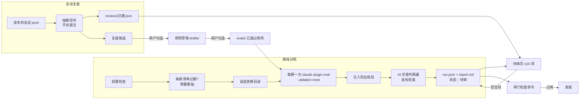

# 插件评测机制（devkit-plugin-eval）

Status: ready-for-agent

## 背景

本 spec 描述一套**通用的 Claude Code 插件评测机制**：任给一个用户自己写的插件，都能用它评。
一次只评一个插件，称为**被测插件**；同时加载、但不在本次评测范围内的其它插件称为**环境插件**。
`devkit-*` 是第一批使用者，不是机制的边界。

决策来自 2026-10-14 至 2026-10-15 的 wayfinder 地图 [map.md](map.md) 与其下 20 张票（[issues/](issues/)）。
每条结论后括号里的编号指向出处票；票内 Answer 顶部有「2026-10-15 部分覆盖」说明的，以覆盖后的现行内容为准，本 spec 已按现行内容写。
术语以仓根 `CONTEXT.md`「插件评测」节为准（被测插件、环境插件、离线对照、臂、上一版、会话复盘、作用方式、AI 评委、分歧样本、金标样本、用例草稿、待审、发版闸门、单测声明、条款清单、复盘候选、基线已满足、回归守护用例、诱导用例、注入文本指纹、退役条款）。

读者：实施者（含 AI 实施者）与插件作者。
实施者照本 spec 动手，不必回读各票；要核对某条取舍的理由与未选项时再点出处票。

## 总览

机制由两条路组成，不分主次（[06](issues/06-scope.md)）：

- **离线对照**：事先准备用例，在隔离环境里分别跑若干**臂**（不装被测插件、上一版、当前版、当前版加环境插件），臂与臂相减得到差。负责量化被测插件带来的差与版本回归。
- **会话复盘**：事后读本机真实会话记录，统计被测插件实际的触发、违规、拦截、时延。没有对照组。负责发现问题，并给离线对照供用例素材。

另有一道**发版闸门**，由闸门检查命令判定某个版本能否发布。



## 一、直接用 `claude plugin eval` 的部分

`claude plugin eval` 是 Claude Code 官方 CLI，**是离线对照唯一的运行器**；不另建独立 harness（[09](issues/09-build-vs-extend.md)）。
它与 skill-creator 的 `evals.json` 是两套，互不读取（[01](issues/01-claude-plugin-eval-capabilities.md)）。

eval 承担的部分：

| 能力 | 用法 | 出处 |
|---|---|---|
| 隔离运行 | 每个 run 一个临时 HOME，用户配置与其它插件全不加载 | [01](issues/01-claude-plugin-eval-capabilities.md) |
| 用例格式与存放 | 已通过的用例放 `<plugin>/evals/<case>/`，eval 原生格式（`prompt.md` / `case.yaml` + `graders/`），可直接裸跑 | [13](issues/13-result-layout.md) |
| 规则判分 | 只用 eval 的确定性 grader（如 `tool_used`、regex）；**不用 eval 内置 `llm` 评委** | [09](issues/09-build-vs-extend.md)、[11](issues/11-judging-and-human-checkpoints.md) |
| 每臂运行 | 每个臂各跑一次 `--ablation none`，每例每臂 3 次 | [09](issues/09-build-vs-extend.md)、[17](issues/17-case-sourcing.md) |
| 多轮与「compact 之后」 | `context.history_file` 回放合成会话 | [17](issues/17-case-sourcing.md)、[19](issues/19-probe-history-file-replay.md) |
| 文件桩 | `context.scaffold_script` 生成合成文件 | [17](issues/17-case-sourcing.md) |
| 条款归属与子集标记 | 用例 frontmatter 的 `tags`（唯一能挂自定义标记的字段，未知 key 报错） | [13](issues/13-result-layout.md) |
| 完整转录 | `--keep-temp` 保留子会话转录，供外围脚本核验注入与 AI 评委判分 | [09](issues/09-build-vs-extend.md) |

已实测的 eval 行为与坑（实施时必须照顾）：

1. **UserPromptSubmit / PreToolUse / SubagentStart 注入不进 trace**，只有 SessionStart 注入进 trace（[05](issues/05-probe-plugin-eval-on-hook-injection.md)）。
   这些注入要从 `--keep-temp` 的子会话转录里核验。
2. **hook 里的 `node` 经 `~/.asdf/shims` 解析时，在 eval 的临时 HOME 下 exit 126**；eval 不报错、分数照算，表现为「插件没效果」（[05](issues/05-probe-plugin-eval-on-hook-injection.md)）。前置检查的 hook 冒烟专防这一条。
3. **headless 子会话里没有 `AskUserQuestion`**，依赖它的条款离线对照不评，归会话复盘（[05](issues/05-probe-plugin-eval-on-hook-injection.md)、[09](issues/09-build-vs-extend.md)）。
4. **多插件同载**：额外插件只能写在用例 `plugins` 字段，且所列目录必须在 containment root 内（[05](issues/05-probe-plugin-eval-on-hook-injection.md)、[14](issues/14-previous-version-arm.md)）。因此每个臂在一个临时**组装目录**里跑，见「二、2.2」。
5. **`history_file` 回放**（[19](issues/19-probe-history-file-replay.md)，Claude Code 2.1.300 实测）：
   - `history_file` 就是会话转录 jsonl，可用 `system/compact_boundary` 开头再接 `isCompactSummary:true` 的摘要；路径须在用例目录或被测插件目录内、且是普通单链接文件；配了它就必须有被测 prompt。
   - auto ablation 会把回放用例降为只跑 with 臂。本机制按臂跑 `--ablation none`，不受这条影响；若实施时改用 eval 自带双臂，必须显式 `--ablation with-without`。
   - 回放子会话的转录写进**用例目录**的 `<历史 sessionId>.jsonl` 与同名目录。用例拷进臂组装目录再跑，每批跑完清理组装目录。
   - 合成历史**不放被测插件的注入文本**，否则「不装」臂也读得到。
6. **`--ablation none` 下 `arm: with-only` grader 计入分数**（devkit-plugin-eval 票 01，2.1.300 实测）：双臂模式下它是不计分的指示器，`none` 模式下照常计分。本机制每臂都跑 `--ablation none`，外围脚本算臂分时只取计分 grader，或用例不写 `with-only` 标记、注入核验改读 `--keep-temp` 转录。

## 二、自建部分：`devkit-plugin-eval`

### 2.1 交付形态

- 本仓新插件 **`devkit-plugin-eval`**（[09](issues/09-build-vs-extend.md)）。
- 一个 **Python 命令行**承担全部动作。
- 只拆两个 skill，对应两个决策时刻：**「跑离线对照」**、**「处理待审」**。
- **不加常驻 hook**。

命令行动作（子命令名属实施细节，下表的名字是为说明起的）：

| 动作 | 做什么 | 出处 |
|---|---|---|
| `register` | 登记被测插件（插件名 + 所在仓路径）。登记即信任声明 | [09](issues/09-build-vs-extend.md)、[15](issues/15-preflight-checks.md) |
| `check` | 单跑前置检查（其余动作开跑前也自动执行） | [15](issues/15-preflight-checks.md) |
| `compare` | 跑一次离线对照，产出待审报告 | [09](issues/09-build-vs-extend.md)、[14](issues/14-previous-version-arm.md)、[17](issues/17-case-sourcing.md)、[20](issues/20-clause-list-lifecycle.md) |
| `review` | 跑一次会话复盘，覆盖全部已登记插件 | [09](issues/09-build-vs-extend.md)、[10](issues/10-session-jsonl-signals.md) |
| `pending` | 生成本地 HTML 待审页；接收用户贴回的回复码并写回状态 | [11](issues/11-judging-and-human-checkpoints.md)、[13](issues/13-result-layout.md) |
| `gate` | 闸门检查：判版本能否发布，跑单测声明，列提示 | [12](issues/12-release-gate-coverage.md)、[16](issues/16-existing-deterministic-tests.md)、[18](issues/18-unit-test-declaration.md) |

另有一个**本仓脚本**（不属于 `devkit-plugin-eval`、不依赖它已安装）：`.githooks/pre-commit` 调起的单测脚本，见「二、2.7」。

实现约束（`devkit-portable-shell` 约定，[15](issues/15-preflight-checks.md)、[18](issues/18-unit-test-declaration.md)）：

- Python 解释器按 `python3` → `python` → `py -3` 实际执行 `--version` 解析。
- 调 `claude` 前先解析出可执行文件路径（Windows 上是 `.cmd`）。
- 配置目录尊重 `CLAUDE_CONFIG_DIR`。
- Windows / Linux 标「未实测」，首次真跑时补测。

### 2.2 离线对照（`compare`）

**何时跑**：用户手动触发；另在三种情形下提示用户跑——升版时改动碰到注入文本、skill description 或 agent 定义；Claude Code 升级；换主力模型（[08](issues/08-cadence-and-budget.md)、[09](issues/09-build-vs-extend.md)）。
**谁跑**：AI 在会话里执行，耗时长的放后台；用户只在待审页勾选（[08](issues/08-cadence-and-budget.md)）。

步骤按顺序：

1. **前置检查**（见 2.6）。硬项失败即中止。
2. **条款清单过期检查与增量重抽**（[20](issues/20-clause-list-lifecycle.md)）：
   - 在真实 HOME、空临时 cwd 下执行被测插件全部注入 hook，对输出文字算**注入文本指纹**。不能复用前置检查的冒烟那次（冒烟用空 HOME，asdf shim 下取不到文字）。
   - 与条款清单记下的指纹相同：不重抽、不产生待审项。
   - 不同：AI 只读旧清单加新旧注入文本的差异，产出清单变更（新增、改写、退役），进本次待审页，**整份变更算 1 项**。用户确认前对照照跑，新条款在报告里列「无用例」，报告标「条款清单待确认」。
3. **组装各臂**（[14](issues/14-previous-version-arm.md)）。每个臂一个临时组装目录，里面并排放：被测插件的某一版、可选的环境插件、`evals/`。**`evals/` 一律拷当前版仓里的用例**，快照自带的不用。
   - **当前版**：工作目录里的被测插件。
   - **上一版**：沿 `HEAD` 按改名追踪 `plugin.json`，找版本号与工作目录 `plugin.json` 不同的最近一个版本，取该版本号**被引入的那个提交**；`--base <提交|版本号>` 可覆盖。用 `git archive <提交> <该提交下的插件路径> | tar -x` 解出。
   - **环境插件**：入参收 `插件名@市场`（按 `~/.claude/plugins/installed_plugins.json` 的 `installPath` 取本机当前版）或路径；拷入时排除 `.in_use/`。
   - **退化**：被测插件不在 git 仓、历史里没有不同的版本号、或快照失败时，自动跳过上一版臂，只跑「不装」与「当前版」，报告首段写明原因。退化报告能否作闸门已审依据，由用户审报告时判断。
   - **跨改名**：上一版与当前版 `name` 不同时快照原样不动，报告标「跨改名」，并列出判分规则里写了 skill 全名、因而跨臂不可比的用例。
4. **每臂跑 eval**：`claude plugin eval --ablation none --keep-temp --no-publish --trust-plugin --output-dir …`，**全量跑所有已通过用例**，每例每臂 3 次（[17](issues/17-case-sourcing.md)，10-15 覆盖后现行）。臂与臂的差由外围脚本自算（[09](issues/09-build-vs-extend.md)）。
5. **注入到达核验**：读 `--keep-temp` 转录，确认注入确实到达；只作前置核验、不计分（[09](issues/09-build-vs-extend.md)）。另查 trace 的 hook `exit_code`，作冒烟之外的第二道防线（[15](issues/15-preflight-checks.md)）。
6. **AI 评委判分**（见 2.4）。
7. **常驻 token 静态算**：直接执行被测插件的 hook 脚本、按输出计数，不调模型（[09](issues/09-build-vs-extend.md)）。
8. **落盘**：写 `runs/<时间>-<版本>-compare/` 下的 `run.json`、`report.md` 等（见第四节），状态「待审」；清理臂组装目录与回放转录；把全量 trace 移到用户级缓存。

**订阅用量限制**：撞上订阅用量限制而失败的 run 判为无效、不计分；整次运行标「不完整」，可从断点续跑；不完整的结果不计入发版闸门（[09](issues/09-build-vs-extend.md) 10-15 覆盖）。
**不设美元上限**、不建账本、不查余额；`run.json` 照记 token 与标价估算，只作信息（[08](issues/08-cadence-and-budget.md) 10-15 覆盖）。

### 2.3 用例从哪来（[17](issues/17-case-sourcing.md)、[20](issues/20-clause-list-lifecycle.md)）

**条款清单**：AI 从被测插件的注入文本拆出可单独判定的条款，每条一个稳定 id，存 `plugin-evals/<plugin>/` 下一份清单文件（文件名属实施细节），用户在待审页整份确认一次（算 1 项）。用例用 `tags` 挂条款 id。

- id 绑判定标准、不绑措辞；判定标准变了即换新 id；拆分、合并都按「旧 id 退役 + 新 id」处理；id 永不复用。
- 退役条款留在清单里，标「退役」并写替代它的新 id。挂在它上面的用例退回 `drafts/`、附 AI 的改挂建议；条款删除时其用例经用户确认后删除。金标样本不删，停止参与校准；替代条款意图一致的，AI 建议迁移、用户确认后生效。
- `run.json` 记本次所用条款清单的指纹。

**来源与先后**：冷启动由 AI 按条款清单起草为主；会话复盘的候选逐步补充、替换编出来的用例。**所有来源一律先进 `drafts/`，用户勾选通过才跑**（[11](issues/11-judging-and-human-checkpoints.md) 第 4 条）。

**复盘候选 → 草稿**：候选只存指针与信号（会话 id、`uuid`、时间、插件版本、命中条款 id、是否在 compact 之后），不存原文。转草稿时 AI 现读本机 jsonl，改写成合成 prompt：保留触发违规的结构，换掉项目名、路径与业务内容；上下文裁到触发轮之前 ≤ 2 轮作 `history_file`。原文过了本机保留期（90 天）的候选作废。

**compact 之后**：合成回放会话（模板化 compact 摘要 + 1～2 轮尾巴 + 被测 prompt）；每个注入插件只挑 ≤ 3 条高风险条款做 compact 版。离线回放测的是「长历史稀释」，测不到注入丢失；「注入在 compact 后是否重新到达」归会话复盘（查 `compact_boundary` 之后有无该插件注入）加静态查 hook matcher。

**基线已满足与诱导用例**：新用例先在「不装」臂跑 3 次，≥ 2/3 通过的标基线已满足（`tags`），只作回归守护用例（比上一版不退化，不计相对不装的差）。要量差时另写诱导用例，手法限任务压力、诱人的捷径、长任务稀释，每条款 ≥ 2 种手法。防过拟合：起草者只看条款意图一句话、不看注入原文；grader 判行为、不判措辞。

**每类几例**：

| 作用方式 | 用例数 |
|---|---|
| 注入 · 纪律 | 每条可判条款 1 个普通用例；基线已满足的另加 2 个诱导用例 |
| skill | 每个 skill 应触发 2、不应触发 2（取相邻 skill 易混场景）；「触发后照做」复用应触发例 |
| agent | 每个 agent 该派 1、不该派 1、照定义做事 1 |
| 注入 · 文风 | 可机械判定的规则每条 1 例；易读性与信息不丢共用 2～3 个固定场景（带不装臂） |

**首批审阅**：草稿按优先级分批，每次待审页 ≤ 10 个，先审已证明有差与复盘已命中的条款；未审条款在报告里列「无用例」，不算失败。

**历史素材**：probe 的「派发带 `model`」「并发检索」两例转草稿；zh-disambiguate 的 3 例改写成 eval 格式进草稿；「待拍板不弹框」例不迁（依赖 `AskUserQuestion`）；wenyan 10 场景只作写法参考。

### 2.4 判分与人工介入（[07](issues/07-questions-eval-must-answer.md)、[11](issues/11-judging-and-human-checkpoints.md)）

每类作用方式要回答的问题见 [07](issues/07-questions-eval-must-answer.md) 的表；判分方按「规则能判的不交 AI」分配：

| 问题 | 判分方 |
|---|---|
| skill 触发 / 误触发；agent 派没派；被拦后是否连续撞同一条规则；副作用失败次数；各项代价；纪律条款中能机械判定的 | 规则 |
| 纪律条款中判不了的；skill 触发后是否照做；agent 是否照定义做事；回执后主会话能否接续；文风之后信息是否丢失 | AI 评委 |
| 误拦；被拦后是否绕过；干扰迹象 | AI 评委初筛，用户确认 |
| 读着累不累；副作用产物质量 | 用户终裁 |

**AI 评委**：在 eval 之外读完整转录判分；**每条判两遍**；**默认用最贵一档模型（如 Fable），可配置**（[08](issues/08-cadence-and-budget.md) 10-15 覆盖）。
**金标校准**：每次评测先让评委判一遍金标样本，与用户一致率不够就不采信本次 AI 判分。金标来自用户裁定过的分歧样本，不另外标注。一致率阈值与启用所需条数等第一批数据出来再定。
**用户看多少**：分歧样本全看；另从两遍一致的样本里随机抽 3 条。

**四个人工环节**集中在一个本地 HTML 待审页：判分裁定、用例草稿勾选、报告审阅、复盘候选选题（另加条款清单确认）。用户选完复制回复码贴回对话，CLI 写回 `run.json` 与 `judge.json`。
**时间上限**：每页（每次对照或每次复盘一页）≤ 10 分钟、≤ 10 个待判项；超出时自动抽样，报告写明抽了哪些。每月合计 ≤ 1 小时（[08](issues/08-cadence-and-budget.md)）。
**待审报告不能作为改插件或发版的依据**；用户审过改「已审」。

### 2.5 会话复盘（`review`）

**何时跑**：**手动触发，不做定时任务**。跑离线对照或闸门检查时，若距上次复盘超过 7 天，提示先复盘（[09](issues/09-build-vs-extend.md) 覆盖 [08](issues/08-cadence-and-budget.md) 第 2 条，用户原话「Q15 选 c」）。
**范围**：用户登记的被测插件清单；结果写回各插件所在仓的 `plugin-evals/<plugin>/reviews/<日期>.json`，零计数也写（[09](issues/09-build-vs-extend.md)、[13](issues/13-result-layout.md)）。
**原始 jsonl 不入库、不另存**，只入库抽取结果：会话 id、时间、命中的规则名或 skill 名、次数，不含对话原文（[06](issues/06-scope.md)）。

可取的信号（字段路径见 [research/session-jsonl-signals.md](research/session-jsonl-signals.md)，[10](issues/10-session-jsonl-signals.md)）：

| 信号 | 取法 | 归因到插件 |
|---|---|---|
| skill 调用 | `Skill` 的 `tool_use`、`<command-name>`、`attributionSkill` / `attributionPlugin` | 稳定 |
| 拦截 | tool_result 文本、`permissionDecision`；展开后的 cache 路径带 `<plugin>/<version>` | 稳定 |
| 注入 | `attachment.type` 为 `hook_additional_context` 等；`command` 未展开、不含插件名 | 靠 hooks.json 导出的「事件 + matcher + 脚本相对路径」指纹加内容标签 |
| hook 时延 | `hook_success.durationMs` | 同上 |
| compact 前后 | `system` 记录 `subtype:"compact_boundary"` | — |
| 环境插件 | `attachment.skill_listing.names[]`；版本取不到，复盘运行时读一次 `installed_plugins.json` 写进结果 | — |
| Claude Code 版本 / 模型 | 记录里的 `version` / `model`，与上次对照的 `run.json` 比对，变了在待审页列「建议跑对照」 | — |

实现要求：子代理文件（`subagents/agent-<id>.jsonl`）并入统计，否则漏掉近半数拦截；**按 `uuid` 去重**（resume / fork 复制历史，约 11% 重复）；对缺字段容错并记录 `version`（`permissionDecision` 2.1.294 起、`wireToolInputs` 2.1.272 起、deny 尾注 2.1.281 起）；改名前的旧目录名按 marketplace 的 `renames` 归一。

归会话复盘回答的问题：compact 后是否仍遵守（离线回放作补充）、依赖 `AskUserQuestion` 的条款、拦截类命中与误拦、副作用失败、hook 时延、Claude Code 版本 / 模型变化（[09](issues/09-build-vs-extend.md)）。
复盘产出**复盘候选**清单，进待审页由用户勾选哪些转用例草稿（[11](issues/11-judging-and-human-checkpoints.md) 第 6 条）。

### 2.6 前置检查（[15](issues/15-preflight-checks.md)）

失败分两级：**硬项失败即中止，不提供绕过开关；软项失败照跑**，在报告与待审页标注。`compare`、`review`、`gate` 开跑前自动执行，`check` 可单跑。

离线对照前：

| 检查项 | 级别 | 做法 |
|---|---|---|
| hook 解释器可达 | 硬 | 临时空 HOME 加同一 PATH，把被测插件、上一版快照、环境插件 `hooks.json` 每条 command 真执行一次；exit 126 / 127 判不可达，其它非零码只提示 |
| `claude` 可执行且 eval 参数齐 | 硬 | 读 `claude plugin eval --help` 做特性探测（`--ablation` `--keep-temp` `--no-publish` `--output-dir` `--trust-plugin`），不比版本号 |
| 已登录 | 硬 | `claude auth status --json` 的 `loggedIn` |
| 插件结构合法 | 硬 | `claude plugin validate <插件目录>`，被测插件、快照、环境插件都过 |
| 环境插件在 containment root 内 | 硬 | 有环境插件臂时才查 |
| 被测插件已登记 | 硬 | 已登记才自动加 `--trust-plugin`；未登记中止并提示先登记 |
| 工作区有未提交改动 | 软 | 照跑，报告记提交加 dirty 标记；**这份结果不计入发版闸门** |
| Claude Code 版本或主力模型与上次对照不同 | 软 | 照跑，标注与上次结果不可直接比 |

会话复盘前：会话目录可定位、可读、非空（硬）；登记清单非空、各仓路径存在且可写（硬）；距上次复盘天数 > `cleanupPeriodDays`（软，报告标出已被清理、未覆盖的时间窗）；要调 AI 评委时查登录态（硬）。

已撤销：「本月余额 > 0」硬项、`--max-cost-usd` 必需参数（[15](issues/15-preflight-checks.md) 10-15 覆盖）。

### 2.7 确定性单测（[16](issues/16-existing-deterministic-tests.md)、[18](issues/18-unit-test-declaration.md)）

被测插件在**插件根**放一份**单测声明** `unit-tests.json`，随插件分发：

```json
{
  "tests": [
    { "run": ["python3", "tests/probe-refresh-url-criterion.test.py"] },
    { "run": ["node", "hooks/tests/worktree-cwd-recovery.js"] },
    { "run": ["bash", "hooks/tests/codegraph-hint-gating.sh"], "platforms": ["darwin", "linux"] }
  ]
}
```

- `run`（必填）：argv 数组，不经 shell；工作目录固定为插件根。
- `timeout_sec`（可选，缺省 120）：超时判失败。
- `platforms`（可选，取值 `darwin` / `linux` / `win32`，缺省全部）。
- 不设其它字段。只收不联网、结果确定的单测。

两处消费者：

| | 闸门检查命令（`gate`） | 本仓 pre-commit 脚本 |
|---|---|---|
| 选哪些插件 | 入参那一个 | 暂存路径命中 `plugins/<name>/**` 的插件（`plugin-evals/<name>/` 不算） |
| 未声明 | 提示「未声明单测」，不拦 | 静默 |
| 声明不合法 | 判失败 | 拦 |
| 平台不在 `platforms` | 跳过并提示 | 跳过并提示 |
| 解释器解析不到 | 判失败 | 跳过并警告 |
| 任一条非零或超时 | 判失败 | 拦（`--no-verify` 可绕过） |

pre-commit 脚本是本仓脚本：JS、由 node 调起，读工作区里的声明、在工作区跑，判据形态与 [scripts/check-versions.js](vscode://file/Users/zhangq/Workspace/mine/claude-devkit-marketplace/scripts/check-versions.js) 一致，不依赖已安装的 `devkit-plugin-eval`。实测代价：改 `devkit-task-keeper` 每次提交多约 37 秒，其余插件 0～5 秒。
实施时备一组共用的声明样例，让 Python 与 JS 两套实现各跑一遍对齐（建议，未拍板）。

### 2.8 发版闸门（`gate`）（[12](issues/12-release-gate-coverage.md)、[13](issues/13-result-layout.md)）

**覆盖范围**：

- **major 升版**与**用户声明需评测的版本**：须有已审的离线对照报告。
- 其余版本：须通过**规则判分子集**——取全部能用规则判分的用例，只跑当前版一臂、不调 AI 评委、不占用户审阅时间，但真跑模型；结果写 `runs/<时间>-<版本>-gate/`（[12](issues/12-release-gate-coverage.md) 10-15 覆盖后现行）。
- 有单测声明的，声明里的单测先要通过。

**判据**：扫 `runs/*/run.json`。某版本过闸 = 存在同版本、且**插件内容指纹**与当前一致、且不是 dirty / 不完整的记录，二者之一：已审的离线对照，或通过的规则子集。插件内容指纹算整个插件目录、排除 `evals/`（补用例不让已审报告失效）。指纹不一致视为未过闸。

**声明与跳过**写在升版提交的提交信息 trailer 里：`eval-required: <理由>` / `eval-skip: <理由>`，命令读 git log。不另设状态文件，不往 `plugin.json` 加字段。

**每次运行还要输出**：

- 所有 `eval-skip:` 版本，由用户决定是否补评（[09](issues/09-build-vs-extend.md) 覆盖 [12](issues/12-release-gate-coverage.md) 第 4 条）；
- 闸门内版本推到 main 时既无已审报告、也无 `eval-skip:` 的漏检；
- 升版改动碰到 skill description 或 agent 定义，或**注入文本指纹相对上次对照变了**：合成一条「建议跑对照（会先更新条款清单）」（[20](issues/20-clause-list-lifecycle.md)）；
- 距上次复盘超 7 天的提醒。

**落点**：通用命令，入参为插件目录。本仓**不接 git hook**，用户发版（推 main）前手动运行（[12](issues/12-release-gate-coverage.md)）。用户知情后接受的风险：靠人记得跑；本仓 [.githooks/pre-commit](vscode://file/Users/zhangq/Workspace/mine/claude-devkit-marketplace/.githooks/pre-commit) 注释记录过「靠文档提醒的实际执行率是零」。

## 三、谁跑、何时跑、占用户多少时间

| 动作 | 谁触发 | 何时 | 用户时间 |
|---|---|---|---|
| 离线对照 | 用户手动；AI 在会话里执行、长任务后台 | 用户想跑时；AI 提示的三种情形（见 2.2） | 每次一页待审，≤ 10 分钟、≤ 10 项 |
| 会话复盘 | 用户手动 | 对照或闸门检查时距上次 > 7 天会提示 | 每次一页待审，≤ 10 分钟、≤ 10 项 |
| 闸门检查 | 用户手动 | 发版（推 main）前 | 0（只读输出） |
| 规则子集 | 闸门检查需要时 | 闸门外版本发版前 | 0 |
| pre-commit 单测 | git 自动 | 本仓每次提交 | 0（代价是提交耗时） |

合计每月用户时间 ≤ 1 小时；超出时调低待判项的抽样比例，不跳过整次评测（[08](issues/08-cadence-and-budget.md)）。
**花费**：用户使用订阅，评测不设美元上限，避免额度干扰评测质量（用户 2026-10-15 原话见 [08](issues/08-cadence-and-budget.md) Comments）；`run.json` 记 token 与标价估算只作信息。

## 四、目录布局与状态文件（[13](issues/13-result-layout.md)）

`<repo>` 是被测插件所在仓的根，`<plugin>` 是被测插件名。

```
<repo>/plugins/<plugin>/evals/<case>/        # 已通过的用例，eval 原生，随插件分发
<repo>/plugins/<plugin>/unit-tests.json      # 单测声明，随插件分发
<repo>/plugin-evals/<plugin>/                # 插件目录外，入库，不分发
  <条款清单文件>                              # 条款 id、判定标准、退役标记、抽取时的注入文本指纹
  drafts/<case>/                             # 用例草稿
  runs/<时间>-<版本>-<compare|gate>/
    run.json                                 # 唯一真源
    arms/<臂>/aggregate-result.json
    injection-check.json                     # 注入到达核验
    judge.json                               # 两遍判分、金标一致率、用户裁定
    samples/<id>.jsonl.gz                    # 用户看过的样本 trace
    report.md                                # 给人读
  reviews/<日期>.json                         # 会话复盘抽取结果，不含原文
  gold/<id>.json                             # 金标样本
~/.claude/plugins/data/devkit-plugin-eval-<marketplace>/
  registry.json                              # 被测插件登记清单（插件名 + 仓路径）
  traces/                                    # 全量 trace 本机缓存，留 90 天
```

- 草稿必须在 `evals/` 之外：eval 递归扫描 `<eval dir>/**`，放进去会被当正式用例跑。
- `<plugin>/evals/results/` 加进 `.gitignore`；外围脚本跑完把 eval 写进去的产物搬到 `runs/`。插件目录就是仓根时，产物仍会分发，接受这个例外。
- `run.json` 字段：插件名、版本、插件内容指纹、条款清单指纹、各臂（上一版的提交 sha、版本号、取得方式、是否退化及原因、是否跨改名；当前版 `HEAD` sha 与 dirty 标记；每个环境插件的来源、版本号与 `gitCommitSha`）、Claude Code 版本、主力模型、AI 评委模型、token 与标价估算、`kind`（`compare` / `gate`）、是否完整、是否通过、审阅状态（待审 / 已审）与审阅时间。
- 入库：结构化结果、两遍判分、注入核验、报告，加用户看过的样本 trace（分歧、抽检、金标），压缩存放。全量 trace 只留本机 90 天（放宽了「原始运行数据要入库」，已在地图 Notes 标注）。
- 上次复盘时间、上次对照的 Claude Code 版本与模型**不另存**，从各仓 `reviews/` 与 `run.json` 现算。
- HTML 待审页在本机生成，不入库。
- 评 radnove 等内网插件时，用例与结果进内网仓，不进本仓（本仓公开）（[06](issues/06-scope.md)）。
- 已撤销：用户级花费账本 `ledger.jsonl`（[13](issues/13-result-layout.md) 10-15 覆盖）。

## 不做的

- 不建独立 harness；不用 eval 内置 `llm` 评委；不用 MCP 打桩冒充 `AskUserQuestion`（[09](issues/09-build-vs-extend.md)）。
- 不做定时任务（[09](issues/09-build-vs-extend.md)）。
- 不设美元上限、不建账本（[08](issues/08-cadence-and-budget.md)）。
- 不量化「同装环境插件后效果打几折」，只答有没有冲突迹象；离线对照默认纯净环境，可手动加一两个环境插件复现已知冲突（[06](issues/06-scope.md)、[07](issues/07-questions-eval-must-answer.md)）。
- 不评 hook 拦截逻辑与副作用本身的正确性——由单测覆盖，经单测声明接入（[07](issues/07-questions-eval-must-answer.md)、[16](issues/16-existing-deterministic-tests.md)）。
- 不给现有 9 个有 hook 无单测的插件补单测（[16](issues/16-existing-deterministic-tests.md)）。
- 不处理 `.scratch/ask-format-eval/`（[04](issues/04-existing-eval-artifacts.md)）。

## 实施待定（非拍板项，实施时实测后定）

1. **「不装」臂怎么跑**：**已实测（2026-10-15，2.1.300）：用只含 `.claude-plugin/plugin.json` 的空桩插件，可行。** eval 接受无组件插件；空桩臂与 eval 自带 without 臂的工具、skill、slash 命令、agent、MCP 五项清单逐项相同，首请求输入 token 同区间，计分 grader 结果相同，同一 eval 里装空桩与不装 Δ=0。`--ablation with-without` 取 `W/OUT` 列不必采用，留作备选（回放用例须显式带该参数，见 [19](issues/19-probe-history-file-replay.md)）。注意：`--ablation none` 下 `arm: with-only` grader 计入分数，外围脚本算分时要剔除，见「一」已实测第 6 条。证据：[devkit-plugin-eval 票 01 报告 · 二、问题 1：空桩插件能否当「不装」臂](../devkit-plugin-eval/probe/REPORT.md#二问题-1空桩插件能否当不装臂)（空桩臂与 without 臂逐项比对）。
2. 用例 `plugins` 字段的相对路径由脚本生成还是改写用例；同一 eval 内同名不同版本插件的行为（本设计不依赖）（[14](issues/14-previous-version-arm.md)）。
3. 用例目录里放 eval 不认识的附加文件会不会报错：**已实测：用例目录与 `evals/` 根目录里的附加文件（md、json、txt、子目录）一律静默忽略；`graders/` 下无 frontmatter 的 md 也忽略。会让整个用例加载失败（退出码 1）的两种：`graders/` 下带 frontmatter 却无 `type:` 的 md；`prompt.md` frontmatter 里的未知键。** 条款归属可另放独立文件，或照旧只用 `tags`（[13](issues/13-result-layout.md)）。证据：[票 01 报告 · 三、问题 3：用例目录里放 eval 不认识的附加文件](../devkit-plugin-eval/probe/REPORT.md#三问题-3用例目录里放-eval-不认识的附加文件)（六种放法与报错原文）。
4. 从 skill 里调 Python 命令行时能否拿到 `CLAUDE_PLUGIN_DATA`：**已实测：环境变量拿不到（eval 沙箱与真实会话都是 unset，与官方文档一致）；SKILL.md 正文里的 `${CLAUDE_PLUGIN_DATA}` 加载时被替换成绝对路径，目录首次引用时自动创建。** 做法：SKILL.md 里写 `--data-dir "${CLAUDE_PLUGIN_DATA}"` 传给 Python；脚本被手动执行拿不到参数时，按自身路径 `~/.claude/plugins/cache/<marketplace>/<plugin>/<version>/…` 取出两段，拼 `~/.claude/plugins/data/<plugin>-<marketplace>/`（字母、数字、`_`、`-` 以外的字符换成 `-`）（[13](issues/13-result-layout.md)）。证据：[票 01 报告 · 四、问题 4：skill 调起的 Python 进程与 `CLAUDE_PLUGIN_DATA`](../devkit-plugin-eval/probe/REPORT.md#四问题-4skill-调起的-python-进程与-claude_plugin_data)（两处实测的变量与参数值）。
5. 插件内容指纹与注入文本指纹的算法（文件清单排序、换行归一；注入文本里若有时间、随机数要归一）（[13](issues/13-result-layout.md)、[20](issues/20-clause-list-lifecycle.md)）。
6. `cleanupPeriodDays` 未设时的默认值：**已查实：30 天**，最小 1，设 0 校验失败；清理范围含会话转录 jsonl 及其 `subagents/`、`tool-results/` 等（[15](issues/15-preflight-checks.md)）。出处：官方文档 settings-reference「**Default**: `30`」，与 2.1.300 可执行文件 settings schema「(default: 30)」一致。证据：[票 01 报告 · 五、问题 5：`cleanupPeriodDays` 默认值](../devkit-plugin-eval/probe/REPORT.md#五问题-5cleanupperioddays-默认值)（文档原文与字符串摘录）。
7. 金标一致率阈值、金标攒到多少条启用校准；「基线已满足」的 2/3 阈值（[11](issues/11-judging-and-human-checkpoints.md)、[17](issues/17-case-sourcing.md)）。
8. 条款清单文件名、子命令名。

## 残余风险与实施后验证项

1. **回放与真实 compact 的等价性**（2026-10-15 用户划出地图，作为实施后验证项）：[19](issues/19-probe-history-file-replay.md) 所测条款在约 3k、20k token 合成历史下没退化，Δ 仍 +0.67；但回放能否复现真实会话里 compact 后的退化**未验证**。
   验证办法：会话复盘产出「compact 前后违规率」后，挑一条真实会话里 compact 后变差的条款再跑回放。真实有退化而回放 with 臂仍满分，触发 [09](issues/09-build-vs-extend.md) 重开条件，重议自建 harness。
2. **条件注入取不到**：依赖项目目录或会话状态才输出的注入，空目录下取不到，这部分改动不触发条款清单重抽（[20](issues/20-clause-list-lifecycle.md)；本仓 devkit-worktree-flow、devkit-omp 部分 command 在空目录下无输出）。
3. **冒烟与 eval 子会话不一致**：冒烟用的 stdin 样例与 eval 实际传给 hook 的输入不同，hook 对输入敏感时可能误报（[15](issues/15-preflight-checks.md)）。
4. **手动纪律靠人记**：闸门检查与会话复盘都手动触发，依赖用户响应提示（[09](issues/09-build-vs-extend.md)、[12](issues/12-release-gate-coverage.md)）。
5. **pre-commit 37 秒**可能让用户习惯性 `--no-verify`；改多个插件共用的仓根文件时按路径找不到插件，不跑单测；pre-commit 跑工作区内容，有未暂存改动时与实际提交可能不一致（[16](issues/16-existing-deterministic-tests.md)、[18](issues/18-unit-test-declaration.md)）。
6. **`--keep-temp` 转录格式**随 Claude Code 版本是否稳定，未查（[09](issues/09-build-vs-extend.md)）。
7. **git archive 快照**缺被 git 忽略却运行必需的文件；本仓插件没有，他人插件未核实（[14](issues/14-previous-version-arm.md)）。
8. **AI 判「判定标准是否变了」可能判错**，靠待审页那 1 项兜底（[20](issues/20-clause-list-lifecycle.md)）。
9. **Windows / Linux** 上冒烟、`.cmd` 解析、`bash` 解析到 Git Bash，均未实测（[15](issues/15-preflight-checks.md)、[18](issues/18-unit-test-declaration.md)）。
10. 150k token 以上历史、历史里含工具调用的回放，未实测（[19](issues/19-probe-history-file-replay.md)）。

## 重开条件

| 条件 | 重议什么 | 出处 |
|---|---|---|
| 回放测不出 compact 后差异，且复盘里 compact 后样本不足以下结论 | 是否自建 harness | [09](issues/09-build-vs-extend.md) |
| 连续两次「超 7 天」提示后仍没有复盘记录 | 是否恢复定时任务 | [09](issues/09-build-vs-extend.md) |
| 闸门检查发现闸门内版本推到 main 时既无已审报告也无 `eval-skip:` | 闸门改接 pre-push | [12](issues/12-release-gate-coverage.md) |
| 第一批评测后每月人工时间持续超 1 小时 | 复盘与闸门覆盖范围 | [08](issues/08-cadence-and-budget.md) |
| 冒烟通过、跑后核验仍发现 hook 静默失败 | 冒烟做法 | [15](issues/15-preflight-checks.md) |
| 他人插件普遍依赖构建产物或被忽略文件，快照跑不起来 | 上一版快照方式 | [14](issues/14-previous-version-arm.md) |
| 退化报告被当作闸门依据后漏判回归 | 退化报告能否作已审依据 | [14](issues/14-previous-version-arm.md) |
| 入库样本 trace 让仓体积每月增长超过约 2MB；或需重看已过 90 天的未入库 trace | trace 入库范围 | [13](issues/13-result-layout.md) |
| 「审后改一字就要重跑」让闸门被频繁 `eval-skip:` | 插件内容指纹范围 | [13](issues/13-result-layout.md) |
| 会话复盘发现注入文字已改、清单却从未提示过期 | 注入文本取法 | [20](issues/20-clause-list-lifecycle.md) |
| 条款清单变更连续两次被用户整份打回 | 增量重抽 | [20](issues/20-clause-list-lifecycle.md) |
| 首批草稿两个月仍没审完一半 | 首批分批与优先级 | [17](issues/17-case-sourcing.md) |
| `--no-verify` 成为常态 | 慢单测移 pre-push | [16](issues/16-existing-deterministic-tests.md) |
| Claude Code 官方给插件清单加了测试入口字段 | 单测声明位置与格式 | [16](issues/16-existing-deterministic-tests.md)、[18](issues/18-unit-test-declaration.md) |
| 两套实现对同一份声明给出不同结论 | 是否收敛到单一实现 | [18](issues/18-unit-test-declaration.md) |

## Comments

- 2026-10-15 提交安排（用户选 a）：用户审完本 spec 后再提交，只提交 `.scratch/plugin-eval/` 与 `CONTEXT.md`，用窄 pathspec，不带工作区里他人对 devkit-tool 的未提交改动（6.25.1→6.26.0）。Jev 选「暂不提交」（置信 0.89），未采纳。
- 2026-10-15 用户审过本 spec（原话「spec 已经审核」），Status 改为 `ready-for-agent`。入库时排除 `probe/traces/`：子会话转录里有 eval 注入的账号邮箱，本仓公开，只留本机，已加进仓根 `.gitignore`。
- 2026-10-15 拆为 17 张实施票（用户确认粒度、阻塞关系，无合并或再拆），写在 `.scratch/devkit-plugin-eval/issues/`。
