# Excalidraw 能画多少种图——69 张样例图库

**编制说明：** 2026-10-25 编制，随 `devkit-excalidraw-diagram` 1.4.0 分发。
全部图由本插件的渲染链路生成（Excalidraw 0.18 `exportToSvg` + 无头 Chromium），业务统一用虚构电商「青禾商城」。
图片统一用**等宽直角风**渲染（全部文字用等宽字体、方框直角），只当记号与版式的参照；出图时的风格按 [SKILL.md · Styles](../../SKILL.md#styles)（四种风格的参数与选用条件）选，不必照抄这里的字体。
读者假定：懂开发，没用过 Excalidraw 或只拿它画过草图。

**一句话：** Excalidraw 只有矩形、椭圆、菱形、线、箭头、文字六种图元，但拼得出 **11 大类、69 种**图——架构、UML、BPMN、协议时序、数据结构、甘特、思维导图、线框图、甚至桑基图和火焰图都画出来了；**能画不等于都该用它画**，结构与关系类是它的主场，数据图表和密集依赖图应换专用工具（见第 12、13 节）。


## 怎么读

| 想知道什么 | 读哪里 |
|---|---|
| 一眼看完全部 69 种 | 「全景」缩略图 |
| 某一类图长什么样 | 第 1～11 节，每节一类 |
| 什么图别用 Excalidraw 画 | 第 12 节「画不好什么」、第 13 节「选型建议」 |
| 图片怎么来的、为什么不带源文件 | 附录 A |
| 哪些图破了作图规范、为什么 | 附录 B |

每张图的固定写法：标题行是「编号 图名（图类型）」，下一行「图 NN 说的是」是一句话图注，图后是画法要点、已知瑕疵、画布尺寸（像素）。
插件只带 PNG，不带 `.excalidraw` 源文件与生成脚本（见附录 A）。

---

## 全景

图 0 说的是：69 张图的缩略图，按编号排列；x1～x4 来自风格评测，按图类型归入第 1、3、5、6 节。

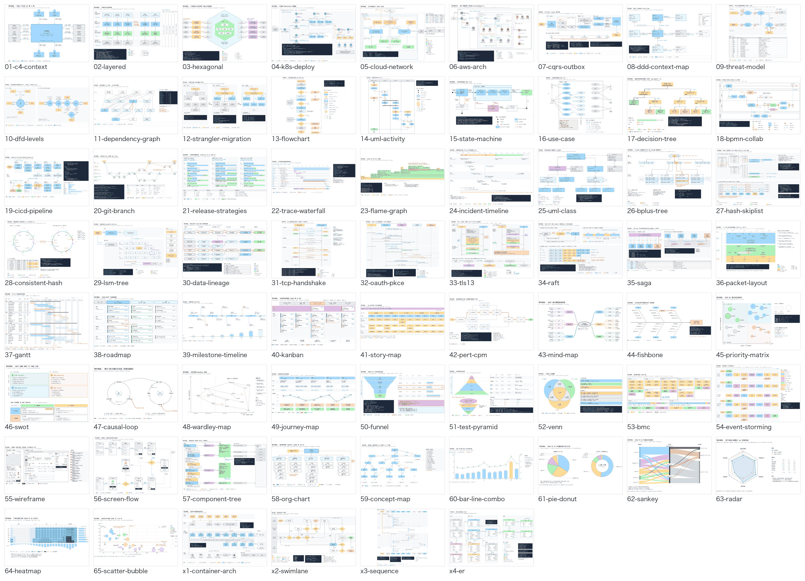

| # | 类别 | 张数 | 包含的图类型 | 用 Excalidraw 画合不合适【判断】 |
|---|---|---|---|---|
| 1 | 软件架构（全貌与部署） | 7 | C4 上下文 / 容器、分层、六边形、K8s 部署、云网络、AWS | **首选** |
| 2 | 软件架构（演进与分析） | 6 | CQRS、DDD 上下文映射、威胁建模、DFD、依赖图、绞杀者演进 | **首选**；依赖图例外 |
| 3 | 流程与行为 | 7 | 流程图、泳道图、活动图、状态机、用例图、决策树、BPMN | **首选**；大型 BPMN 用 bpmn.io |
| 4 | 工程实践 | 6 | CI/CD、Git 分支、发布策略、链路瀑布、火焰图、故障时间线 | 可用；时间轴全靠手算 |
| 5 | 数据与结构 | 7 | 类图、ER 图、B+ 树、哈希与跳表、一致性哈希、LSM、血缘 | **首选** |
| 6 | 协议与分布式 | 7 | 时序图、TCP、OAuth、TLS、Raft、Saga、报文位图 | **首选** |
| 7 | 规划与项目 | 6 | 甘特、路线图、里程碑、看板、故事地图、CPM 网络 | 可用；数据常变就换工具 |
| 8 | 分析与思考 | 6 | 思维导图、鱼骨、优先级矩阵、SWOT、因果回路、Wardley | **首选** |
| 9 | 产品与业务 | 6 | 旅程地图、漏斗、测试金字塔、韦恩、商业画布、事件风暴 | **首选** |
| 10 | 界面与组织 | 5 | 线框图、页面流、组件树、组织架构、概念图 | **首选** |
| 11 | 数据图表 | 6 | 柱线组合、饼环、桑基、雷达、热力、气泡 | **不建议**：能画，但该用 ECharts |

---

## 1 软件架构（全貌与部署）

### 01 青禾商城系统上下文图（C4 第 1 层）

图 01 说的是：青禾商城和 4 类人、6 个外部系统各自交换什么、走什么协议。

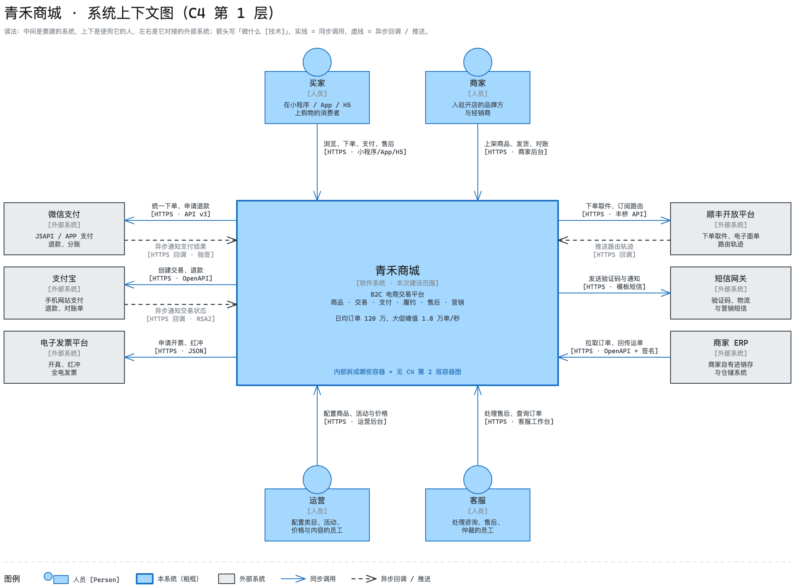

**画法：** 系统框居中加粗；人用「圆头 + 身体框」；外部系统灰色左右各 3；连线标签写「动词 + [协议 · 技术]」，同步蓝实线、回调灰虚线。
**瑕疵：** 等宽字体下框内说明偏挤。
画布 1980×1465

### x1 青禾商城容器架构图（C4 第 2 层）

图 x1 说的是：把上一张的「青禾商城」方框打开，里面的网关、各业务服务、Kafka 事件总线与数据存储怎样连接。

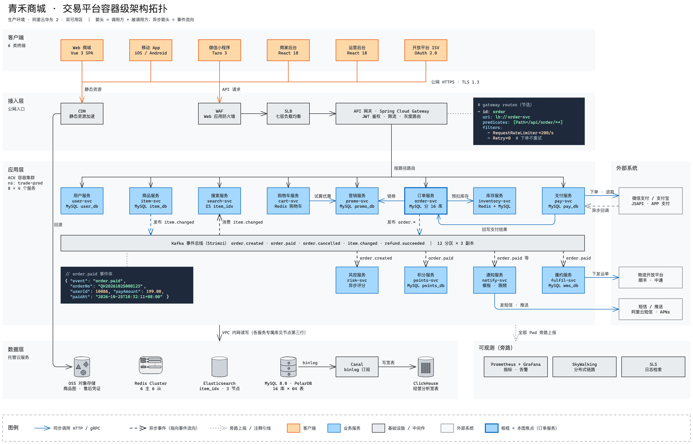

**画法：** 业务服务与基础设施分组着色；素材库图标表示 MySQL、Redis、ES；连线全部直角折线并标动词。来自风格评测。
画布 2620×1680

### 02 交易平台分层架构（分层架构图）

图 02 说的是：四层各有哪些真实模块，依赖只许向下，基础设施层靠依赖倒置实现领域层接口，并示范一条被构建拦下的违规依赖。

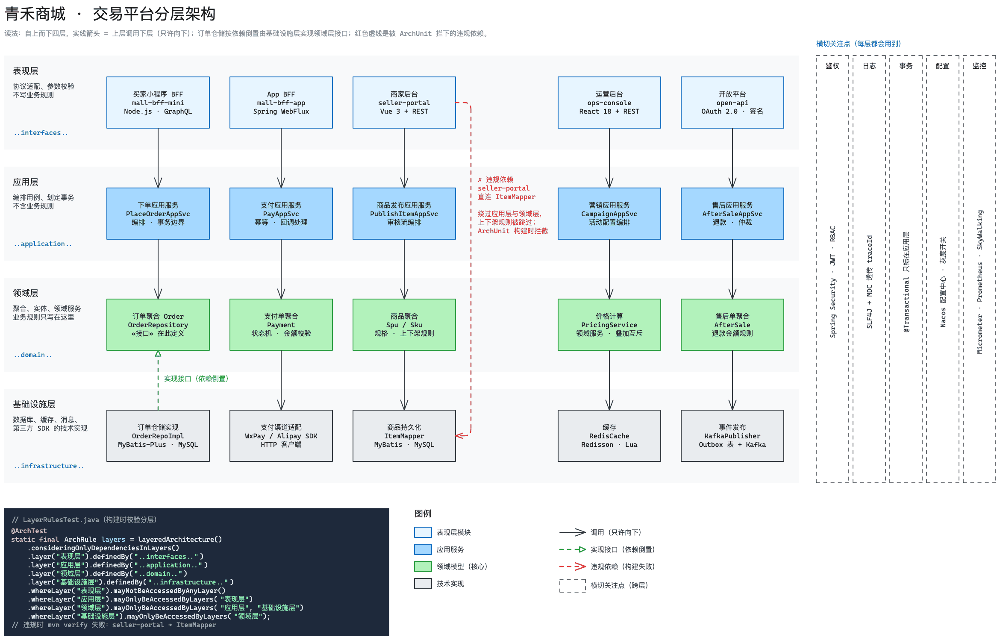

**画法：** 四条横带 × 5 列模块；绿色虚线加空心三角表示「实现接口」；红色虚线绕行表示违规直连；5 根横切关注点竖条；附 ArchUnit 规则。
**瑕疵：** 竖排说明在手绘字体下偏细。
画布 2340×1498

### 03 订单服务六边形架构（端口与适配器）

图 03 说的是：入站适配器调用端口，出站适配器实现端口，所有依赖都指向领域核心。

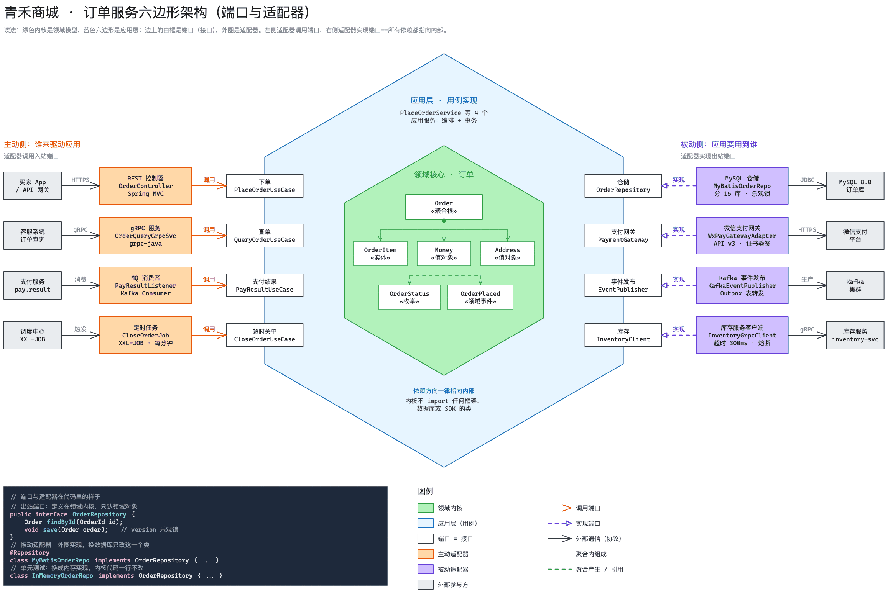

**画法：** 多边形画两层六边形（应用层 ⊃ 领域核心），核心里画迷你领域模型；左右竖边各挂 4 个端口；附 Java 代码。
**瑕疵：** 六边形四个斜角留白多。
画布 2316×1548

### 04 交易域 Kubernetes 部署图（K8s 部署图）

图 04 说的是：流量从 SLB 经 Ingress、Service 进到 Pod，Redis 用 StatefulSet 加 PVC 落盘，HPA、ConfigMap、Secret 各管什么。

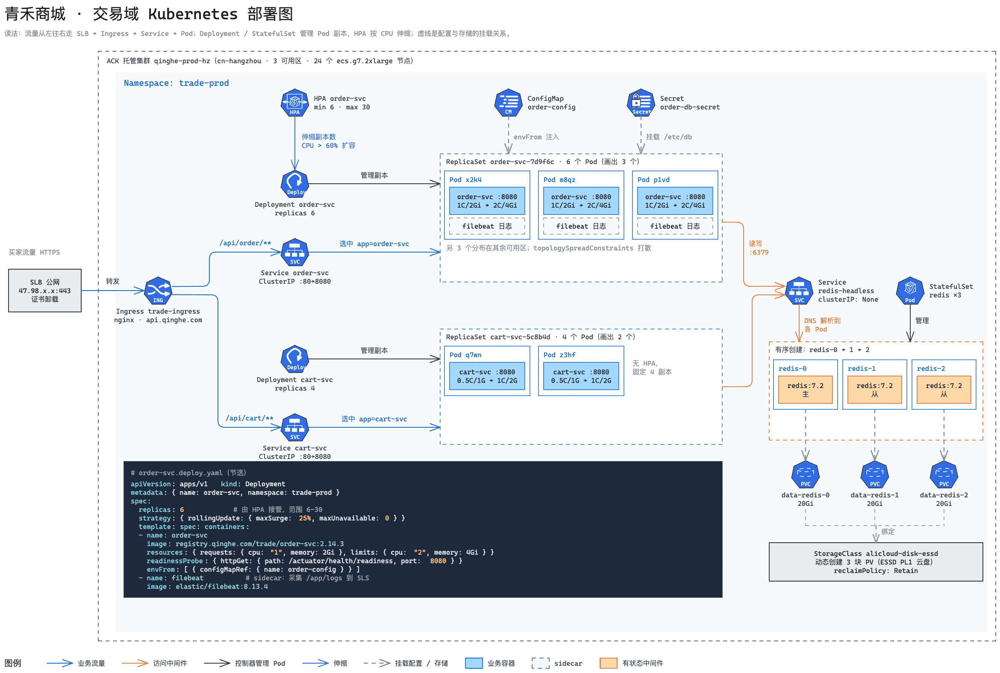

**画法：** 集群 ⊃ 命名空间两层框；K8s 官方图标；Pod 卡片带 filebeat sidecar；PVC 用总线汇入 StorageClass；附 Deployment YAML。
**瑕疵：** 图标库缺 StatefulSet，用 Pod 图标加文字代替。
画布 2340×1575

### 05 生产网络拓扑·华东 1 杭州（云网络拓扑）

图 05 说的是：VPC 10.0.0.0/16 怎样跨两个可用区切出公网、应用、数据三层子网，流量怎么进、怎么出网、怎么经专线到 IDC。

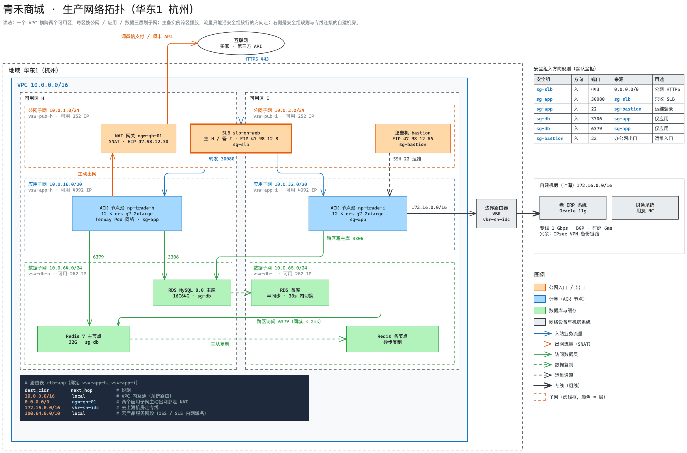

**画法：** Region ⊃ VPC ⊃ 可用区三层嵌套；子网标 CIDR、交换机名、可用 IP 数；主备复制绿虚线；附安全组与路由表。
**瑕疵：** 连线通道全靠手工规划，图偏密。
画布 2380×1570

### 06 青禾海外站 AWS 部署架构（AWS 架构图）

图 06 说的是：海外买家经 Route 53、CloudFront 进来，动态请求回源到跨可用区的 ALB 与 Fargate，静态资源回源 S3，订单事件经 SQS 由 Lambda 调 SES 发邮件。

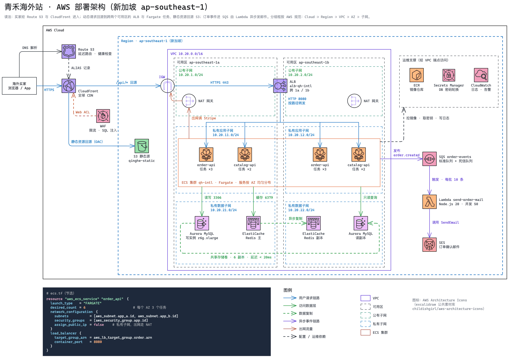

**画法：** 按 AWS 规范画分组框；图标取自社区库 `childishgirl/aws-architecture-icons`，排线填充改成实心；附 `ecs.tf`。
**瑕疵：** 可用区 b 的 NAT 网关没画出网连线；子网标题位置不统一。
画布 2370×1668

---

## 2 软件架构（演进与分析）

### 07 下单链路的 CQRS 与 Outbox（事件驱动架构）

图 07 说的是：订单服务在一个本地事务里同时写订单表和发件箱表，Debezium 读 binlog 投到 Kafka，再投影成 ES 和 Redis 读模型，查询最多晚约 1 秒看到最新数据。

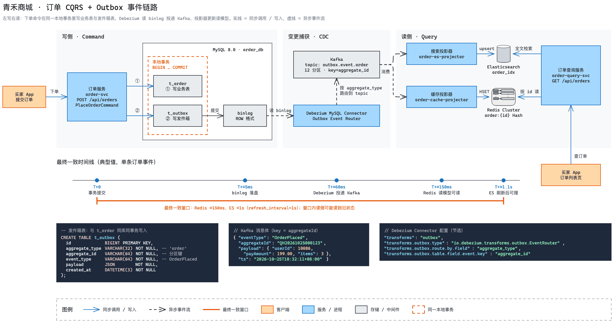

**画法：** 写侧 / 变更捕获 / 读侧三分区；橙色虚线框圈出本地事务；底部时间轴用粗括号标出最终一致窗口；三块证据代码。
**瑕疵：** 素材库的 Redis 图标是通用服务器，靠文字区分。
画布 2280×1200

### 08 限界上下文映射图（DDD Context Map）

图 08 说的是：订单上下文是核心，商品、营销、库存、支付在上游，物流在下游；对接微信支付和顺丰时分别用遵奉者（CF）和防腐层（ACL）。

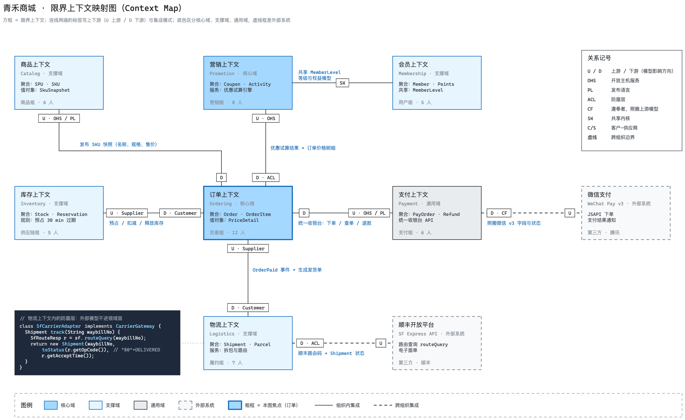

**画法：** 底色区分核心 / 支撑 / 通用 / 外部域；关系线不带箭头，两端白底徽标写 U/D 和模式，六种关系全用上；附防腐层代码。
画布 2320×1420

### 09 下单与支付链路威胁建模（STRIDE 数据流图）

图 09 说的是：4 条信任边界把系统切成 5 个信任域，跨边界的 9 条数据流共 17 项 STRIDE 威胁，最高风险是支付回调被伪造或重放。

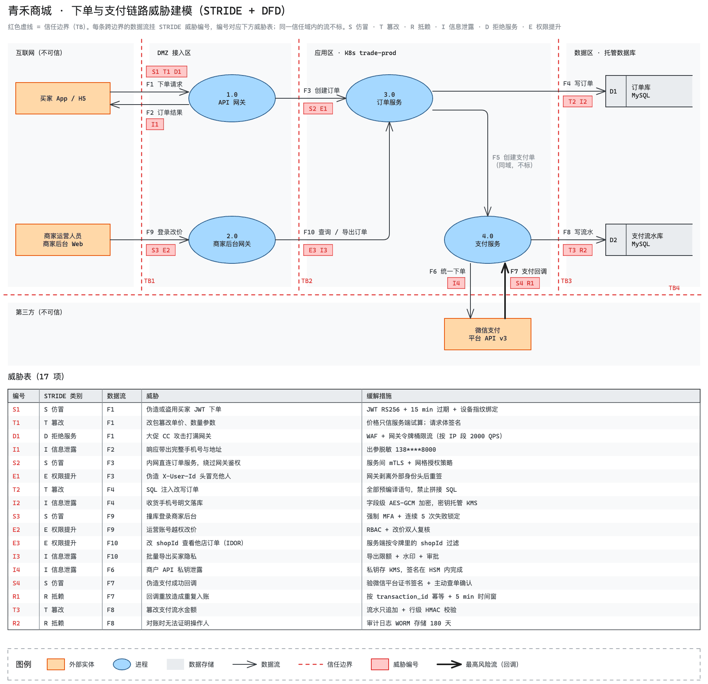

**画法：** 红色虚线画信任边界；进程用椭圆、存储用 Gane-Sarson 记号；每条流挂威胁编号；下方 17 行威胁表。
**瑕疵：** 第三方分区大半空着。
画布 1800×1740

### 10 订单系统结构化数据流图（DFD 0 层 + 1 层）

图 10 说的是：0 层把订单系统当一个进程，只画它和 5 个外部实体交换的 a–h 八条数据；1 层拆成 5 个子进程和 4 个存储，a–h 两层同名对得上。

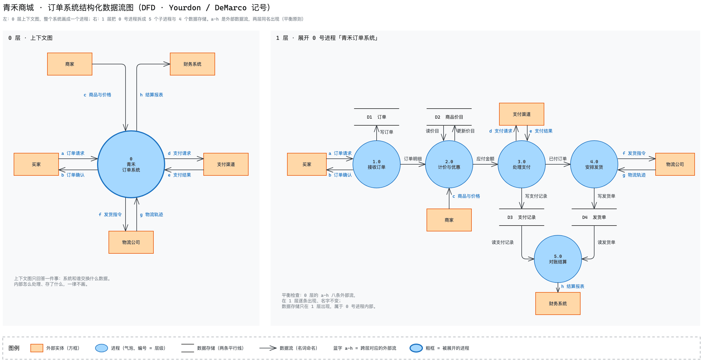

**画法：** Yourdon/DeMarco 记号（气泡 = 进程，双平行线 = 存储）；两层左右并排，跨层数据流写蓝字便于对照；附平衡检查。
画布 2520×1300

### 11 服务依赖图（分层依赖图）

图 11 说的是：16 个服务分 4 层、36 条同步调用，item / order / user 被依赖最多，order 与 promo 之间有一处循环依赖。

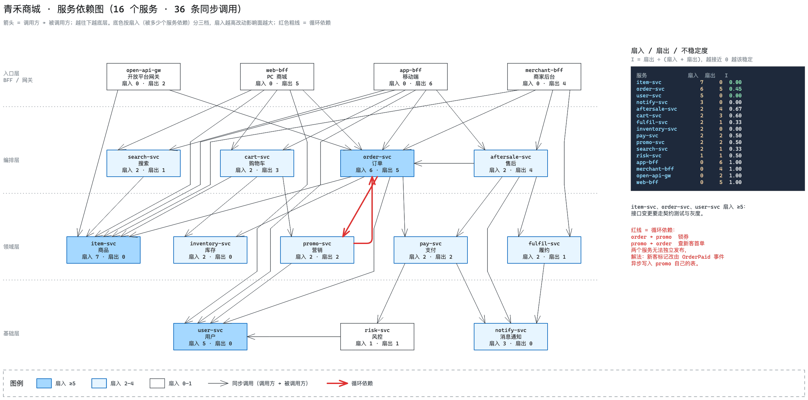

**画法：** 脚本做分层布局（虚拟节点、端口按对端排序）；底色按扇入分三档；循环用红色粗线；右栏扇入 / 扇出 / 不稳定度表。
**瑕疵：** **36 处连线交叉**，手工调整最好只降到 33——这类图该交给 Graphviz（见第 12 节）。
画布 2420×1200

### 12 单体拆分演进（绞杀者模式三阶段）

图 12 说的是：网关作为绞杀者门面，先把订单、支付按路径切到新服务（支付先灰度 30%），再迁出其余模块，最后单体和共享库一起下线。

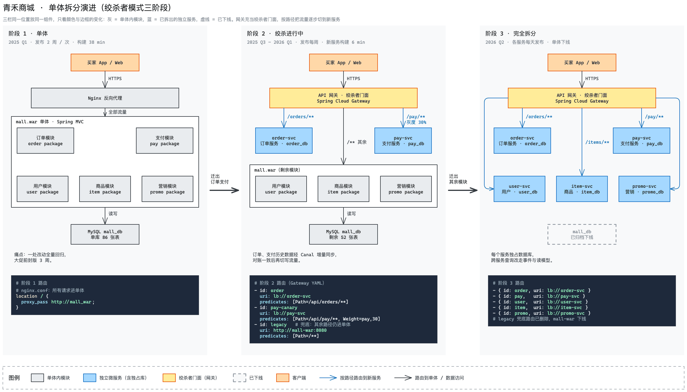

**画法：** 三栏里组件位置固定，只变颜色与边框（灰 = 单体内、蓝 = 已拆出、虚线 = 已下线）；单体边界逐栏缩小；每栏下放当期路由配置。
画布 2420×1380

---

## 3 流程与行为

### 13 下单扣减库存流程图（ISO 5807 流程图）

图 13 说的是：下单要过三道关——风控、最多重试 3 次的 Lua 原子预扣、本地事务写单；任一关失败都从右侧红色出口返回 403、409 或 503。

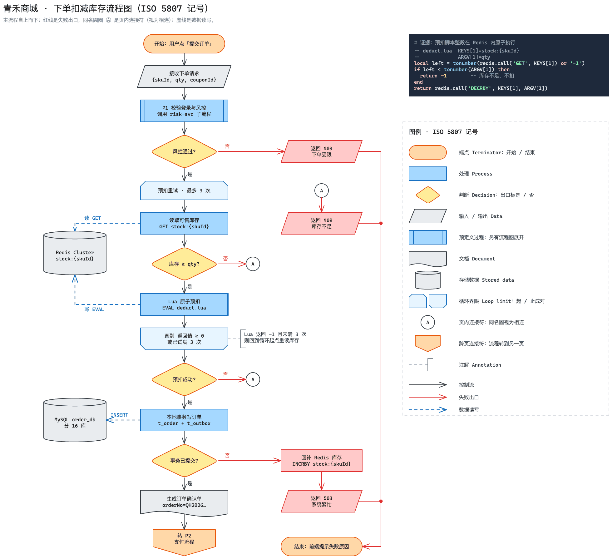

**画法：** 端点、数据 I/O、预定义过程、文档、存储、循环界限、连接符都用多边形拼出；失败出口并到一条红色汇流线；图例列全 11 种记号。
画布 1960×1790

### x2 售后退款泳道流程图（跨角色泳道图）

图 x2 说的是：买家、商家、平台客服、支付渠道四方怎样接力处理一笔售后退款，商家审核与退款类型判断在哪里分叉。

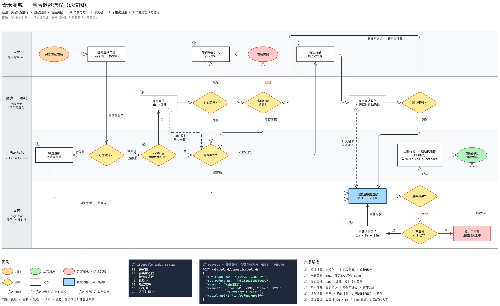

**画法：** 横向泳道 + 判断菱形；跨道箭头直角折线、零交叉。来自风格评测。
画布 2680×1638

### 14 订单履约活动图（UML 2.5 活动图）

图 14 说的是：四条泳道里，支付成功后拆单、拣货；整单缺货就取消退款，有货则复核打包与预约揽收并行；签收后主动确认与 7 天超时确认二选一，汇合后结算给商家。

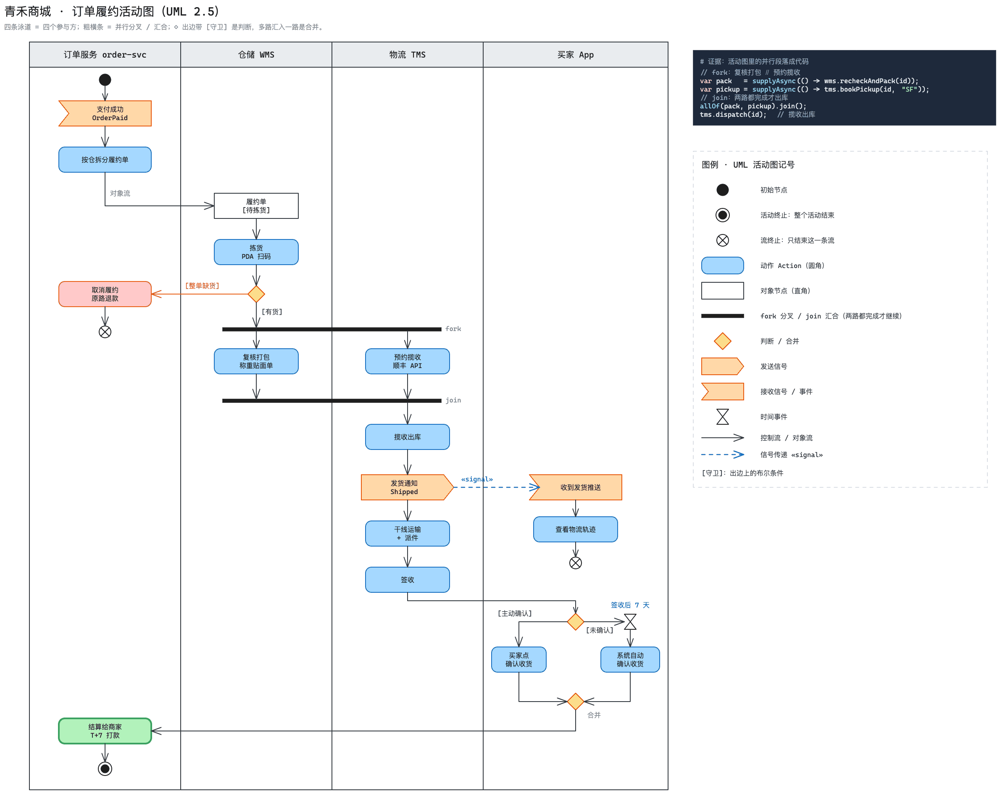

**画法：** fork/join 粗横条；发送 / 接收信号用凸 / 凹五边形；沙漏表示时间事件；«signal» 虚线；附 Java `allOf`。
**瑕疵：** 订单服务泳道中段留白；Cascadia 字体把代码里的 `->` 连写成 →。
画布 2380×1890

### 15 订单状态机图（UML 2.5 状态机图）

图 15 说的是：订单从待支付进入复合状态「已支付」（内含待发货、已发货、已签收），取消或 30 分钟超时进入已取消，售后撤销时经浅历史 H 回到原子状态。

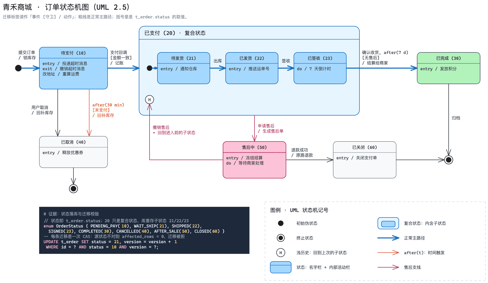

**画法：** 复合状态套子状态；浅历史 H；状态分名字栏与 entry / exit / do 栏；`after(t)` 用橙色；附枚举与 CAS 更新 SQL。
**瑕疵：** 为零交叉省略了「已完成 → 售后中」这条迁移。
画布 1860×1080

### 16 交易系统用例图（UML 2.5 用例图）

图 16 说的是：系统边界内买家侧、扩展与包含、商家与外部系统侧三列用例，示范关联、«include»、«extend»、用例泛化、参与者泛化五种关系。

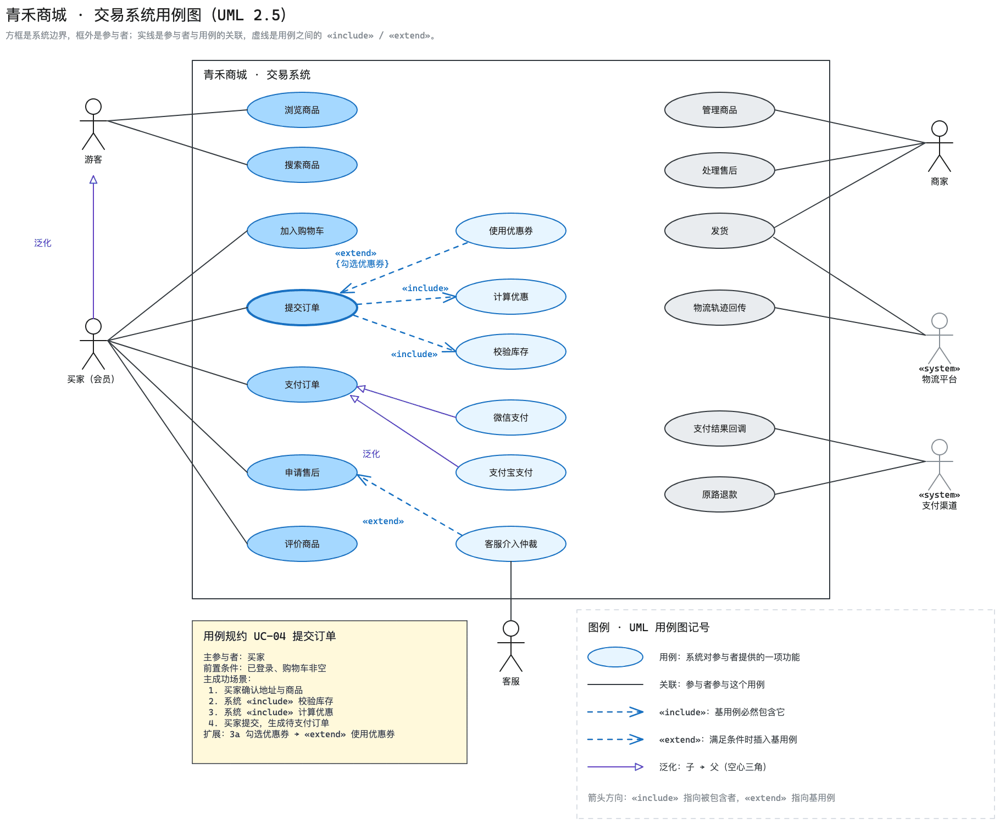

**画法：** 参与者小人用线条拼；外部系统灰色标 «system»；泛化用紫色空心三角；黄色卡片是 UC-04 用例规约。
画布 1820×1500

### 17 退款风控审核决策树（CART 决策树）

图 17 说的是：12,480 笔退款申请依次按金额、账号年龄、设备指纹、退款率、会员等级、类目切分，71.5% 落在「小额 + 老账号 → 自动通过」这片叶子。

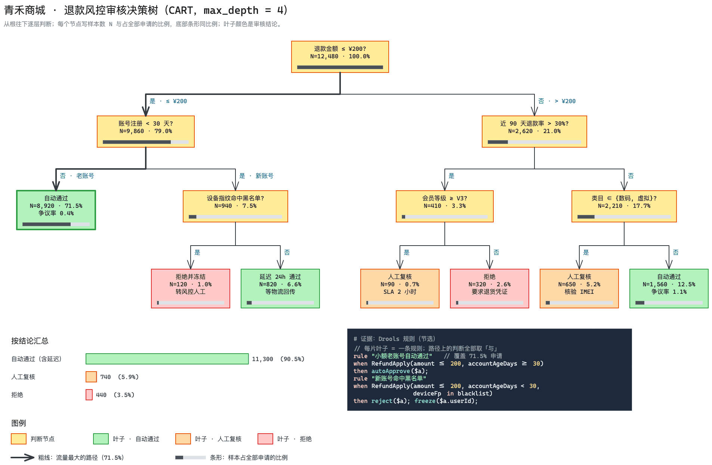

**画法：** 节点写样本数与占比，底部配同比例条；叶子按结论配绿 / 橙 / 红；粗线标流量最大的路径；附 Drools 规则。
画布 1905×1244

### 18 免密代扣下单支付协作图（BPMN 2.0 协作图）

图 18 说的是：买家、青禾商城、支付渠道三个池由四条消息流串起来；青禾池内部用事件网关等回调或超时、XOR 网关验签、AND 网关并行发货与发积分。

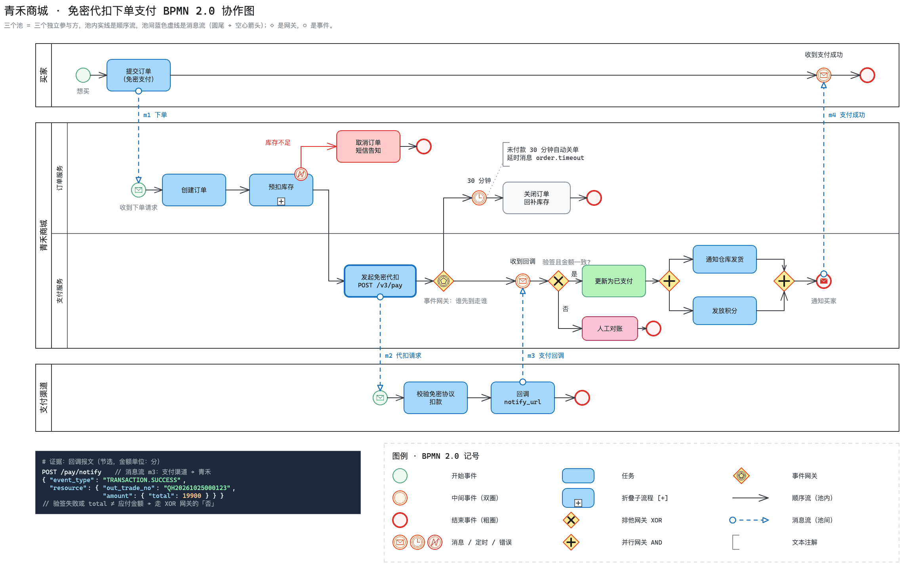

**画法：** 三种网关与开始 / 中间 / 结束事件全部手拼；池名竖排旋转 90°；消息流画成圆尾虚线；折叠子流程挂错误边界事件。
**瑕疵：** 小尺寸下错误事件的闪电看起来像字母 N。
画布 2280×1430

---

## 4 工程实践

### 19 order-svc 的 CI/CD 流水线（流水线图）

图 19 说的是：一次 push 从 lint 到生产金丝雀要走哪些阶段、哪些 job 并行、镜像怎样只构建一次一路晋级，以及最慢的一环其实是等人审批。

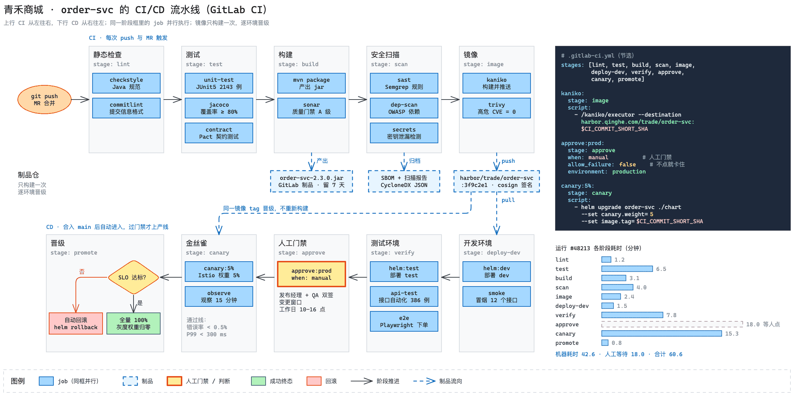

**画法：** 上排 CI 左→右、下排 CD 右→左，中间夹产物道；人工门禁粗框；附 `.gitlab-ci.yml` 与各阶段耗时（机器 42.6 分钟 / 等人 18.0 分钟）。
画布 2230×1114

### 20 交易仓的 Git 分支图（git flow）

图 20 说的是：v2.3.0 怎样从 develop 切 release、合进 main 打 tag，v2.3.1 热修复为什么必须同时合回 main 和 develop。

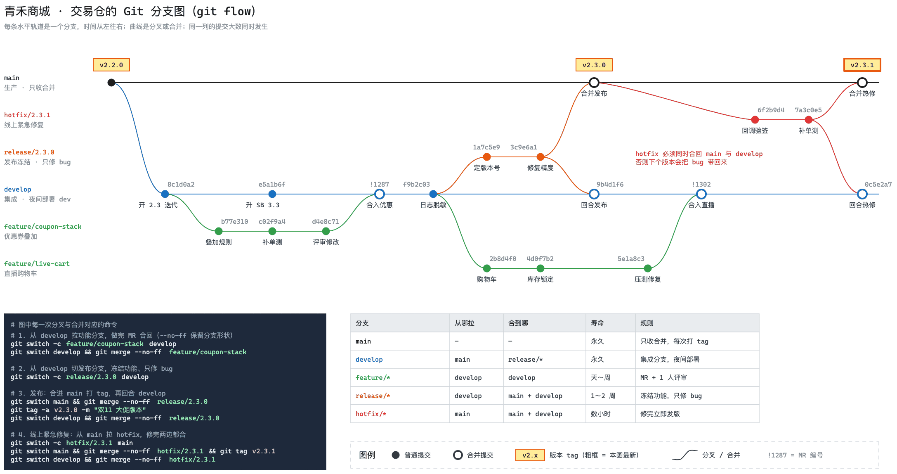

**画法：** 6 条轨道 20 个提交，合并提交画空心粗环；分叉线是脚本采样的贝塞尔折线（自带曲线会打圈）；附 git 命令与分支规则表。
画布 2174×1148

### 21 三种发布策略对比（并列时序对比）

图 21 说的是：同一次 v1→v2 升级，滚动、蓝绿、金丝雀在 T0–T4 各时刻的 Pod 构成与流量分配，以及回滚速度、资源开销、风险上的取舍。

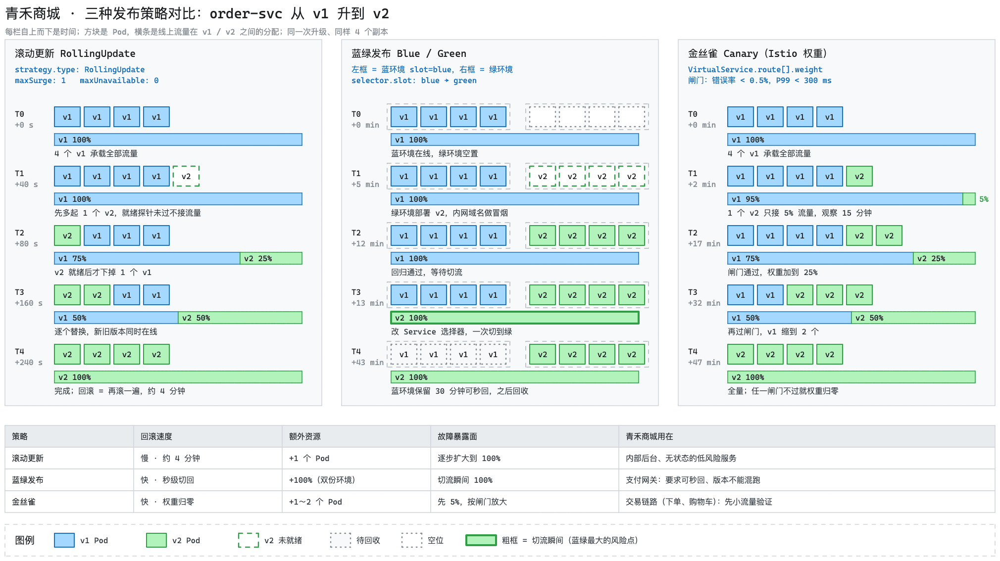

**画法：** 三栏共用时间行；Pod 方块五种形态；流量条宽度与比例对应；底部对比表写青禾各业务实际用哪种。
画布 2020×1134

### 22 下单请求的链路追踪瀑布图（span 瀑布图）

图 22 说的是：一次 842 ms 的下单请求里，一条 `INSERT t_order_23` 吃掉 498 ms（59%），其中 486 ms 在等行锁。

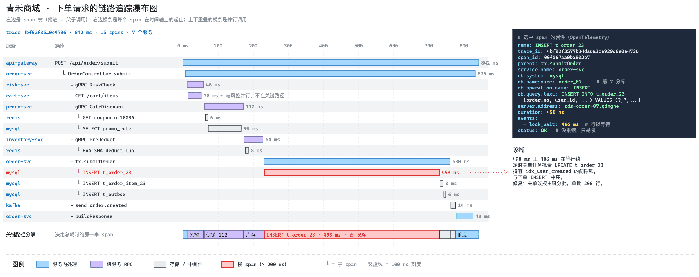

**画法：** 左缩进 span 树、右按毫秒对齐的横条；慢 span 红色粗框；底部关键路径分解条；附 OTel 属性与修复办法。
画布 2290×910

### 23 order-svc 的 CPU 火焰图（火焰图）

图 23 说的是：30 秒 CPU 采样里，把整单序列化进日志的 `JSON.toJSONString` 这座塔占了 26%。

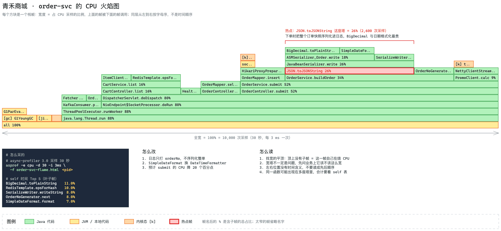

**画法：** 递归树自动排版，每 1% 占 22px；Java / JVM / 内核 / 热点四色；附 async-profiler 命令与 self 时间 Top 5。
**瑕疵：** 窄帧名截断成 `..`，2% 的帧不显示名字。
画布 2220×1024

### 24 双 11 支付回调超时复盘时间线（泳道时间线）

图 24 说的是：20:03 影响开始到 20:58 完全恢复，四个角色按分钟做了什么，MTTD 4 分钟、MTTR 55 分钟分别耗在哪里。

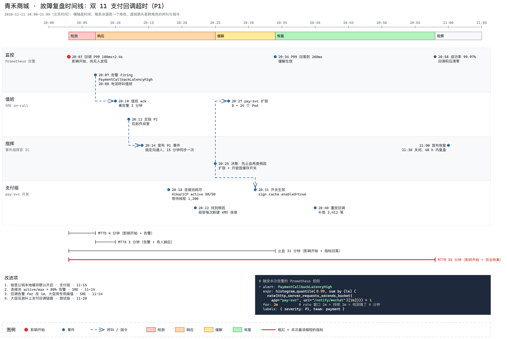

**画法：** 每分钟 30px；五段阶段条；跨角色呼叫画蓝虚线；MTTD / MTTA / 止血 / MTTR 四个括号；附 Prometheus 规则。
画布 2284×1530

---

## 5 数据与结构

### 25 促销引擎类图（UML 类图）

图 25 说的是：引擎先过规则链（库存 / 互斥 / 叠加上限）拦掉不可用优惠，再让各策略各算一遍取最优——策略模式加责任链。

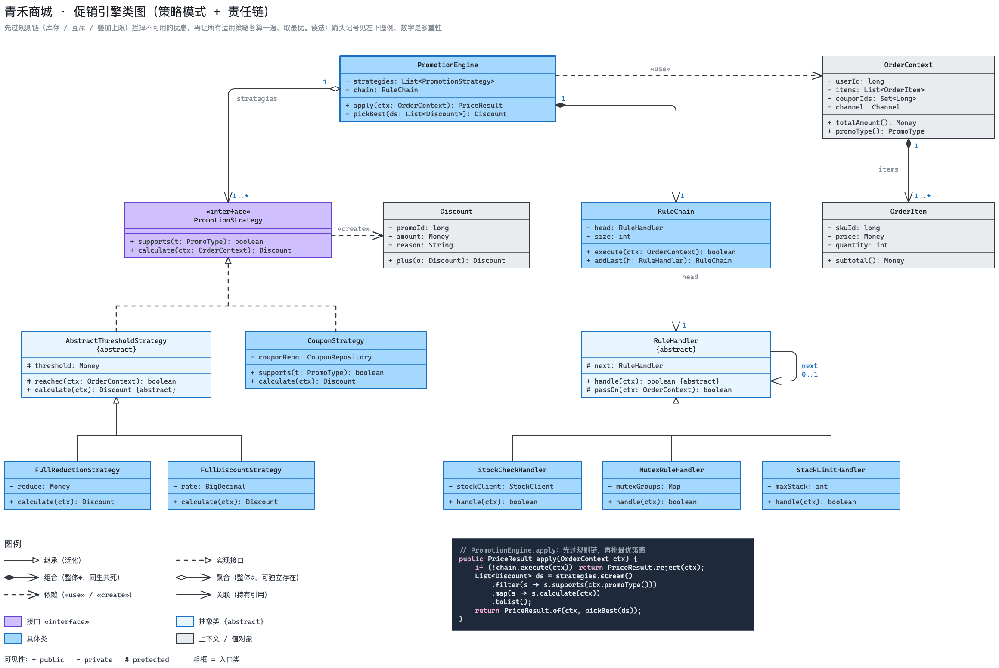

**画法：** 三栏类框带 «interface»、{abstract} 与可见性；继承、实现、组合、聚合、依赖五种关系用 Excalidraw 原生箭头头；子类经共享总线汇入空心三角。
**瑕疵：** 原生三角、菱形箭头头偏小，缩略图上难分辨。
画布 2320×1550

### x4 交易核心数据模型（ER 图）

图 x4 说的是：订单、订单明细、支付、售后等核心表的字段与一对多关系。

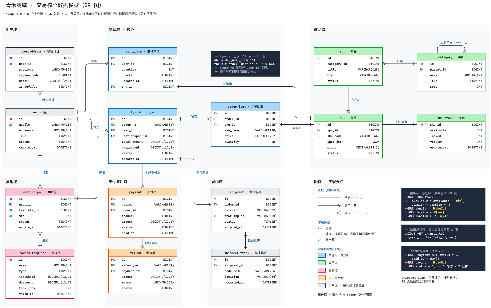

**画法：** 表框列字段与类型，主外键标记；关系线两端用乌鸦脚（crowfoot）箭头头。来自风格评测。
画布 2580×1620

### 26 t_order 主键索引的 B+ 树（数据结构图）

图 26 说的是：非叶子页只存「主键 + 子页号」，叶子页存整行并用双向链表串起来；橙色是 id=10086 等值查询读 3 页的路径。

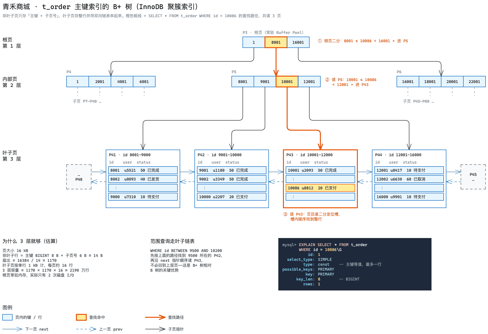

**画法：** 每页一排键格；叶子页带行格；next 实线、prev 虚线；路径标 ①②③；附容量估算与 EXPLAIN。
画布 1980×1360

### 27 Redis 内部结构：dict 渐进式 rehash 与 zset 跳表（内存结构图）

图 27 说的是：上半是 dict 从 4 桶扩到 8 桶、搬到一半时新旧两张表并存；下半是热销榜跳表，ZRANK 靠累加 span 算排名。

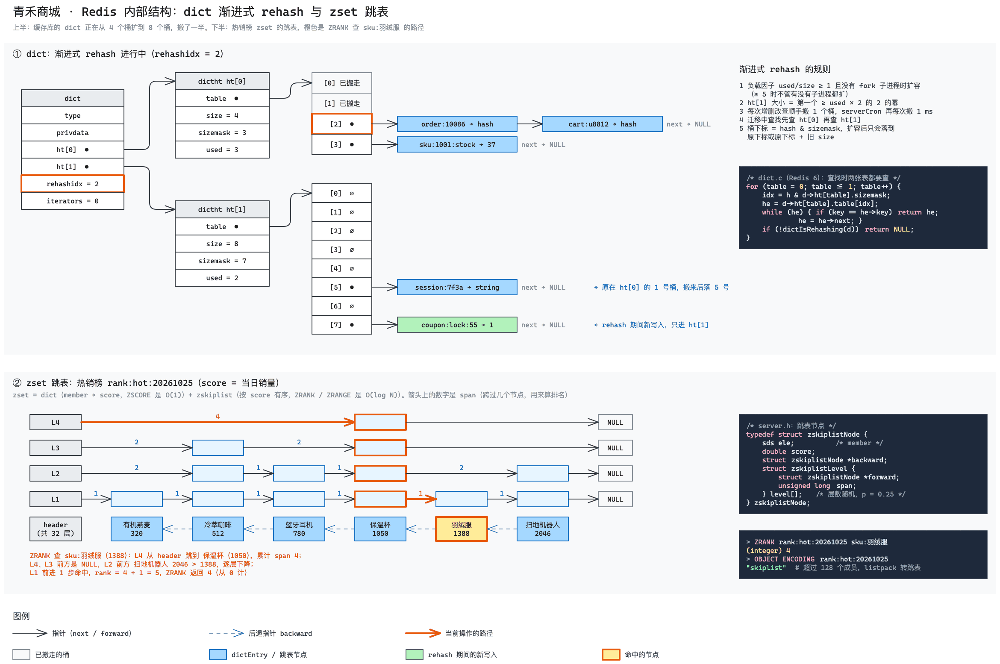

**画法：** 结构体画成竖排字段格；已搬走的桶灰掉；跳表逐层画 forward 指针并标 span；附 Redis 源码片段。
画布 2340×1554

### 28 缓存集群一致性哈希环：3 台扩到 4 台（环形示意图）

图 28 说的是：key 顺时针找第一个虚拟节点；新增 redis-d 后，只有被它接管的三段区间里的 key（3/7）换了归属。

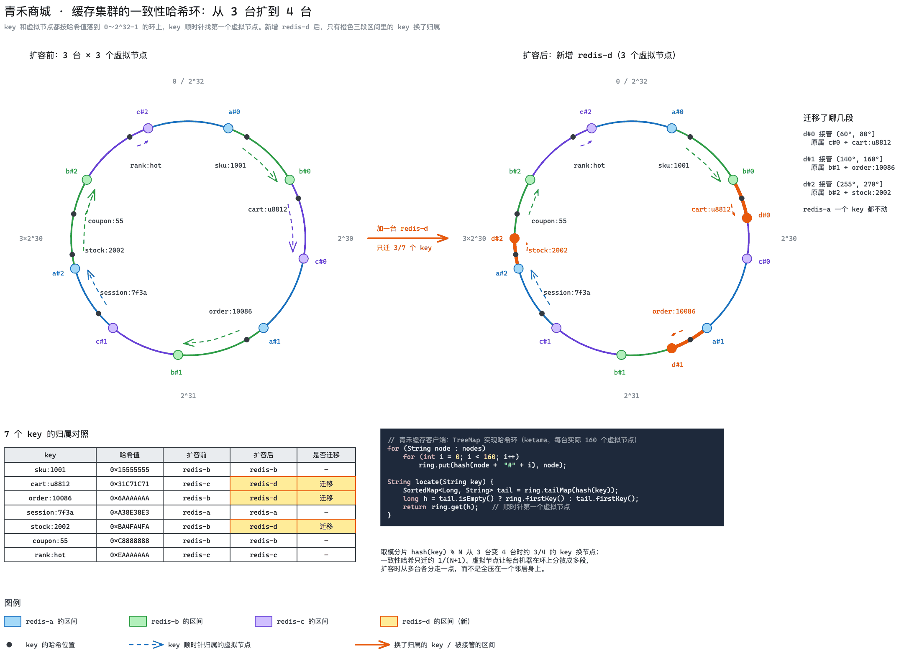

**画法：** 两环并排；环由按所属节点着色的折线弧拼成；被接管区间用橙色粗线；附归属对照表与 ketama 代码。
**瑕疵：** 短弧上的曲线箭头几乎看不出箭头头。
画布 2161×1562

### 29 风控特征库 RocksDB 的 LSM-Tree（存储结构图）

图 29 说的是：写入先追加 WAL、再写跳表，写满冻结后刷成 L0，后台逐层合并；读取从新到旧逐层找，Bloom Filter 跳过不含该 key 的文件。

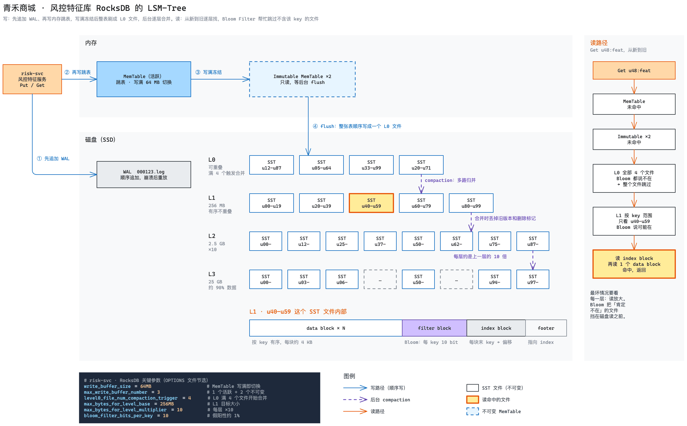

**画法：** 内存 / 磁盘分区；L0 文件 key 范围互相重叠、L1 起不重叠；写路径蓝色编号、compaction 紫虚线、读路径橙色；附 OPTIONS。
画布 2340×1452

### 30 数仓分层与「支付 GMV」表级血缘（数据血缘图）

图 30 说的是：一个指标从业务库到报表经过的全部表，分 Flink 实时与 Spark 离线两条链路。

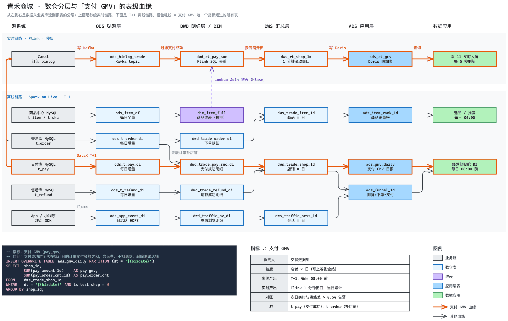

**画法：** 列是分层（源 / ODS / DWD·DIM / DWS / ADS / 应用），泳道是链路；维表 Lookup 紫虚线；附 GMV 口径 SQL。
画布 2170×1372

---

## 6 协议与分布式

### x3 下单支付时序图（UML 时序图）

图 x3 说的是：从买家下单到支付回调落账，App、网关、订单、支付、渠道各方的消息先后，以及回调验签用的消息签名。

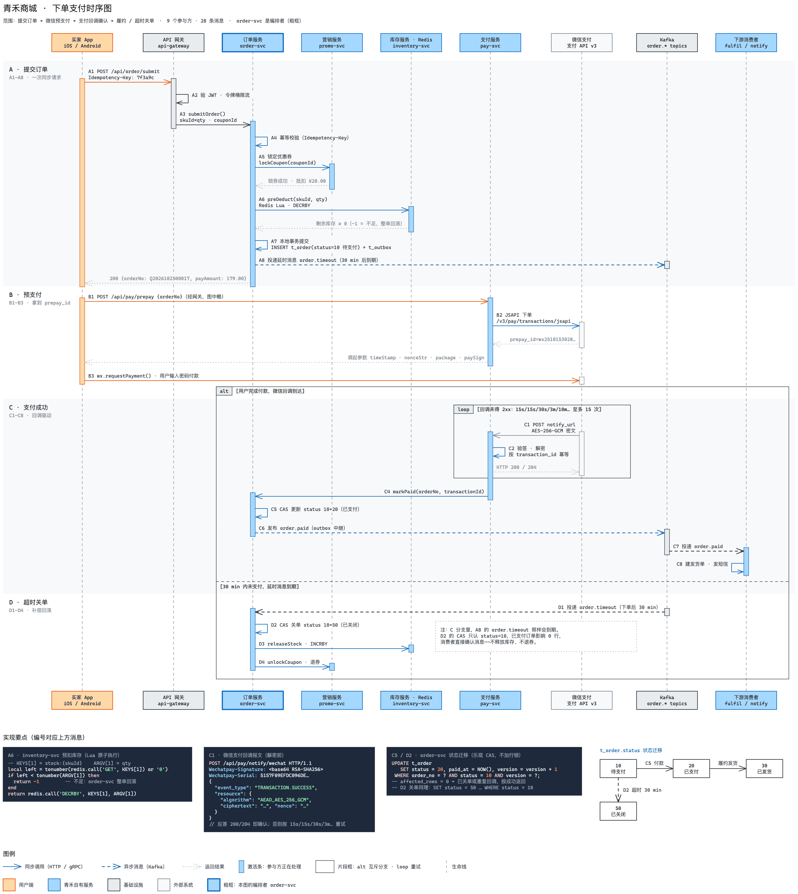

**画法：** 生命线 + 激活条 + alt / opt 片段；证据块放签名代码。来自风格评测。
画布 2620×2936

### 31 TCP 连接的建立与释放（报文梯形图）

图 31 说的是：客户端与服务端用 SYN / ACK / FIN 和真实 seq/ack 值完成三次握手、数据传输、四次挥手，每一刻双方处在哪个 TCP 状态，2MSL 等多久。

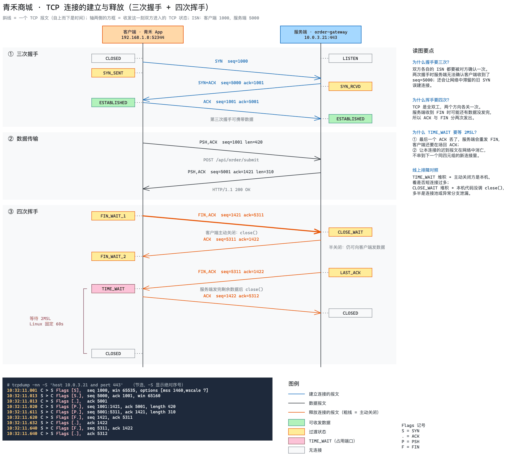

**画法：** 斜向下的箭头表示传输时延；状态框用虚线引线贴在竖轴上；阶段用底带；附 `tcpdump -S` 证据。和 36 号图是同一个 SYN 包（seq=1000）。
画布 1903×1690

### 36 一个 SYN 报文的逐位解剖（RFC 风格位图）

图 36 说的是：IPv4 头和 TCP 头（含 12 字节选项）每个字段占哪几位、在这个 SYN 包里取什么值，并能和 `tcpdump -X` 的十六进制逐段对上。

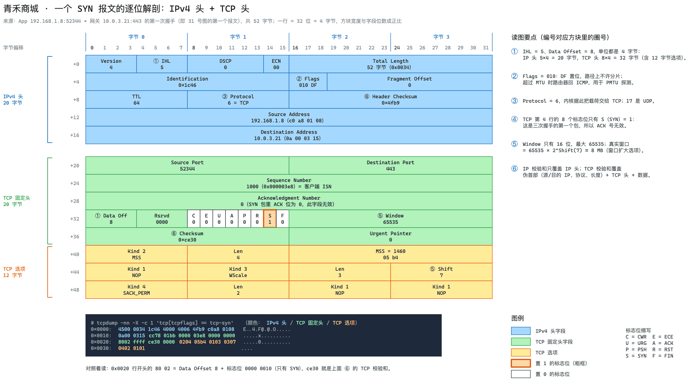

**画法：** 每位 40px、一行 32 位；8 个标志位各占一格，SYN 粗框；IP 与 TCP 校验和（0x4fb9、0xce30）是按 RFC 用脚本实算的。
**瑕疵：** 十六进制证据块右侧约 200px 空白。
画布 2204×1202

### 32 OAuth 2.0 授权码 + PKCE 登录时序（UML 时序图）

图 32 说的是：公开客户端靠 code_verifier / code_challenge 证明「换令牌的人 = 发起授权的人」，以及 code 被恶意 App 截获时为什么换不到令牌。

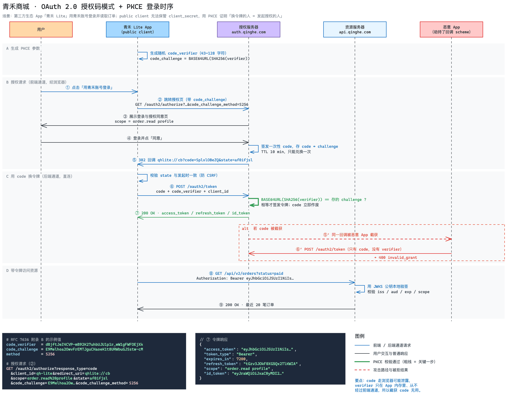

**画法：** 5 条生命线；alt 片段虚线框；**每个标签下垫一块同底色矩形挡住穿过的生命线**（Excalidraw 文字没有背景色）；证据是 RFC 7636 附录 B 的示例值。
画布 2100×1636

### 33 TLS 1.3 握手：1-RTT 与 0-RTT（双栏时序图 + 密钥派生）

图 33 说的是：每条握手消息用哪一级密钥加密（明文 / 早期 / 握手 / 应用四色），0-RTT 怎样让首包就带业务数据，以及为什么 0-RTT 只能放行幂等请求。

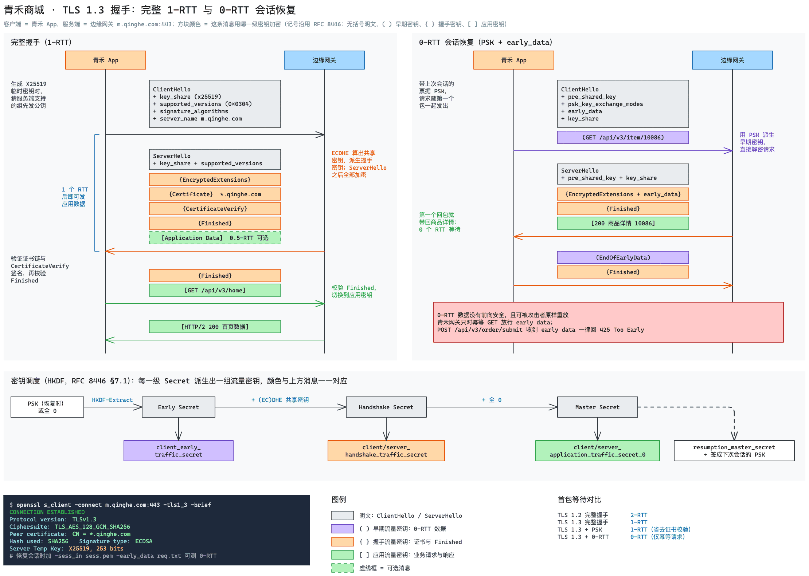

**画法：** 每个 flight 的消息堆成彩色方块，括号记号沿用 RFC 8446；底部 HKDF 密钥调度图把颜色和密钥一一对应；附 `openssl s_client`。
画布 2220×1582

### 34 Raft 共识：角色、任期、日志提交（状态机 + 时间线 + 矩阵）

图 34 说的是：节点按什么条件在 Follower / Candidate / Leader 间切换，term 怎样随选举推进（含分裂投票），一条日志复制到多数派才算提交、冲突条目怎样被覆盖。

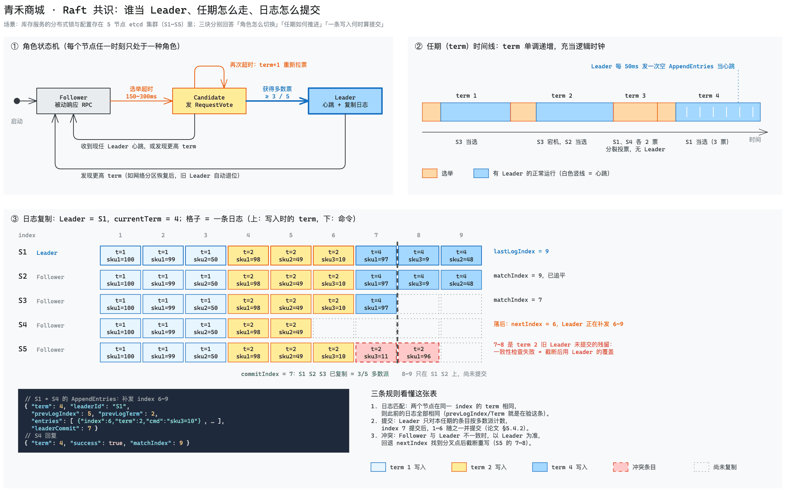

**画法：** 状态机回边全走直角折线；时间线用色块区分选举与正常运行；日志矩阵每格写「term + 命令」，commitIndex 粗虚线贯穿。
画布 2140×1340

### 35 下单 Saga：编排式 vs 协同式（并列对比架构图）

图 35 说的是：同一笔支付失败的订单，编排式由编排器逆序下发补偿，协同式靠服务间的 Kafka 事件接力补偿，两种方式各适合什么场景。

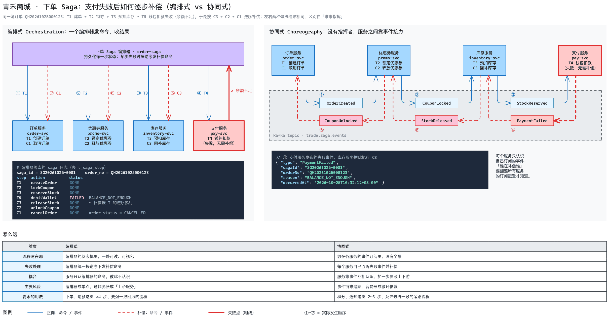

**画法：** 正向蓝实线、补偿红虚线；每个服务底边固定四个出入点保证零交叉；①～⑦ 标实际顺序；附 saga 日志表与事件 JSON。
**瑕疵：** 画布宽 2420，超出 2400 上限 20px。
画布 2420×1265

---

## 7 规划与项目

### 37 双 11 大促备战甘特图（甘特图）

图 37 说的是：8 周、20 项任务加 4 个里程碑分四组推进，关键路径共 58 天，今天是 10-12。

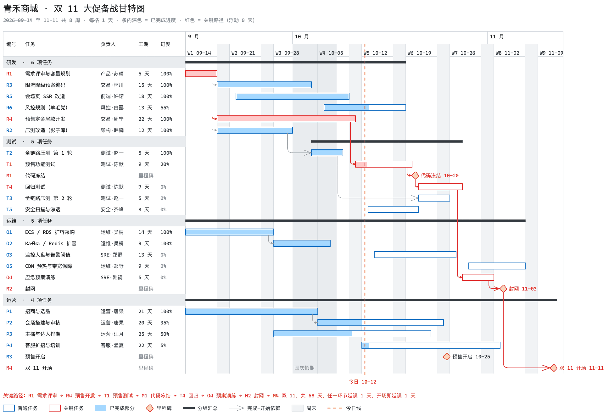

**画法：** 左任务表、右日格（每天 20px），周末与假期加底纹；条内浅色块表示进度；依赖箭头直角下行、零交叉；今日线橙虚线。
**瑕疵：** 「双 11 开场」标签伸出右边界约 120px。
画布 1936×1320

### 38 2026–2027 产品路线图（Now / Next / Later 路线图）

图 38 说的是：交易、会员、供应链、平台四条主题线，从「承诺交付」到「方向探索」各有 1–2 张卡，积分商城要等前置仓库存同步先上线。

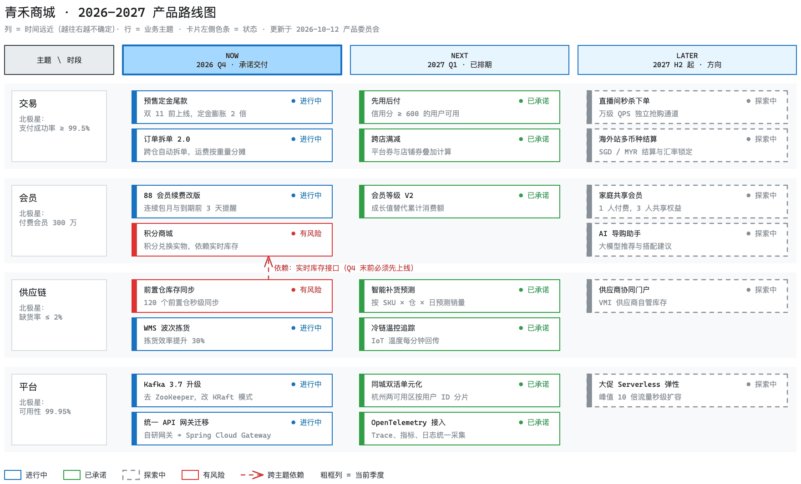

**画法：** 当前季度列加粗框；每行左侧写主题与北极星指标；卡片左色条表示状态，「探索中」用虚线框；一条跨泳道的红色依赖箭头。
画布 1760×1066

### 39 发展里程碑 2019–2026（里程碑时间线）

图 39 说的是：14 个里程碑按业务、技术、融资三色上下交错挂在年份轴上，底部柱子是 GMV 从 0.8 亿涨到 420 亿（2026 为预计）。

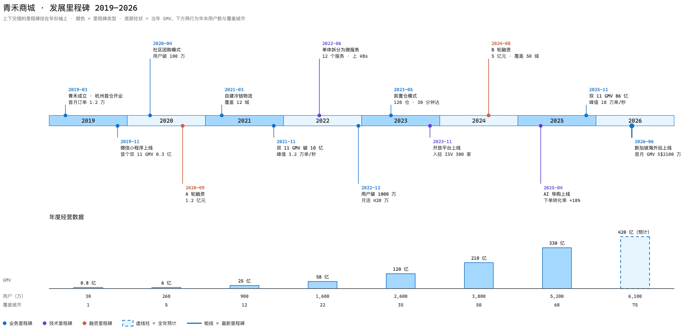

**画法：** 年份轴用深浅交替色块；标签上下各两层循环；底部手绘柱状图加两行数据表，预计值用虚线柱。
**瑕疵：** 最后一个标签伸出轴右端约 30px。
画布 2371×1140

### 40 交易研发组看板·第 42 周（看板）

图 40 说的是：「开发中」5 张卡超出 WIP 上限 4，列头标红；两张卡被外部依赖阻塞；加急泳道里有一个 P0 插队。

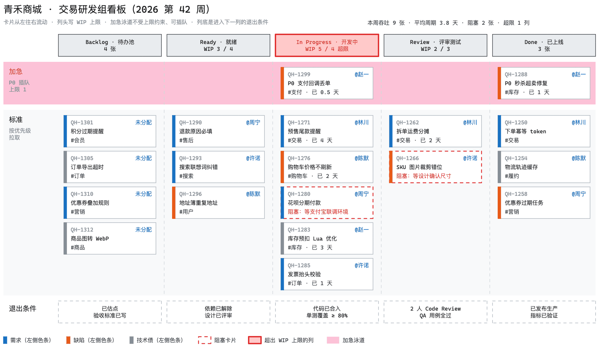

**画法：** 两条泳道；卡片三行（编号与负责人、标题、标签与已耗天数），左色条区分需求 / 缺陷 / 技术债；阻塞卡红虚线框；列底写退出条件。
**瑕疵：** 加急泳道的粉色偏抢眼。
画布 1744×1010

### 41 「30 分钟买菜」用户故事地图（故事地图）

图 41 说的是：5 个骨干活动拆成 10 个用户任务，每个任务下按 MVP、R2、R3 三个切片排故事卡，MVP 那一层连起来就是最小可走通的骨架。

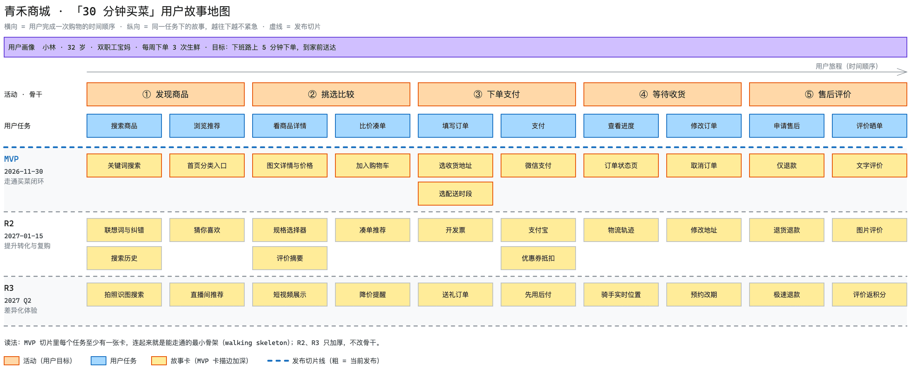

**画法：** 顶部用户画像与时间箭头；活动橙、任务蓝、故事黄；虚线切片线，MVP 最粗；左栏写发布名、日期与目标。
**瑕疵：** 画像横条的紫色偏重。
画布 2200×892

### 42 新加坡海外站上线关键路径网络图（PERT / CPM）

图 42 说的是：10 个活动正推、逆推算出总工期 30 天，A→B→C→H→I→J 浮动为 0，D、E、F、G 各有 5～7 天余量。

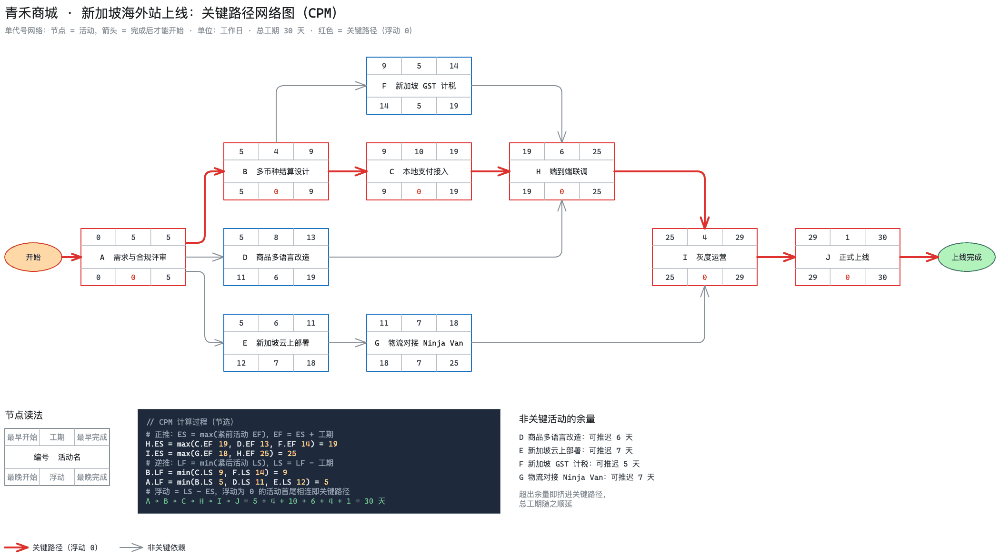

**画法：** 节点是标准 3×3 CPM 格（ES / 工期 / EF，LS / 浮动 / LF），数值由脚本里的 `cpm()` 算出；关键路径红色粗线；附计算过程。
画布 2100×1170

---

## 8 分析与思考

### 43 2027 增长策略思维导图（思维导图）

图 43 说的是：「2027 增长策略」放射出 6 大方向、18 项举措、36 个关键动作与指标，一个方向一种颜色贯穿整棵子树。

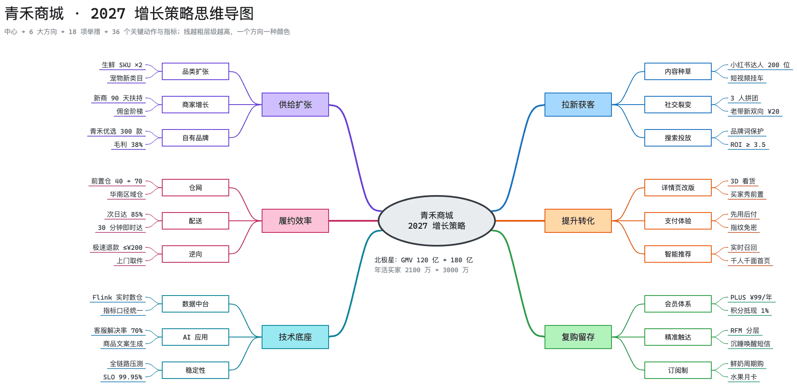

**画法：** S 形曲线连接，线宽按层级 4 → 2 → 1 递减；叶子是不加框的文字加同色下划线；左右镜像；北极星指标挂中心下方。
**瑕疵：** 用了 6 种分类色（超出 ≤4 的规范，见附录 B）。
画布 1916×930

### 44 支付成功率下降根因分析（鱼骨图）

图 44 说的是：支付成功率从 99.2% 降到 97.8%，六根大骨下各挂 4 个候选原因；红色粗线是已回滚验证的根因「SDK 3.8 验签超时」，灰字是已排除项。

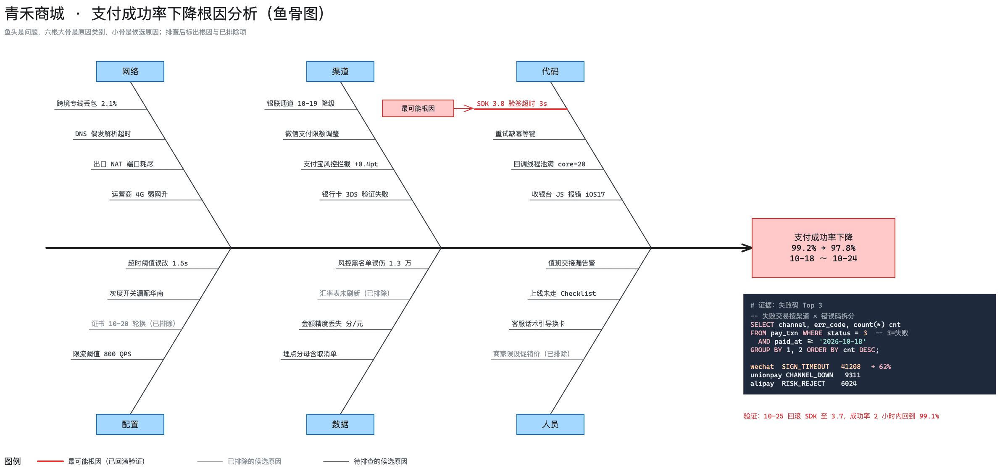

**画法：** 粗鱼脊指向鱼头；小骨的 x 按大骨在该高度的位置算；三种线型区分状态；附失败码 Top 3 的 SQL。
画布 2380×1121

### 45 2027 Q1 需求优先级矩阵（2×2 矩阵 + 气泡）

图 45 说的是：16 个需求按「实现成本 × 用户价值」落进速赢 / 战略投入 / 填空 / 放弃四个象限，气泡大小是影响用户数，右侧是 RICE 评分与排期。

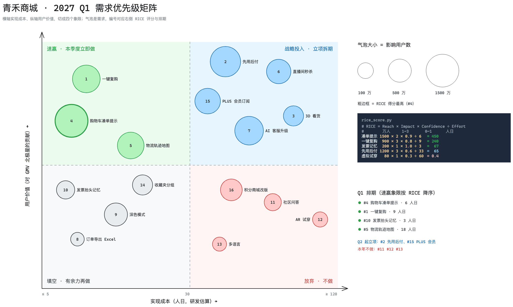

**画法：** 四象限浅底；气泡直径按用户数开方；纵轴标题旋转 -90°；RICE 最高的 #4 粗框作唯一强调。
画布 2080×1245

### 46 2027 战略 SWOT 与 TOWS 分析（SWOT 矩阵）

图 46 说的是：上半四格 SWOT 每条带编号；下半把 S/W 与 O/T 两两交叉得出四类策略，每条注明组合了哪两项，粗框 SO 是第一优先级。


**画法：** 四格各一种语义色；字母放圆形徽章；行标题旋转；用编号（S1、O1）把上下两半连起来。
**瑕疵：** 等宽字体里「O1」的 O 与 0 不好分辨。
画布 1900×1316

### 47 增长飞轮与履约天花板（因果回路图）

图 47 说的是：增强回路 R1（买家 → 商家 → 品类 → 买家）越转越大，调节回路 B1 经履约压力、配送时效把增速压回履约能力；橙色是可干预的杠杆点。


**画法：** 变量不加框；回路箭头沿圆周取点画曲线；延迟符号 `||` 是两根短线；回路中心用环形箭头表示旋向。
画布 1710×1065

### 48 即时零售 Wardley 地图（Wardley 地图）

图 48 说的是：「30 分钟收到新鲜菜」依赖的 14 个组件按可见度（纵轴）和演化阶段（横轴）落位，标出三个演化移动与前置仓的惯性。


**画法：** 锚点实心、组件空心；依赖是斜直线（Wardley 惯例）；演化移动红虚线箭头；惯性是粗竖线；右侧五条策略注记。
画布 2170×1153

---

## 9 产品与业务

### 49 新客首单用户旅程地图（旅程地图）

图 49 说的是：新客从刷到直播到退款的 5 个阶段里，在哪两处跌到谷底（比不出规格、收货压坏），又在退款处到达峰值，每个痛点对应一个机会点。


**画法：** 阶段头是箭头色带；6 行 × 5 列；情绪曲线穿过 10 个打分点，峰值与谷底单独着色（峰终定律）。
画布 2200×1060

### 50 2026 年 9 月全站转化漏斗（漏斗图）

图 50 说的是：5 层漏斗里只有详情→加购这一层下降（30.0%，▼4.5pp），其余三层的小幅上升都能对上已上线的改动。


**画法：** 梯形宽度按人数取对数；右侧表格与层对齐并带迷你对比条；粗红框标最大缺口；附 ClickHouse `windowFunnel` SQL。
画布 1943×1046

### 51 交易域测试金字塔（测试金字塔 + 反模式）

图 51 说的是：5 层测试按用例数自下而上收窄，各层耗时、成本、触发时机、工具列在右表；下半是 2023 年的冰淇淋筒反模式与改造前后对比。


**画法：** 层宽按 log(用例数) 的堆叠梯形；冰淇淋筒用椭圆加倒梯形；附 `.gitlab-ci.yml` 节选。
画布 2160×1181

### 52 三类核心人群重叠（三集合韦恩图）

图 52 说的是：付费会员、近 30 天活跃、高客单三群重叠出 7 个区域并各标人数，右侧写每个集合的圈法和其中 4 个区域的运营动作。


**画法：** **不用透明叠色**——7 个区域各自由圆弧求交拼成闭合多边形后实心填充；标签放在离三条圆周最远的点；附 bitmap 求交 SQL。
**瑕疵：** 圆面积不按人数等比（副标题已注明）。
画布 2020×995

### 53 商业模式画布 2026 版（商业模式画布）

图 53 说的是：按 Osterwalder 九格，左半资源与成本、右半客户与收入、中间价值主张；黄色便利贴是现状、绿色是 2027 规划、粉色是待验证假设。


**画法：** 九格拼成，价值主张粗框；便利贴两列自动排布；成本、收入两格用堆叠条表达占比。
画布 2140×1010

### 54 事件风暴：从下单到发货（事件风暴）

图 54 说的是：下单→支付→仓内作业→发货四段的命令、聚合、外部系统、事件、策略链，外加一条「未支付」异常分支；斜放的红签是 5 个未决热点。


**画法：** 按 Brandolini 配色，每行一条「命令→聚合→事件→策略」链；热点签旋转；异常分支虚线框；附 `OrderPaid` 事件代码。
**瑕疵：** 8 种便利贴颜色（事件风暴记号本身规定，见附录 B）；行间不画连线，靠编号接续。
画布 2310×1560

---

## 10 界面与组织

### 55 商品详情页与订单确认页线框图（低保真线框图）

图 55 说的是：移动端详情页与 PC 确认页两屏的布局，以及 12 处交互规则（编号对应右侧说明）。


**画法：** 全灰阶；图片位是带对角叉的矩形，文案位是灰细条；单选框是圆加圆点；橙色编号圆是唯一强调色。
画布 2160×988

### 56 小程序从首页到支付结果的页面流（页面流）

图 56 说的是：11 屏缩略线框之间的跳转，蓝色实线是下单最短路线，灰色虚线是登录、库存不足、支付失败等分支。


**画法：** 每屏一个迷你线框加小程序路由；三行蛇形排布；绕行箭头走顶部和右侧外圈，零交叉。
画布 2140×1498

### 57 结算页 React 组件树与数据流（组件树 + 数据流）

图 57 说的是：14 个组件的父子关系与 props / state，其中 4 个组件调 hooks，经 TanStack Query / Zustand 打到 BFF 接口；草稿一变就自动重新试算。


**画法：** 缩进树（主干线加短横线）；hooks → 状态层 → 接口 → BFF 四列，箭头全部水平；附 `useQuote` 代码。
**瑕疵：** BFF 框下半部留白偏多。
画布 2300×1414

### 58 青禾技术中心组织架构图（组织架构图）

图 58 说的是：中心 → 5 个部门 → 18 个组 → 4 个小队的直线汇报关系，外加两条虚线汇报；各层人数逐层核对相等。


**画法：** 第 1→2 层总线下挂，第 3、4 层竖排挂左侧主干；幕僚框（PMO）挂 CTO 侧边；为让虚线汇报不交叉调整了部门顺序。
画布 1792×936

### 59 商品领域概念图（Novak 命题式概念图）

图 59 说的是：16 个概念、17 个命题由一般到具体分层；两条橙色虚线是跨分支连接，灰色虚框是具体实例。


**画法：** 直线箭头（Novak 惯例，不用直角折线），连接词写在线旁；右侧命题清单把每条线连读成一句话。
画布 2210×1124

---

## 11 数据图表

这一节证明「能画」，不是推荐用 Excalidraw 画图表：每个坐标都由脚本按数据算出，数据一变就要重跑脚本，而且没有悬停、缩放等交互。

### 60 月度 GMV 与支付转化率（柱线组合图，双 Y 轴）

图 60 说的是：GMV 和转化率在 618、双 11 同步冲高，双 11 单月占全年 18.8%。


**画法：** 柱子是矩形，折线是线加圆点；两轴共用虚线网格；双 11 柱橙色强调；读图要点里的数字由数据现算。
**瑕疵：** 右轴刻度是 1.5% 的倍数，不是整数。
画布 2178×910

### 61 流量来源与支付方式（饼图 + 环形图）

图 61 说的是：搜索加推荐占 60% UV；两家钱包合计占 83% 订单、共 1,286 万单。


**画法：** 扇区由 `wedge()` 生成多边形，环形图是带内径的扇区；引线三段折，同侧标签按 y 排开、间距 ≥30px。
画布 1689×822

### 62 10 月流量去向（桑基图）

图 62 说的是：1,000 万 UV 从 5 个来源经 3 类落地页流向 3 种结果，详情页贡献 72% 的下单。


**画法：** 色带是多边形，上下沿按 smoothstep 各采样 29 点；带宽 0.7px / 万 UV；脚本断言落地页流入等于流出。
**瑕疵：** 色带透明度 35–85（不透明会互相遮住，见附录 B）；最细一条只有约 4px。
画布 1860×1180

### 63 用户体验六维雷达（雷达图）

图 63 说的是：青禾物流、售后两项领先，内容种草落后竞品乙 3.3 分。


**画法：** 同心六边形网格；青禾的浅蓝面垫底层、描边另画一层（整体设透明会连描边一起变淡）；竞品用虚线 / 点线；右侧原始分表。
画布 1530×970

### 64 下单时段热力图（7×24 热力图）

图 64 说的是：峰值在周日 21 点（36.2 千单 / 小时），19–24 点贡献全周 37% 的订单。


**画法：** 168 个方格，5 档单色相色阶；只给 ≥30 的格标数值；峰值格橙色粗框；右侧日合计、下方小时合计。
**瑕疵：** 小时合计竖条朝下画，读起来像倒置的柱图。
画布 1692×824

### 65 品类定位气泡图（气泡图，对数 x 轴）

图 65 说的是：20 个品类按客单价 × 复购率分成四个象限，宠物和手机是两个异常点。


**画法：** 气泡半径 = 10·√GMV，先画大的再画小的；x 轴取 log10；象限线是 GMV 加权均值；每个标签方位手工指定。
**瑕疵：** 为避免标签打架，手动调过 4 个品类的虚构数据。
画布 1896×900

---

## 12 Excalidraw 画不好什么

下面每条都是 11 组作图时**实际碰到**的，按影响大小排列。

1. **没有自动布局，也不会避让。**
   - 节点坐标、连线通道、标签位置全靠手算；部署图、网络图的大部分时间花在排线上。
   - 数据一变就要重排：甘特、看板、时间线尤其明显。
   - 密到一定程度就压不住交叉：11 号依赖图 16 个服务、36 条边，**交叉最少只降到 33 处**。
2. **没有专业记号，全靠基础图元手拼。**
   - UML 圆角动作与信号、BPMN 网关与事件、DFD 存储、ISO 流程图记号、K8s / AWS 图标都要自己搭或从社区库取。
   - 拼出来的多边形**不能被箭头绑定**：在 excalidraw.com 里拖动图形，箭头不会跟着走。
   - 小记号一缩小就失真，如 BPMN 错误事件的闪电看起来像字母 N。
3. **没有圆弧、表格、坐标轴。**
   - 环、扇区、韦恩区域都用折线多边形逼近；表格用线和矩形拼，圆角风格下还得单独设成直角。
   - 内置曲线在控制点靠近时会过冲打圈，Git 分支线只能自己采样贝塞尔再画成折线。
4. **文字没有背景色。** 线穿过标签时只能在标签下垫一块同底色矩形（32 号图的做法），或逐条算坐标避开。
5. **箭头头尺寸固定、偏小。** UML 的空心三角、菱形在缩略图上难分辨，短曲线上几乎看不见。
6. **图标质量取决于社区素材库。**
   - AWS 库 `narhari-motivaras` 只有 4 个图标，06 号图改用 `childishgirl/aws-architecture-icons`。
   - 这些库的图标默认是排线填充，要转成实心；K8s 库缺 StatefulSet 图标。
7. **等宽字体的代价（本图库与 mono 风格共有）。**
   - 中文字距偏大，框要比估算的留宽；O 与 0 难分。
   - Cascadia 字体会把代码里的 `->` 连写成 →、`<=` 连写成 ≤（语义不变）。

---

## 13 选型建议

以下是**判断**，依据是第 12 节的局限与本次作图耗时。

| 图的性质 | 建议 | 理由 |
|---|---|---|
| 结构与关系：架构、部署、ER、类图、数据结构、DDD、概念图 | **用 Excalidraw** | 节点数适中，手排出来的版面比自动布局更能讲清重点 |
| 时序与协议：时序图、握手、状态机 | **用 Excalidraw** | 证据块（报文、代码）和图放在一起，教学价值最高 |
| 思考与业务：鱼骨、SWOT、旅程地图、事件风暴、线框图 | **用 Excalidraw** | 本来就是白板类图，手绘风也合适 |
| 密集依赖图（边数 >30） | 换 **Graphviz / D2** | 自动分层与减少交叉是它们的强项 |
| 数据图表 | 换 **ECharts / Vega-Lite** | 数据驱动、可交互，数据变了不用重排 |
| 甘特、路线图这类数据常变的计划图 | 换 **Mermaid gantt** 或项目管理工具 | 改一行数据就重新排版 |
| 要交给流程引擎执行的 BPMN | 换 **bpmn.io** | 产出可执行的 BPMN XML |

---

## 附录 A：图片来源与文件布局

```text
references/gallery/
├── README.md        # 本文件
└── png/
    ├── overview.png  # 全景缩略图
    └── NN-slug.png   # 69 张：01～65，加上 x1～x4
```

- 每张图原本是一份 `.excalidraw` 源文件，由脚本按坐标表生成后渲染；PNG 随插件分发前压成 64 色，体积约为原图的三分之一。
- 源文件与生成脚本不随插件分发：69 份源文件压缩后仍约 6.7 MB；生成脚本依赖图库专用的辅助库，而本 skill 的做法是逐段手写 JSON。
- 用到的图标库：`rohanp__system-design`、`childishgirl__aws-architecture-icons`、`lowess__kubernetes-icons-set`，用 `references/excalidraw_lib.py fetch <库名>` 拉取。

## 附录 B：违反作图规范的图与理由

作图规范（[design-guide.md](../design-guide.md)）要求：语义色 ≤4、透明度一律 100、画布宽 ≤2400、标签不出画布。以下是有意或未修的例外。

| 图 | 违反哪条 | 理由 |
|---|---|---|
| 43 思维导图、61 饼图 | 分类色 6 种 | 分类图表靠颜色区分类别，合并颜色会丢信息 |
| 54 事件风暴 | 便利贴 8 种颜色 | Brandolini 记号本身规定了颜色 |
| 62 桑基、63 雷达、65 气泡 | 透明度 <100 | 不透明会互相遮住；62 号图上有脚注说明 |
| 35 Saga | 画布宽 2420 | 超 20px，未修 |
| 37 甘特、39 里程碑 | 标签伸出右边界 | 分别约 120px、30px，未修 |
| 11 依赖图 | 结构图要求零交叉 | 36 处交叉，Excalidraw 无法自动优化，见第 12 节 |
| 15 状态机 | 省略一条迁移 | 为了零交叉去掉「已完成 → 售后中」 |
