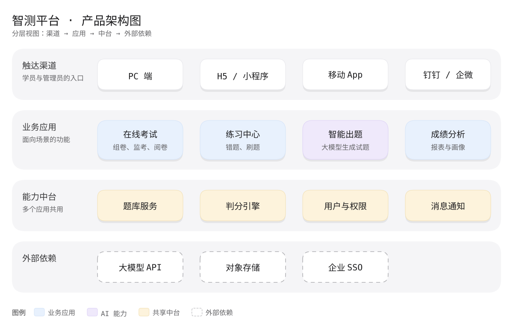

# devkit-svg-diagram — SVG 图解

让 AI 画架构图、流程图、时序图时只写一份简短的 JSON 描述，由脚本按固定主题排版、渲染成 SVG，再转出 PNG。

配色、字体、圆角、阴影**全由主题决定**，除自由坐标外的布局自己算坐标，元素的圆角、阴影、箭头、连线标签照搬 Excalidraw 导出 SVG 的画法。
同一份文档里的十几张图因此风格一致，AI 也不用逐个算坐标，省下的 token 用在「图要讲清什么」上。

图 1 说的是：默认 `mac` 主题下，一份约 40 行的 JSON 描述渲染出的分层架构图——四个灰色分区、按颜色区分角色的卡片、底部图例。




## 什么时候触发

| 说法 | 走哪里 |
|---|---|
| 「画个架构图 / 流程图 / 时序图 / 泳道图 / 甘特图 / ER 图 / 组织架构」「出张图放文档里」「换成手绘 / 深色风格」 | 本插件 `svg-diagram` |
| `devkit-tool:show-me`、`tech-doc`、`new-thing-understand` 判定要出成品图 | 它们默认转调本插件（devkit-tool 6.43.0 起） |
| 「用 Excalidraw 画」「要 .excalidraw 文件」「要能拖拽改的白板图」 | `devkit-excalidraw-diagram` |


## 九种布局

| 要表达 | 布局 | 例子 |
|---|---|---|
| 系统分几层、每层有哪些部件 | 分层（`zones`） | [分层架构图](gallery/layers-mac.svg) |
| 步骤、分支、状态和它们之间的流转 | 网格（`nodes` + `edges`） | [流程图](gallery/flow-mac.svg) |
| 谁按什么顺序调用谁 | 时序（`participants` + `messages`） | [时序图](gallery/sequence-mac.svg) |
| 层级关系：组织架构、模块拆分 | 树（`tree`） | [组织架构树](gallery/tree-mac.svg) |
| 哪个角色做流程里的哪一步：跨团队流程、审批 | 泳道（`lanes` + `steps`） | [审批泳道图](gallery/lanes-mac.svg) |
| 任务、里程碑、依赖随时间排开：排期、发版计划 | 甘特（`tasks`） | [发版甘特图](gallery/tasks-mac.svg) |
| 表、字段与基数关系：数据模型 | ER（`entities` + `relations`） | [数据模型 ER 图](gallery/entities-mac.svg) |
| 按两个维度给事项归类：优先级、投入产出 | 四象限（`matrix`） | [优先级四象限](gallery/matrix-mac.svg) |
| 以上都不合适时的兜底 | 自由坐标（`canvas`，逐个元素给 x / y / 宽高） | [自由坐标图](gallery/canvas-mac.svg) |

自由坐标同样只能按角色取主题配色，描述里写颜色会被检查报出。

字段说明见 [`skills/svg-diagram/references/dsl.md`](skills/svg-diagram/references/dsl.md)，示例描述在 [`skills/svg-diagram/examples/`](skills/svg-diagram/examples/)。


## 七套主题

同一份描述换主题不用改内容，命令行加 `--theme <名字>` 即可。

| 主题 | 样子 | 示例 |
|---|---|---|
| `mac`（默认） | 浅灰分区、淡色卡片、细描边、卡片底边下一道淡灰投影、等宽字体（Cascadia） | [看图](gallery/layers-mac.svg) |
| `brutal` | 新野兽派：饱和色块、粗黑描边、黑色硬投影 | [看图](gallery/layers-brutal.svg) |
| `swiss` | 瑞士 / 包豪斯：蓝黄红黑色块、直角、粗黑分隔线、无阴影 | [看图](gallery/layers-swiss.svg) |
| `isometric` | 伪等轴测：`mac` 配色，卡片右下多一个同色系侧面 | [看图](gallery/layers-isometric.svg) |
| `sketchnote` | 手绘速写笔记：米白纸底，描边、箭头都是手绘抖动线，手写字体（英文 Excalifont、中文小赖，与 Excalidraw 手绘体同款），分区标题带荧光笔底色 | [看图](gallery/layers-sketchnote.svg) |
| `ligne` | 黑白线稿加一种蓝色强调：十个角色靠灰度与线型（粗细、虚线、点线）区分，黑白打印也分得清 | [看图](gallery/lanes-ligne.svg) |
| `dark` | 深色扁平：近黑底、深色调卡片、中间调描边，无渐变、无发光 | [看图](gallery/lanes-dark.svg) |

所有主题的文字与底色对比度都达到 WCAG 4.5:1；`ligne`、`dark` 的描边与连线对画布和分区底色也都在 3:1 以上。
字体随插件内置在 `skills/svg-diagram/assets/fonts/`（约 2 MB，不联网下载）：Cascadia（等宽）、Excalifont（英文手写）、小赖（中文手写，裁到 GB 2312 的 7000 来个常用字）。
`to_png.py` 转图时只把图里用到的字抽出来嵌进 SVG（每张图多 7～35 KB），所以 SVG 发给谁、在哪台电脑上打开都一样。
GB 2312 以外的生僻字落到系统字体（楷体、苹方 / 微软雅黑）。三款字体均为 SIL OFL 1.1 许可，许可原文与出处见 [`LICENSE-OFL.txt`](skills/svg-diagram/assets/fonts/LICENSE-OFL.txt)。
主题定义集中在 [`skills/svg-diagram/themes/themes.json`](skills/svg-diagram/themes/themes.json)，加一个主题只需加一个对象，不改代码，做法见 [`references/themes.md`](skills/svg-diagram/references/themes.md)。


## 自带的检查

AI 不靠肉眼找问题，两个脚本发现问题时**退出码为 2**，并逐条打印原因：

- `render.py`：连线穿过别的卡片、连线标签压住卡片或彼此重叠、两个节点占同一格、引用了不存在的节点或颜色角色、用了多种颜色却没有图例、长单词放不进卡片；描述里写了颜色、一份描述给了多个布局；树、泳道、甘特、ER、四象限里的同格冲突、依赖时间矛盾、事项跨象限或压住象限标题；自由坐标里元素互相重叠、超出画布、半压分区边界、固定高度装不下文字。
- `to_png.py`：用浏览器的真实字体测量每行文字，超出卡片宽度的逐条报出。

SVG 里嵌着原始 JSON 描述（`theme` 字段记的是实际用的主题），`render.py --extract 图.svg` 可以取回来，改完重新渲染。`devkit-tool:tech-doc` 打单文件 HTML 时也会把这份描述藏进 HTML，之后能还原。


## 前置依赖

1. **Python 3.9+**：`render.py` 只用标准库。Windows 上把 `python3` 换成 `python` 或 `py -3`。
2. **uv**（[安装说明](https://docs.astral.sh/uv/)）：只有转 PNG 的 `to_png.py` 需要，它在脚本开头按 PEP 723（Python 单文件脚本的内联依赖声明）写明了 Playwright 与 fonttools 依赖，`uv run` 会自动建好环境。
3. **Chromium**，下载一次即可（`<skill-dir>` 是插件缓存里 `skills/svg-diagram` 的绝对路径）：

   ```bash
   uv run '<skill-dir>/scripts/to_png.py' --install-browser
   ```

2、3 两项只在跑 `to_png.py` 时需要。不跑它的 SVG 不含字体，换台电脑打开会落到系统字体，所以要发给别人的图都过一遍 `to_png.py`。


## 版本

| 版本 | 变更 |
|---|---|
| 1.0.0 | 首版：分层 / 网格 / 时序 / 树 / 泳道 / 甘特 / ER / 四象限八种布局加自由坐标兜底（配色仍走主题角色），七套主题（含黑白单强调色 `ligne` 与深色扁平 `dark`；元素画法取自 Excalidraw 导出），圆形与椭圆节点，sketchnote 手绘线条与手写字体，字体内置并在转 PNG 时嵌入 SVG，渲染期 lint 与 PNG 期文字溢出检查，SVG 内嵌描述可回取。 |
