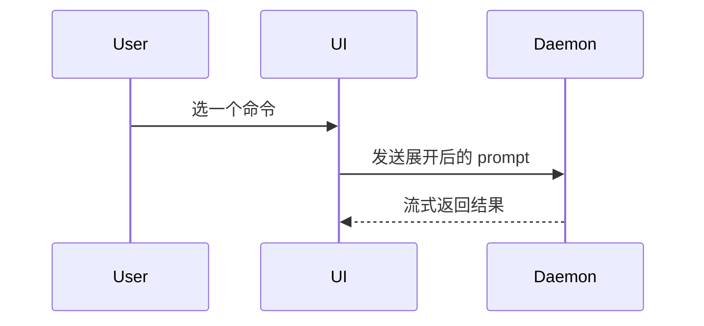

# Show Me（把当前话题画给用户看）

略过铺垫，散文压到最短。挑**最小**那种能把要点讲清楚的视图——多给一种就多一份要读者自己对齐的东西。

三步走：先按「要讲的是什么」选视图，再按视图定载体，最后给图定落点。三步各有一节。

## 一、选哪一种视图

按「要讲的是什么」选，不按「哪种看起来更专业」选。

### 讲逻辑或算法 → 伪代码

```text
on(save)
  若内容未变
    返回缓存结果
  写入新内容
  返回新结果
```

### 讲运行时控制流 → 调用树

```text
submitForm
  createSession
    persistPrompt
    launchAgent
  navigateToSession
```

### 讲某一次具体运行、或 bug 为什么出现 → 带实值的走查

在调用树的每一步旁边写上**这一次**实际流过的值。抽象流程讲的是「可能怎么走」，走查讲的是「这一次怎么走」，读者能直接看到值在哪一步变错。值取自日志、SQL 结果、请求报文，不编造；裸值按会话的「值(含义)」约定带含义。

```text
POST /member/list  orgId=org_8812(某机构)
  resolveScope(orgId)        -> deptIds=[]          ← 这里就空了
  queryMembers(deptIds=[])   -> 0 行
  render                     -> 列表为空
```

### 讲 UI 结构 → 组件树

带上真正相关的 state 与模块边界，其余一律不写。

```tsx
<SessionPage> (apps/example/src/routes/session.tsx)
  useSessionEvents()
  <SessionToolbar>
    <RunSkillButton> (packages/ui)
```

### 讲文件职责或一次大范围重构 → 浅文件树

只铺到能说明职责的那一层。

```text
plugins/devkit-tool/
├── hooks/          # 纯注入，不拦操作
├── skills/         # 一个技能一个目录
└── tests/          # 离线回归用例
```

### 讲组件交互、控制流、状态流转 → Mermaid

按关系选图种：调用与交互用 `sequenceDiagram`，流程与分支用 `flowchart`，状态用 `stateDiagram-v2`。**讲方案时改前、改后各一张**，读者对着两张图找差异，比读一段「原来……现在……」快。



Mermaid 终端不渲染，它的载体与落点见第二、三节。

### 讲几个方案怎么取舍 → 对比表

行是方案，列是读者做决定要比的那几维（代价、影响范围、能否回退、要改几处）。每格写结论，不写「视情况」。

| 方案 | 代价 | 影响范围 | 能否回退 |
|---|---|---|---|
| a. 加缓存 | 多一层失效逻辑 | 仅读路径 | 删配置即回退 |
| b. 改索引 | 一次 DDL 审批 | 全表写入变慢 | 需回滚 DDL |

### 讲事故、或「为什么这次没生效」→ 时间线

按时刻列事件：部署、配置变更、首次报错、恢复。时序类问题的答案往往就是「A 发生在 B 之前」，时间线把这个先后直接摆出来。时刻带时区。

```text
2026-09-30 10:02 +08:00  tf 发布 order-svc（分支 feat-x）
2026-09-30 10:05 +08:00  配置中心改 cache.ttl=0
2026-09-30 10:06 +08:00  首次报 NPE（traceId 3f9a…）
```

### 讲「这个现象确实存在」→ 一条能自己跑的复现命令

给一条只读命令，让用户自己跑一下、亲眼看到现象。结论从「信我」变成「你看」。命令要能原样复制执行，前置条件（要在哪个目录、要什么登录态）写在命令上方一行。

### 讲「变了什么」→ diff

前提是周围那个形状已经存在、读者已经知道。**diff 的形状要跟话题的形状对齐**——讲组件改动就 diff 组件树，讲目录调整就 diff 文件树，讲调用链就 diff 调用树，不要一律 diff 源码。

```diff
 src/
 ├── commands/
+│   └── show-me.ts       # 展开这条 slash command
 ├── sessions/
-└── transport.ts
+└── transport/
+    ├── client.ts
+    └── stream.ts
```

### 讲一段大部分是新写的东西 → 整块贴出来

三种情况值得贴整块：大半是新的；省掉上下文会让归属或先后顺序看不出来；用户需要一份可直接复制的目标形状。

### 讲视觉界面、布局、配色对比，或 Mermaid 装不下的概念 → 一个 HTML 文件

图解、信息图、短幻灯，哪种贴合要点就做哪种。配色、字体、间距、组件向目标产品看齐，用真实标签与真实数据，桌面与移动都能看。

## 二、载体：放正文、写进 md，还是做成 HTML

| 视图 | 载体 | 为什么 |
|---|---|---|
| 伪代码、调用树、走查、组件树、文件树、diff、对比表、时间线、复现命令、整块代码 | 直接放正文的代码块或表格 | 终端原样显示，读者不用离开对话 |
| Mermaid | md 文件里的 ` ```mermaid ` 源码块，正文给链接 | 终端不渲染 mermaid，源码摊在正文里读者看不出形状 |
| 视觉布局、信息图、短幻灯 | HTML 文件 | 只有它能控制版式与配色 |

**要留作资产的图一律用 md，不用 HTML。** md 在 GitLab / GitHub 网页、Typora、Obsidian 里都能直接渲染 mermaid；它是纯文本，能 diff、能在 MR 里审，后来的 agent 也能读能改。HTML 在代码托管网页上只显示源码，一次改动 diff 出几百行样式噪声，改一个节点要重写整段。HTML 美观度更高，所以只用在「一次性给人看、看完即弃」的场合。

## 三、落点：图留在哪

**判图的寿命**：图描述的是**持久事实**——架构、跨服务调用链、状态机、已确认的根因、已拍板的方案——就值得留作过程资产；描述的是一次性解释——回答这一轮的问题、没被采纳的草图、还没证实的排查假设——看完即弃。

按顺序取第一个命中的落点：

1. **本轮本来就要写一份 md 文档**（方案、报告、spec、交接）→ 图直接放进那份文档。
2. **持久事实，且本轮属于某个已有工作项目录** → 写到 `<工作项目录>/diagrams/<主题>.md`。工作项目录指本轮任务已经在用的那个目录：`.scratch/<feature>/`、task-keeper 的条目目录（如 `.keeper/<交付id>/debug/DBG-123/`）、sdlc 交付目录、spec 目录；判据是本轮已经往里面写过文件，或用户点名了它。**不自己 commit**，在回复里说一句「新增了未跟踪文件 `<路径>`」，让它随该工作项的正常提交入库——新建的未跟踪文件不会被 `commit -a` 带走，但会被 `git add -A` 带走，用户得知道它在那。
3. **其余情况** → 写到系统临时目录下的 `claude-diagrams/<主题>.md`（macOS / Linux 取 `$TMPDIR`，未设则 `/tmp`；Windows 取 `%TEMP%`）。其中**图是持久事实、但本轮没有工作项目录**的，在回复末尾加一句「这张图值得留作资产，建议放到 `<路径>`，要我挪过去吗」，用户同意后再挪。建议路径优先选项目里已有的文档目录；项目里没有合适目录时，把「新建哪个目录」一并写进这句建议，由用户定——各项目 `docs/` 的布局各有规矩，自建目录可能与之冲突。

HTML 文件一律落系统临时目录（`show-me-<短描述>.html`），不写进仓库：它不是资产，留在工作区会弄脏 `git status`，还可能被顺手提交进去。打开命令 macOS 用 `open`，Windows 用 `start`。

**正文怎么给**：md 图示文件给一个**不带 `#` 行号**的 `file://` 链接，并用一句话说图里画了什么。不带 `#` 的原因：带了 iTerm2 会按 Semantic History 交给编辑器跳到某行，看到的是源码；不带才交给系统默认 md 应用（如 Typora）渲染打开。VS Code 内置 md 预览不渲染 mermaid，所以不要把它当作默认查看器来写说明。

**子代理**：能写文件的子代理照第三节落盘，把绝对路径写进回执；不能写文件的（`Explore`、`Plan`）把 mermaid 源码原样附在回执里，由主会话落盘。子代理不执行 `open` / `start`——它会抢走屏幕焦点，而子代理不知道 Human 此刻在不在看；由主会话决定什么时候打开。

## 排版约定

- **视图紧挨着它支撑的那一两句话**，不要把图攒到回答末尾。读者是在读到那句话时需要那张图的；落进文件的图，链接放在那句话旁边。
- **代码块内部的路径原样写裸路径**（`plugins/devkit-tool/skills/show-me/SKILL.md`），不套 markdown 链接——终端不会把块里的链接渲染成可点击，反而把树形结构撑乱。正文里提到某个文件时才按会话的 clickable-paths 约定给链接。
- **只保留回答当前问题所需的那些调用、文件、props、状态与边界。** 判据是：删掉这一行，用户还能不能答出他正在纠结的那个问题；能，就删掉。

## 什么时候不触发

- **用户问的是一个事实**（某个值是多少、某条命令怎么写、某个报错什么意思）——直接答，画图是绕路。
- **要讲的东西没有形状**（一句话的取舍、一个是非判断、一段状态汇报）——散文更短。
- **单函数小改动**——改动范围一眼看得完，diff 本身就够。
- **形状已经在用户眼前**——他刚贴出那段代码、刚看过那个目录树，再画一遍是复述。
- **用户当轮明确说了不要图**——以他的话为准。

## 收尾

上面这些形态，一次通常用一种，偶尔两种，几乎不会全用上。自己判断，别把用户淹了。
